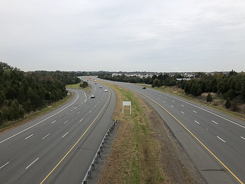

In 1990 the census counted 86,129 people in **[Loudoun County](kloom:e/loudoun-county-virginia)**, [Virginia](kloom:e/virginia), a county of farms, horse country and new subdivisions west of Washington, D.C. **[Ashburn](kloom:e/ashburn-virginia)**, near its eastern edge, held 3,393 of them. In the middle of 1996 **[AOL](kloom:e/aol)**, then the largest online service in the United States, moved its headquarters out of Fairfax County to a campus at 22000 AOL Way, in the part of Loudoun the post office calls Dulles. Within a few years the networks that carried much of the country's internet traffic were meeting a few miles away, in Ashburn, and the county that had been farmland became the place this trail follows. How that began is told mostly by people with a stake in the telling, the county's economic development office first among them, so this frame sets their account beside the records.

## Why here

The reasons the county gives are proximity and infrastructure. Its own history says that a nearby exchange point, "available land, a reliable power grid, proximity to major customers such as federal agencies, and the availability of an established workforce" made Loudoun an optimal location. Virginia's legislative audit commission, JLARC, reached much the same list in its 2024 study of the industry: data processing contractors had clustered near their federal customers since the mid-twentieth century, an internet exchange arrived in the 1990s, and fiber, "reliable cheap energy" and land followed.

The exchange was **[MAE-East](kloom:e/mae-east)**, begun in 1992 by Metropolitan Fiber Systems and **[UUNET](kloom:e/uunet)**, whose central room was in a parking garage in Vienna, in neighboring Fairfax County; _Carrier hotels and colocation_ tells its story. The roads and the airport were already there.

| Year | What changed in eastern Loudoun                                |
| ---- | -------------------------------------------------------------- |
| 1962 | Dulles International Airport opens                             |
| 1984 | The Dulles Toll Road opens beside the airport road             |
| 1995 | The Dulles Greenway, a privately financed toll road, opens     |
| 1996 | AOL moves its headquarters to Dulles                           |
| 1998 | UUNET opens its headquarters in Ashburn                        |
| 2000 | The zoning administrator rules data centers are like offices   |
| 2009 | MAE-East closes; its networks have moved to Equinix in Ashburn |

The airport, **[Dulles International Airport](kloom:e/dulles-international-airport)**, opened in 1962. The Dulles Greenway, which the drawing follows from Leesburg to the airport, opened in 1995 and the photograph shows it near Ashburn. Electricity came from **[Dominion Energy](kloom:e/dominion-energy)**, the utility that serves the area; in 2020 the county's economic development pages said the typical power rate its data centers paid was "28 percent below the U.S. average," a figure they gave without a method, so it is the county's claim. What the lines from Dominion could carry became the question of _Ashburn's power lines_.

## AOL's network

AOL grew too fast for its Fairfax buildings. By 1997 about half of American homes online reached the internet through it, and in August 1996 a failure took the service down for 19 hours. Its new campus gave it room for the machines and the network behind them. The fiber AOL laid around that campus is remembered as the start of what followed: Ali Fard, an architecture professor at the University of Virginia, told the news site NOTUS in 2026 that AOL built "an 'information superhighway'" around its campus, and Buddy Rizer, the county's economic development director since 2007, wrote that the county later had "tons of unused fiber in the ground thanks to AOL." We found no map or filing of that fiber, so its extent is their account. AOL moved its headquarters to New York in 2007, and early in 2008 closed and sold its data center in Reston, across the county line.

## Where the networks met

Networks meet where other networks already are, and the meeting place moved west. The county's timeline says MAE-East "was relocated to Loudoun in 1998," and that half the world's traffic passed through it by 1997, a figure it gives without a source. The exchange's own histories tell it differently: its main switching room stayed in Vienna until that part closed in 2001, and Ashburn was one of four sites of its later service in 2003. Both agree on the end. When MAE-East shut down in 2009, most of its networks had moved to the exchange run by **[Equinix](kloom:e/equinix)**, a company founded in 1998 to build "neutral" meeting places, whose first Ashburn building, DC1, was followed by a larger one on Filigree Court. Each network that joined made the building worth more to the next.

In 2000 Loudoun's zoning administrator decided that, with no category of its own in the ordinance, a data center would be treated as an office building, allowed by right wherever offices were. Office parks in eastern Loudoun sat beside new subdivisions, and so, later, did data centers. The drawing marks, as small squares, the 20 data center buildings still standing in 2026 that the county dates to 2001 or earlier, about 2.0 million square feet by our sum of its figures.

| Census | Loudoun County | Ashburn (CDP) |
| ------ | -------------: | ------------: |
| 1980   |         57,427 |             — |
| 1990   |         86,129 |         3,393 |
| 2000   |        169,599 |             — |
| 2010   |        312,311 |        43,511 |
| 2020   |        420,959 |        46,349 |

Ashburn is a census-designated place, and neighborhoods many people call Ashburn, such as Brambleton and Broadlands, are counted as places of their own, so its column is a rough guide.

Which of these reasons mattered most is not settled. The county stresses its welcome to the industry, the people quoted here stress AOL's fiber, and the state's auditors list several at once. No one measured the traffic that crossed Loudoun in 1997. What happened next, as the buildings filled the office parks along Route 7, is _Data Center Alley_.
