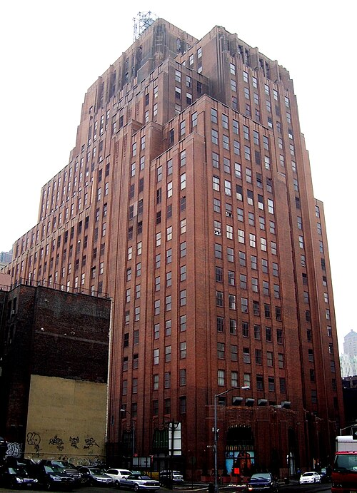

Until the early 1990s most of the American internet rode on one government network, the National Science Foundation's **[NSFNET](kloom:e/national-science-foundation-network)**, whose rules allowed only research and education. Once commercial networks were allowed to carry traffic, they had to hand it to each other somewhere, and that somewhere was a room. In 1992 Metropolitan Fiber Systems (MFS) and UUNET joined a handful of providers' networks over shared Ethernet around Washington, D.C. "A group of network providers in the Virginia area got together over beer one night and decided to connect their networks," as the exchange's architect, Steven Feldman, put it. It was called the MAE, later **[MAE-East](kloom:e/mae-east)**, and it was the first **[internet exchange point](kloom:e/internet-exchange-point)** run by a company rather than a government.

## Where networks meet

Early in 1994, as Merit's history of the transition records, the Foundation awarded contracts for four Network Access Points, places where the commercial networks would meet once its backbone was gone. MAE-East was taken as their model.

| Network Access Point | Run by       | Where                                  | In service                    |
| -------------------- | ------------ | -------------------------------------- | ----------------------------- |
| MAE-East             | MFS Datanet  | Washington, D.C., and Vienna, Virginia | since 1992; FDDI in fall 1994 |
| Sprint NAP           | Sprint       | Pennsauken, New Jersey                 | late summer 1994              |
| Chicago NAP          | Ameritech    | Chicago                                | March 1995                    |
| California NAP       | Pacific Bell | California                             | March 1995                    |

MFS opened a second exchange, **MAE-West**, in San Jose in November 1994. On April 30, 1995 the NSFNET backbone was switched off, and the internet's long-distance traffic passed to companies that met at these points. MAE-East's central room was a cinder-block space in the underground parking garage of an office building at 1919 Gallows Road in Vienna. It later spread to Ashburn, and how Ashburn's county came to hold so many data centers is the story of _One county_.

## Carrier hotels

A carrier that wants to connect to another needs only a fiber cable across a room, if both are in the same building. So networks gathered in buildings that already held the most cables, and those buildings came to be called **[carrier hotels](kloom:e/colocation-centre)**. **[60 Hudson Street](kloom:e/60-hudson-street)** in New York was built in 1928–30 as Western Union's headquarters, then the world's largest telegraph building; the wires of six long-distance carriers converged beneath it, and after Western Union left it was turned over to colocation and was nearly full by the late 1990s. **[One Wilshire](kloom:e/one-wilshire)** in Los Angeles was a law firms' office tower of 1966. When Pacific Bell barred competitors from its switching center two blocks away in the 1980s, MCI put a microwave station on One Wilshire's roof, and carriers followed. Its fourth-floor _meet-me room_, where tenants' cables are joined, held about 260 internet providers in 2008, by _Wired_'s count.

What such a building sold was its position, not its floor space: the more networks already inside, the more each new tenant could reach by a short cable. The neighbors noticed the machinery. In 1999 residents near 60 Hudson Street complained that its cooling equipment was too loud, and in 2006 a city panel's approval of diesel fuel stored on six of its floors drew objections that it was a fire hazard. _Data center noise_ and _Backup diesel generators_ take up both questions.

## Colocation, and the bust

**Colocation** turned the carrier hotel into a product: the customer owns its servers, and the operator rents it space, power, cooling, security and connections. **[Exodus Communications](kloom:e/exodus-communications)**, founded in 1994, became the largest web host of the late 1990s, went public in 1998 and was valued at about $32 billion at its peak in 2000. **[Equinix](kloom:e/equinix)** was founded in 1998 by Al Avery and Jay Adelson, two facilities managers at [Digital Equipment Corporation](kloom:e/digital-equipment-corporation), to build "neutral" exchanges where competing networks could meet.

The money came on a forecast. Through the late 1990s, executives at **[WorldCom](kloom:e/worldcom)**, then the largest internet carrier, said internet traffic was doubling every three or four months, a claim repeated by a former chairman of the Federal Communications Commission, by a Commerce Department report of 1998 and in the press. The mathematician **[Andrew Odlyzko](kloom:e/andrew-odlyzko)**, who estimated traffic from what carriers disclosed, found it had been about doubling each year since 1997, and that backbone links ran at about 10 to 15% of their capacity over a week. By his estimate the faster figure had been true briefly, in 1995 and 1996. Carriers had built far more fiber than traffic could fill, and when the **[dot-com bubble](kloom:e/dot-com-bubble)** burst in 2000, the borrowing that had paid for it became hard to repay. Exodus filed for bankruptcy on September 26, 2001; its new chief executive said its data centers had gone from waiting lists to half empty. WorldCom followed in 2002, after an accounting fraud. Much of the unlit, **[dark fiber](kloom:e/dark-fibre)** was later leased to others, and a business grew from it.

These years are cited on both sides of today's argument: as a warning that a forecast made by those who profit from it can outrun demand, and as evidence that what was overbuilt was used in the end. Whether either lesson fits the present is not settled, and _Is it a bubble?_ sets out each side's case. What was new in the 1990s was that the building itself had become the business. Next, a company built one for itself, at The Dalles.
