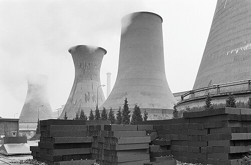

A **[cooling tower](kloom:e/cooling-tower)** gets rid of heat by evaporating water. Warm water from a building's chillers is sprayed over _fill_, stacked sheets that spread it thin, while a fan draws air up through it. A small part of the water evaporates, the evaporating takes its heat from the rest, and the cooled water falls to a basin and is pumped back to collect more heat. The same machine, a box on a roof or a concrete shell a hundred meters tall, cools office buildings, hospitals, refineries, power stations and data centers.

## Why evaporation takes so much water

Turning water into vapor takes far more energy than warming it. Water's **[latent heat](kloom:e/latent-heat)** of vaporization, a term [Joseph Black](kloom:e/joseph-black) introduced in Glasgow in the 1760s, is about 2,257 kilojoules a kilogram at its boiling point, and about 2,430 at 30 °C, by a standard fit to the measurements in cloud physics. Rejecting one kilowatt-hour of heat, 3,600 kilojoules, by evaporation alone therefore takes 3,600 ÷ 2,430, or about 1.5 kilograms of water: about one and a half liters, by our arithmetic. The [Environmental Protection Agency](kloom:e/united-states-environmental-protection-agency)'s rule of thumb agrees: a tower evaporates about 1% of the water circulating through it for every 10 °F it cools it.

There is a floor to how cold the water can get. The **[wet-bulb temperature](kloom:e/wet-bulb-temperature)** is the lowest temperature that evaporating water can reach in the air around it: on a dry day it lies well below the thermometer's reading, and in saturated air it equals it. A tower can only bring its water close to the wet bulb. That is its advantage over an air-cooled machine, which can only approach the higher dry-bulb temperature, and the advantage shrinks as the air nears saturation, when the two temperatures meet.

## The water budget

What goes in as _make-up_ water leaves in four ways: evaporation, which does the cooling; _drift_, droplets carried off in the air, 0.05% to 0.2% of the circulating flow in older towers and under 0.005% with modern eliminators; leaks; and _blowdown_. Evaporating water leaves its dissolved minerals behind, so part of the water is drained off and replaced before scale forms. The ratio of the minerals in the blowdown to those in the make-up is the tower's _cycles of concentration_, roughly the make-up divided by the blowdown, and treatment chemicals let an operator run more of them. The table is a worked example with invented round numbers: a tower rejecting one megawatt-hour of heat, its water cooled by 10 °F.

| Cycles of concentration | Evaporated (L) | Blowdown (L) | Drift, modern (L) | Make-up (L) |
| ----------------------: | -------------: | -----------: | ----------------: | ----------: |
|                       3 |          1,480 |          740 |                 8 |       2,228 |
|                       5 |          1,480 |          370 |                 8 |       1,858 |
|                      10 |          1,480 |          164 |                 8 |       1,652 |

Evaporation is fixed by the heat; blowdown is the operator's choice, limited by the chemistry of the local water. A data center's chillers also add the heat of their own compressors to the load, which is one reason the models of **[Lawrence Berkeley National Laboratory](kloom:e/lawrence-berkeley-national-laboratory)** put a tower-cooled site well above 1.5 liters per kilowatt-hour of computing.

## A steam-age machine

Cooling towers came from the [steam engine](kloom:e/steam-engine). Its condenser needs a steady supply of cool water, and by 1900, where rivers or city mains could not supply enough, engineers were recycling the water through ponds and evaporative towers. In 1916 the Dutch engineers **[Frederik van Iterson](kloom:e/frederik-van-iterson)** and Gerard Kuypers patented a tower whose thin shell of reinforced concrete was a hyperboloid, a curved surface made of straight lines, strong for its weight and drawing air up by its own chimney effect. The first was built at the Dutch State Mines' Emma colliery in Heerlen; Wikipedia's articles date it 1917, "between 1917 and 1918" and "from 1918." The photograph shows the mine's towers in 1977. For most of a century the hyperboloid has stood for power stations, coal and nuclear alike.

## Why data centers use them

Operators choose towers to save electricity: water, as **[Google](kloom:e/google)** puts it, is "a highly efficient means of cooling that requires less energy than air-cooling technologies." In the Berkeley laboratory's 2024 simulations, a midsize data center with water-cooled chillers and towers had a median power usage effectiveness of about 1.5, against about 1.8 for one with air-cooled chillers, by our reading of its figure; the towers spent about 2.9 liters of water per kilowatt-hour of computing to save that electricity. The report calls water-cooled chillers highly efficient, and adds that the towers' evaporation "has raised concerns regarding data center water consumption and availability at the local level."

The white plume above a tower is water: vapor condensing into droplets as the warm, saturated exhaust meets cooler air. It is not smoke, though, as Wikipedia notes, it is often taken for it, and by that article's account it shows most when the outside air is cool and near saturation. Google's caption to a photograph of its towers at The Dalles, Oregon, says a plume means "humidity and temperatures are low," indicating the towers "are at their most efficient"; the two accounts differ on the humidity.

How many towers cool American data centers, and at what cycles, is not published; Berkeley's figures are modeled. _Water usage effectiveness_ turns a tower's water into the industry's ratio.
