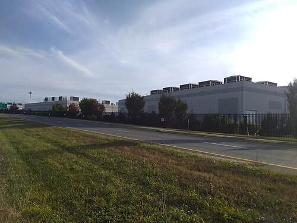

"Data Center Alley" is the name for the strip of eastern **[Loudoun County](kloom:e/loudoun-county-virginia)** around **[Ashburn](kloom:e/ashburn-virginia)**, between Route 7 and the Dulles Greenway, which holds, as the county and Virginia's auditors both describe it, the highest concentration of data centers in the world. It is part of the wider **[Dulles Technology Corridor](kloom:e/dulles-technology-corridor)**, and the name was in print by 2011. The county's own history dates the largest surge to 2007–2016, and gives a reason that had little to do with computers. Before the housing crash of the **[Great Recession](kloom:e/great-recession)**, Loudoun "relied heavily on residential taxes," and when home values fell, it "suddenly lost a significant portion of its tax base." Buddy Rizer, its economic development director, put it in a statement to NOTUS in 2026: "We lost a third of our tax base almost overnight." He went looking for commercial taxpayers, and found data centers.

## How big it grew

The county keeps a record of every data center building, with the year each was finished. Counting only buildings that stood on September 1, 2026, the floor area finished by the end of each year grew like this, by our arithmetic from that record:

| Finished by the end of | Million square feet | Finished by the end of | Million square feet |
| ---------------------- | ------------------: | ---------------------- | ------------------: |
| 2001                   |                 2.0 | 2016                   |                 8.5 |
| 2004                   |                 2.0 | 2019                   |                16.9 |
| 2007                   |                 2.7 | 2022                   |                26.6 |
| 2010                   |                 4.1 | 2025                   |                36.1 |
| 2013                   |                 5.1 |                        |                     |

These are measured, from building permits and assessments, but they leave out anything torn down or converted before 2026. The county's own summary that September counted 58.3 million square feet in 245 buildings built or under construction, another 33.8 million approved, and 21 million more seeking approval. Its marketing pages gave rounder figures as they went: "nearly six million square feet" in operation in 2016, 13.5 million in 2019, "more than 25 million" from 2022.

Against the world, the usual measure is not floor space but megawatts of operating capacity, estimated by commercial real estate firms such as **[Cushman & Wakefield](kloom:e/cushman-and-wakefield)**, which also broker the space. JLARC, Virginia's legislative audit commission, used that firm's 2024 comparison: the northern Virginia market, which takes in Fairfax and Prince William counties as well, was more than twice the size of the next, Beijing, and held 13% of the world's operating capacity. Loudoun holds about half of Virginia's industry, by JLARC's count of sites, floor space and energy.

## "Seventy percent of the world's internet traffic"

From at least 2016 to early 2020, the county's economic development pages said that "more than 70 percent of the world's internet traffic passes through Loudoun's digital infrastructure." The state's economic development agency, _The Washington Post_ and a regional chamber of commerce repeated it. No one has found where it came from: in 2025 the columnist Dwayne Yancey of _Cardinal News_ asked, and the state agency did not know either. It is a claimed number, and one that would need a count of all the world's traffic, which no one publishes.

What has been measured points much lower. In 2019 Tim Stronge of TeleGeography, a firm that maps the internet's long-distance capacity, set out the figures:

| What TeleGeography measured, 2019                       | Share    |
| ------------------------------------------------------- | -------- |
| World's international internet capacity connected to US | 23%      |
| US international capacity in the Washington area        | about 9% |
| US data centers in northern Virginia                    | 9%       |
| Cloud availability zones in northern Virginia           | 30–40%   |

"There's just no way that 70% of the world's internet traffic flows through the region," he wrote, while adding that the county's importance to the internet was "under-appreciated." JLARC's analyst Mark Gribben told _Cardinal News_ that "we didn't put any credence in it." By January 2021 the county's page said "much of the world's internet traffic" instead.

## Gray boxes beside the houses

The buildings look alike: long and windowless, many with cooling units on the roof, and, in the county's description, campuses that "could potentially house dozens of generators, each the size of a tractor trailer." The drawing shows every building the county counted in 2026, each circle's area in proportion to its floor space. Because the early rule allowed data centers wherever offices could go, many went up beside homes: JLARC found that 24% of Loudoun's data center sites were within 200 feet of land zoned residential. Residents of Brook Haven complained of noise in 2021, and a fix was finished in November 2023, the auditors recorded, after "repeated communications from residents." Opposition, which the auditors found had rarely met data center proposals in the past, had by 2024 grown "especially in Loudoun and Prince William." The county's 2023 zoning rewrite added façade standards, a 200-foot setback beside homes, acoustic barriers and limits on generator tests, and in 2025 it ended building them by right, the story of _Loudoun ends by-right data centers_.

The county's land figures cut both ways. On the county's figures, a parcel where data centers may be built sells for $2 million to $6 million an acre, against $300,000 to $500,000 for similar land without that right. On houses, the county's assessors see "no impacts to housing prices due to proximity to a data center" in a tight market, and add that a looser one might show some.

How much traffic really passes through the alley is still unmeasured, and how many of the approved buildings will be built depends on power no one has yet promised. What the alley pays the county is _What data centers pay Loudoun_; what it asks of the grid is _Ashburn's power lines_.
