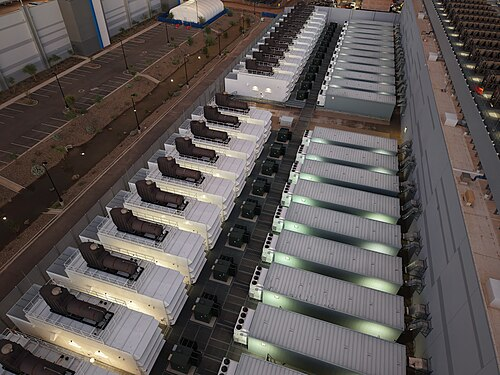

When the grid fails, the batteries of a data center's **[uninterruptible power supply](kloom:e/uninterruptible-power-supply)** carry its load for seconds, and **[diesel generators](kloom:e/diesel-generator)** carry it for hours or days. _Inside a data center_ lays out the chain. A diesel engine, as one operator describes it, is quick to start and can follow a load up and down, and a set of 2,000 kilowatts fits in a 40-foot container with its own fuel tank. Operators say their customers, banks and hospitals among them, expect no downtime at all. In **[Virginia](kloom:e/virginia)** the state's legislative auditors, the Joint Legislative Audit and Review Commission (JLARC), found in 2024 that nearly every data center relies on diesel: an average of 54 permitted generators a site, typically one to three megawatts each, about 8,000 in the state. Since then the **[Piedmont Environmental Council](kloom:e/piedmont-environmental-council)**, a conservation group critical of the industry, has put the count, by its own tally, at about 9,000, some 4,700 of them in **[Loudoun County](kloom:e/loudoun-county-virginia)**.

## How often they run

Operators told JLARC that each generator gets a 10- to 30-minute test a month and one of one to four hours a year, staggered across a site, and that most sites had seen zero to two outages in two years, nearly all of one to five hours. In 2023 the industry's emissions, as reported to regulators, were 7% of what its permits allowed. Northern Virginia's data center generators were under 4% of the region's **[NOx](kloom:e/nox)** (nitrogen oxides, which form ozone) and 0.1% or less of its carbon monoxide and fine **[particulate matter](kloom:e/particulate-matter)**. In the worst case, if every generator in the region ran to its permit limit in a long outage, JLARC estimated, they would emit over 9,000 tons of NOx, about half what all sources there usually emit in a year. A substation fire in Loudoun in 2025 had generators running for four or five days; a county supervisor said complaints flooded his inbox.

Most Virginia data center generators are certified to the **[United States Environmental Protection Agency](kloom:e/united-states-environmental-protection-agency)**'s Tier 2 standard. Tier 4 engines, or Tier 2 engines fitted with **[selective catalytic reduction](kloom:e/selective-catalytic-reduction)**, a catalyst that turns NOx into nitrogen and water, emit far less:

| Engine over 900 kW, per kilowatt-hour | Tier 2 (2006–10) | Tier 4, generator set (2015 on) |
| ------------------------------------- | ---------------: | ------------------------------: |
| NOx and hydrocarbons                  |            6.4 g |                          0.86 g |
| Particulate matter                    |           0.20 g |                          0.03 g |
| One hour at 2,500 kW: NOx and HC      |            16 kg |                          2.2 kg |

The hourly row is our arithmetic from EPA's limits, at full load.

## The rules, 2023 to 2026

In January 2023 Virginia's **[Department of Environmental Quality](kloom:e/virginia-department-of-environmental-quality)** (DEQ) proposed letting data centers run generators to relieve a strained grid in northern Virginia; it pared the plan to eastern Loudoun, then withdrew it in April after public comment. The Data Center Coalition, the industry's trade group, had itself written of "important and unresolved technical, federal regulatory, and operational challenges." In May 2025 the EPA said certain emergency engines may run up to 50 hours a year outside emergencies to support the grid, under a contract. A DEQ memo of September 2025, in force by January 2026 by _E&E News_'s account, treats a utility's planned outage, notified 14 days or less ahead, as an emergency in which Tier 2 engines may run. The coalition supported it; the Southern Environmental Law Center said such a change needs a full rulemaking. In 2026 the General Assembly passed House Bill 507: from July 1, 2026, a new data center permit must hold each generator to Tier 4-equivalent emissions, with NOx, carbon monoxide and particulate controls. How it will apply to the thousands of generators already permitted is not yet settled.

## Two cases

**The critics' case**: **[diesel exhaust](kloom:e/diesel-exhaust)** is a known human carcinogen, as the **[International Agency for Research on Cancer](kloom:e/international-agency-for-research-on-cancer)** classed it in 2012, mostly on evidence from workers such as miners. NOx feeds ozone in a region that has struggled to meet the ozone standard, and nothing else puts as many generators on one site, so local effects are hard to model. A study by researchers at Caltech and the University of California, Riverside, whose paper names no funder, modeled Virginia's generators at 10% of their permitted emissions and estimated about 14,000 asthma symptom cases and 13 to 19 deaths a year across the country. That is a model of an assumed level, above the 7% reported for 2023, and its figures changed between versions of the paper.

**The operators' case**: the generators run for maintenance and rare outages, their share of regional pollution is small, and reliability is what customers buy. Companies told JLARC that Tier 4 engines cost more, add complexity and are hard to get in the numbers a campus needs; a law firm advising developers notes that catalysts work only when hot, which short tests at low load may not achieve.

## What might replace them

Batteries already bridge the first seconds, but lithium-ion banks typically last four to eight hours and take land. Renewable diesel, made from vegetable oils, runs in existing engines, but JLARC found no East Coast supply. In June 2022 **[Microsoft](kloom:e/microsoft)** ran a 3-megawatt hydrogen **[fuel cell](kloom:e/fuel-cell)** with Plug Power in Latham, New York, "the size of the diesel generators that we use right now," in Microsoft's words, and said its use would wait on green hydrogen becoming available and affordable. Gas engines and turbines are another answer, and in Memphis they ran for months, the subject of _xAI's gas turbines in Memphis_.

What is not known is how the air near the densest clusters actually reads. DEQ put sensors in Loudoun's data center corridor in March 2026 and moved some to Prince William that September; its analysis is still being updated week by week.
