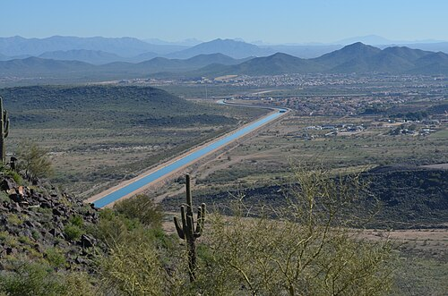

On August 21, 2026, the federal government issued a two-year plan that cuts **[Arizona](kloom:e/arizona)**'s take from the **[Colorado River](kloom:e/colorado-river)** by 760,000 acre-feet, roughly 27% to 30%. Opponents ask why a desert should cool computers with water; supporters answer that they use a small share of it. Both claims are hard to check, because the Arizona Department of Water Resources (ADWR) does not track the water most data centers use, and the companies are not required to report it.

## Arizona

Most of the state's campuses are around **[Phoenix](kloom:e/phoenix-arizona)**. In May 2021 the **[Mesa](kloom:e/mesa-arizona)** city council approved an $800 million data center, reported to be Facebook's, that could need up to 1.25 million gallons of water a day. Vice Mayor Jenn Duff voted against it: "We are on red alert, and I think data centers are an irresponsible use of our water." A **[Google](kloom:e/google)** campus approved earlier could use up to 4 million gallons a day, NBC News reported, citing _Bloomberg_. Those are allowances. Google's own report for 2025 says its Mesa site withdrew 19.4 million gallons, about 53,000 a day by our arithmetic, and that its Phoenix site, cooled by air, withdrew 0.5 million.

Chandler passed an ordinance in 2015 that keeps out new water-intensive businesses that do not fit its plans, after learning in 2013 how much one data center used. Since 2024 Phoenix has required anyone using 250,000 gallons a day or more to apply with a water-efficiency plan, and Mesa and Avondale cap industrial use and make large users bring extra water to exceed it. **[Microsoft](kloom:e/microsoft)** says its water-cooled sites in Arizona consume water, on net, only when it is hotter than 85°F, up to 40% of the year in Phoenix, and that it will build only zero-water sites in the state from now on. **[Tucson](kloom:e/tucson-arizona)**'s council turned down the "Project Blue" data center after residents protested (_NDAs and code names_).

| Figure                                                 | Kind                                  | Source                                   |
| ------------------------------------------------------ | ------------------------------------- | ---------------------------------------- |
| Phoenix-area data centers' cooling water, 385 M gal/yr | modeled estimate, 2025                | Ceres, a sustainability nonprofit        |
| The same, if planned campuses are built: ~3.8 B gal/yr | projected                             | Ceres                                    |
| Power plants' water for Arizona's data centers: 14.5 B | projected (a 400% rise)               | Ceres                                    |
| Direct use implied by a proposed fee: ~600 M gal/yr    | derived from a budget's revenue guess | Governor Hobbs's January budget proposal |
| Agriculture's share of Arizona's water use: 72%        | the state's accounting                | ADWR                                     |
| Mesa's industrial share of its drinking water: ~6%     | measured, 2024                        | City of Mesa, as reported by _Grist_     |

## Texas

In January 2026 the Houston Advanced Research Center (HARC), an independent nonprofit, estimated that **[Texas](kloom:e/texas)** data centers would consume about 25 billion gallons in 2025, counting the water at their power plants, 0.4% of the state's use; by 2030, 29 to 161 billion gallons, 0.5% to 2.7%. Both are modeled. Its concern is planning: the state water plan of the **[Texas Water Development Board](kloom:e/texas-water-development-board)** is built from water use already reported, so a campus that opened in 2025 enters the plan only in 2032. The board projects 25% less groundwater by 2070. One data center is unlikely to drain a neighbor's well, the hydrologist Robert Mace said of West Texas, where landowners may pump under the rule of capture, but each is "another straw in the aquifer pulling water out."

## Chile, Uruguay and Spain

In February 2024 an environmental court in **[Chile](kloom:e/chile)** partly reversed the permit for Google's $200 million data center at Cerrillos, in Santiago, after a long drought, telling Google to weigh climate change's effect on the city's aquifer, "taking into account a possible modification of the cooling system." Google said it had already changed the design to air cooling. In **[Uruguay](kloom:e/uruguay)**, during the 2023 drought, a court case showed that Google's planned site in Canelones would need 7.6 million liters of drinking water a day for its cooling towers; Google made the project smaller and switched to air cooling, and the environment ministry approved it in July 2024. In **[Talavera de la Reina](kloom:e/talavera-de-la-reina)**, Spain, **[Meta](kloom:e/meta-platforms)**'s plans projected 665.4 million liters of drinking water a year, the Tagus basin authority warned that it would leave little for other uses, and the activist Aurora Gómez founded the campaign _Tu Nube Seca Mi Río_, "your cloud dries up my river" in our translation. Meta moved to dry air coolers, and the favorable environmental declaration puts the data center's own net consumption near 40,600 cubic meters (40.6 million liters) a year, by the water journal _iAgua_'s reading of it in August 2026.

## Small, or too much?

**The case that it is small**, as water experts at Arizona State University's Kyl Center make it: cooling uses a relatively modest amount of water, said its director, Sarah Porter, and its research director, Kathryn Sorensen, said data centers use about as much as bottlers and golf courses. The center found no evidence that power plants in central Arizona were using more water. Farms use 72% of the state's. Supporters add that cities' ordinances already act as what Sorensen called a "guardrail."

**The case that it matters anyway**, as environmental groups make it, with some help from the same experts: Sorensen herself calls groundwater depletion "an existential threat for the Phoenix area," which is why she wants data centers on city supplies rather than wells, and "there's no extra Colorado River water," said Sandy Bahr of the Sierra Club. Water promised to a campus is not there for the next use: "What if, down the road, we decide that that shouldn't be a data center," Porter asked. And use peaks on the hottest days, in drought, when towns need water too.

Each side has a reply. Companies point to air cooling and reclaimed water; critics answer that air cooling takes more electricity, whose power plants use water too (_The water behind the electricity_). What no one has yet is a measured, site-by-site account of any dry state's data centers. The designs meant to stop evaporating water at all are the subject of _Zero-water cooling_.
