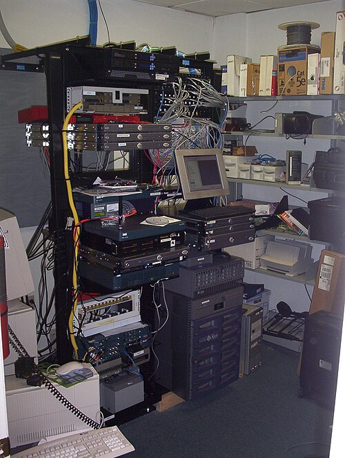

The strongest energy argument made for data centers is that they get more work from each kilowatt-hour every year. **[Google](kloom:e/google)** puts it in its 2025 environmental report: its data centers "deliver over six times more computing power per unit of electricity than they did just five years ago," much of it from its own AI chips, **[tensor processing units](kloom:e/tensor-processing-unit)**. That is the company's claim about its own buildings, and its website in 2026 gives a smaller one, over three times in the five years to 2025. The argument's best independent evidence is one decade.

## More work for nearly the same energy

In February 2020 Eric Masanet, Arman Shehabi, Nuoa Lei, Sarah Smith and **[Jonathan Koomey](kloom:e/jonathan-koomey)**, from Northwestern University, **[Lawrence Berkeley National Laboratory](kloom:e/lawrence-berkeley-national-laboratory)** and Koomey Analytics, published a recalibrated estimate in _Science_. The Department of Energy and two private donors, Leslie and Mac McQuown, supported the work. By their model, the world's data centers used about 194 terawatt-hours in 2010 and 205 in 2018, a rise of 6%, while the number of _compute instances_ (units of computing work, each often a virtual server) rose 550%. Energy per instance fell by about 20% a year. These are estimates from a bottom-up model, not meter readings, and several of its inputs came from Cisco, which sells data center equipment, through its Global Cloud Index. The plate draws the paper's ratios of 2018 to 2010.

The authors gave four reasons. A typical server's electricity per computation fell fourfold. **[Virtual machines](kloom:e/virtual-machine)** let one server host about five times as many workloads. Storage drives came to use a ninth of the energy per terabyte. And the overhead measured by **[power usage effectiveness](kloom:e/power-usage-effectiveness)** fell by a quarter, as work moved out of small rooms: traditional data centers held 79% of compute instances in 2010, and cloud and hyperscale buildings 89% by 2018.

## The closet and the campus

That move is the consolidation argument, and in 2014 an environmental group made it as forcefully as any company. The **[Natural Resources Defense Council](kloom:e/natural-resources-defense-council)**, with the consultancy Anthesis, reported that the largest cloud companies had "largely solved the technical efficiency problems" of their buildings, while server rooms and closets used about half of American server electricity. Average server utilization had stayed between 12% and 18% from 2006 to 2012, and a server doing almost nothing still drew 30% to 60% of its maximum power.

The same report projected that American data centers would use about 140 billion kilowatt-hours by 2020. The Berkeley laboratory's 2024 estimate for 2020, read from its chart, is a little over 100. A projection can miss in either direction, as the last section shows.

## Koomey's law, and its slowing

In 2011 Koomey and three colleagues showed that the computations a computer performs per kilowatt-hour had doubled about every year and a half since the 1940s, a trend called **[Koomey's law](kloom:e/koomeys-law)**. Around 2000 it slowed, with the end of **[Dennard scaling](kloom:e/dennard-scaling)**, under which smaller transistors had used proportionally less power. In 2015 Koomey and Sam Naffziger, a corporate fellow at the chipmaker AMD, wrote that peak-output efficiency now doubled about every 2.7 years: a hundredfold gain a decade had become one in eighteen years. Efficiency in typical use, with chips idle most of the time, kept improving faster, by their calculations from tests of AMD's own chips.

## The reply: per task is not in total

Critics point to the Berkeley laboratory's 2024 report, which says the flat decade ended: the spread of AI hardware "has ended the era of generally flat data center energy use." American data centers held at about 60 terawatt-hours from 2014 to 2016, then rose to 76 in 2018 and 176 in 2023 as GPU servers spread. The laboratory's own 2016 report had projected flat use through 2020; its 2024 estimates for 2018 to 2020 are higher than every scenario it drew then.

Google's figures show the same gap from the inside, by its own reporting:

| Year | Google data centers, TWh (company-reported) |
| ---- | ------------------------------------------: |
| 2020 |                                        14.4 |
| 2021 |                                        17.7 |
| 2022 |                                        20.8 |
| 2023 |                                        24.3 |
| 2024 |                                        30.8 |

Its data centers' electricity rose 2.1 times from 2020 to 2024, by our arithmetic, in the same years it reports computing per unit of electricity rising several times over. Google says the growth came from Cloud, Search and YouTube as well as AI. Both can be true, because an efficiency figure is per task and a bill is a total. The International Energy Agency wrote in April 2026 that energy per AI task was falling by at least a factor of ten a year, and still projects that data centers' use will roughly double by 2030. A compute instance is not a fixed amount of work, either, so a fall in energy per instance is not quite a fall in energy per result. Whether efficiency lowers the total or raises it by making computing cheaper is the question _Efficiency and the rebound effect_ takes up.

No public meter covers the world's data centers; every total here is modeled, and Berkeley's own report says the lack of data "significantly limits" it. How fast AI chips will gain efficiency, and how much more will be asked of them, is the open question. _Data center jobs_ takes up the next argument for building.
