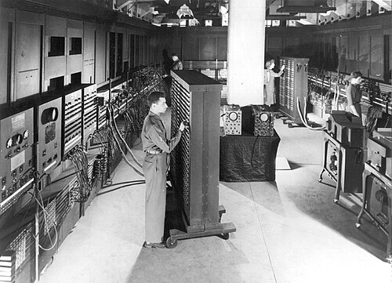

When the Army showed **[ENIAC](kloom:e/eniac)** to the press in February 1946, the computer was a room. It stood at the **[Moore School of Electrical Engineering](kloom:e/moore-school-of-electrical-engineering)** of the **[University of Pennsylvania](kloom:e/university-of-pennsylvania)**: forty panels "arranged in U shape," in the words of the school's own report that June, with three function tables on wheels, a card reader and a card punch, in a room the university now gives as 30 by 50 feet. With it came ventilating equipment, seven panels of power equipment apart from the machine, and three cabinets of capacitors. How ENIAC computed is _ENIAC_'s story, in the computing subject. This frame follows what came in on its wires and how it was got out of the room again.

## Forty panels and a power trough

The report, written by **[Adele Goldstine](kloom:e/adele-goldstine)**, sets out the supply. Regulated three-phase power at 240 volts went to transformers, and 110 volts ran in a power trough along the front and foot of the panels, feeding the heaters of the tubes. Twenty-nine power supplies made the 78 different direct-current voltages the circuits needed. Each panel, the Army's 1961 history adds, was about 9 feet high, 2 feet wide and a foot deep, with "air ducts at the top of all the panels" to draw off the hot air around the **[vacuum tubes](kloom:e/vacuum-tube)**.

How much power that was depends on who is counting, and when. The machine was modified for years, and about 3,000 tubes came out of it; the Army's later accounts count 42 panels where the report counts 40.

| Source                                      | Tubes  | Power         | Floor space |
| ------------------------------------------- | ------ | ------------- | ----------- |
| Moore School, _Report on the ENIAC_, 1946   | 18,000 |               |             |
| Weik, Ballistic Research Laboratories, 1955 | 17,468 | 174 kW        | 1,800 sq ft |
| Weik, "The ENIAC Story," 1961               | 19,000 | almost 200 kW |             |
| Kempf, Ordnance Corps history, 1961         | 19,000 | about 174 kW  | 1,800 sq ft |
| J. Presper Eckert, interviewed 1989         |        | 150 kW        |             |
| Penn Engineering, today                     | 18,000 | 150 kW        | 30 by 50 ft |

The 1955 figures are from the Army's survey of American computers, which gave each machine's power, space and operating record.

## Where the power went

A computer does no mechanical work. Nearly all of the 150 to 174 kilowatts ended as heat in the room. "The ENIAC's 18,000 vacuum tubes generate a considerable amount of heat," the 1946 report says; "an elaborate system of fans and blowers" drove it off, and a thermostat in every panel cut the power to the whole machine if the air inside passed 115 degrees Fahrenheit.

In 1947 ENIAC was taken apart and rebuilt at the **[Ballistic Research Laboratory](kloom:e/ballistic-research-laboratory)** at **[Aberdeen Proving Ground](kloom:e/aberdeen-proving-ground)**, Maryland. There the heat became the worst of its problems. The **[United States Army](kloom:e/united-states-army)**'s historian Karl Kempf wrote in 1961 that it "was never solved for the ENIAC": no special air conditioning had been provided, and the blowers could not push the heat out into "the warm, humid atmosphere." The 1955 survey describes its air conditioning in three words, "forced outside air." Hot tubes failed sooner, and Kempf counted tube failures as ninety percent of the machine's interruptions. Harry Reed, who came to the laboratory in 1950, told an ACM history panel some fifty years later that the only air-conditioned rooms there were those that stored punched cards, which swelled with damp and jammed the readers. By then, he said, some of his computer rooms had "more problems associated with air-conditioning than they do with things associated with electronics."

## Keeping it running

Tubes failed most often as they warmed up and cooled down. In his 1989 interview **[J. Presper Eckert](kloom:e/j-presper-eckert)**, its chief engineer, said the builders ran the tube filaments below their rated voltage to make them last, and that a tube failed "about every two days" and could be found within fifteen minutes. He called the story that ENIAC dimmed the lights of Philadelphia "total fiction." The laboratory ran it in three shifts, seven days a week. In 1955 it tried to run 164 hours a week and got 113 good ones, with 5.6 hours between errors on average. That suits the common account that ENIAC was seldom switched off, though the survey records the schedule, not the reason. Wikipedia gives 116 hours as its longest run without a failure in 1954; the survey's 116 hours that year are good hours in a week.

The six women who first programmed it are named in the computing subject. For the people who worked it, Reed said, it was a machine "you kind of lived inside": "instead of your holding a computer, this computer held you."

By our arithmetic, ENIAC's 150 to 174 kilowatts is 1.1 to 1.3 times the 132 kilowatts that **[Nvidia](kloom:e/nvidia)** and Vertiv designed one rack of 72 AI chips to draw in 2024, a design figure of the companies'. ENIAC spread that load over forty panels and 1,500 to 1,800 square feet; the rack holds it in a single cabinet. A decade later the Air Force gave its computers buildings of their own, with power plants beside them: SAGE's blockhouses.
