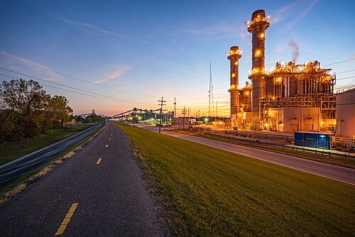

When a data center needs power that new wind and solar farms cannot promise at every hour, much of what is being planned to supply it burns **[natural gas](kloom:e/natural-gas)**. In Texas alone, Global Energy Monitor, a group that tracks fossil fuel projects, counts more than 80 gigawatts of new gas plants in the pipeline, about half of them meant for data centers. At the end of September 2026 **[GE Vernova](kloom:e/ge-vernova)**, the largest of them, had 122 gigawatts of gas turbines under contract, up from 50 gigawatts in March 2025. Its chief executive, Scott Strazik, told investors in July 2026 that it expected to be "mostly sold out through '30." About 20% of those gigawatts were for data centers, by the company's own count; the rest were for utilities and other customers. Siemens Energy said in November 2026 that data center customers made up under 10% of its whole order backlog. These are the companies' own figures, reported to investors, and the gigawatts are orders, not plants yet built.

| Quarter ending | Firm orders, GW | Reservations, GW | Total, GW |
| -------------- | --------------: | ---------------: | --------: |
| March 2025     |              29 |               21 |        50 |
| June 2025      |              29 |               25 |        55 |
| September 2025 |              33 |               29 |        62 |
| December 2025  |              40 |               43 |        83 |
| March 2026     |              44 |               56 |       100 |
| June 2026      |              53 |               63 |       116 |
| September 2026 |              64 |               58 |       122 |

## The case each side makes

**The case for**, as utilities and the industry make it: a gas plant runs whenever it is needed, day or night, and it can be built in about three years, where the first new small reactors are promised for the 2030s. A **[combined-cycle power plant](kloom:e/combined-cycle-power-plant)** sends a gas turbine's hot exhaust through a boiler to drive a second, steam turbine, and turns well over half its fuel's heat into electricity, against roughly 40% for either engine alone. It follows Sadi Carnot's advice of 1824, taking heat in as hot as a flame and letting it out as cool as river water; the plate draws one. **[Entergy](kloom:e/entergy)** says such units burn less fuel, and so emit less, for each unit of power. "Customers face growing electricity demand and see real economic value in deploying new gas turbines," GE Vernova's chief executive said.

**The case against**, as environmental groups and ratepayer advocates make it: a plant built for one customer's forecast will burn gas for thirty years or more, and if the customer leaves early, other customers may pay for the rest. In July 2025 Georgia's regulators approved a plan from **[Georgia Power](kloom:e/georgia-power)** that kept its Bowen and Scherer coal plants, about 4,000 megawatts, running into the 2030s rather than retiring them. In January 2025 the utility had forecast about 8,200 megawatts of load growth over six years, driven, it said, by large new customers; the plan, it said, "helps to ensure we have the resources and programs we need." "Georgia Power is pretending it is scrambling to meet the needs of a tsunami of data centers," said Lexy Doherty of the Sierra Club.

## Three plants for one customer

In August 2025 the **[Louisiana Public Service Commission](kloom:e/louisiana-public-service-commission)** voted 4–1 to let Entergy Louisiana build three combined-cycle plants, about 2,200 megawatts, chiefly to serve **[Meta](kloom:e/meta-platforms)**'s **[Hyperion](kloom:e/hyperion-data-center)** data center in Richland Parish. Meta agreed to pay for them under a 15-year contract. The commission's consultant told it Meta was covering "100%" of the turbines' cost. Commissioner Davante Lewis voted no: "There's a lot of things I just can't verify at the moment." Critics noted that a gas plant runs about twice as long as fifteen years, and that Entergy may amend its contract with Meta. If that happens, said Logan Burke of the Alliance for Affordable Energy, a ratepayer group, the commission must "force Entergy to eat the losses," and "historically the commission has not done that." Could other customers end up paying? "I do believe that's a possibility; I don't believe it's a likelihood," the consultant answered.

Entergy's quarterly reports to the commission, as WWNO reported them in November 2026, show what the plants are now expected to cost; Meta agreed to pay more, Burke said.

| Plant                      | Where              | Due       | First estimate | Latest estimate |
| -------------------------- | ------------------ | --------- | -------------: | --------------: |
| Franklin Farms (two units) | Richland Parish    | late 2028 |  $2.39 billion |   $2.24 billion |
| Waterford 5                | St. Charles Parish | end 2029  |  $1.08 billion |   $1.76 billion |

In March 2026 Entergy asked to build seven more combined-cycle plants for the campus, over 5,200 megawatts, which it says Meta will pay for in full and which, it claims, will save other customers about $2 billion over 20 years. The commission put the request on a fast track toward a vote in December 2026; the Union of Concerned Scientists says the schedule leaves too little time to examine the costs, and on November 9 three groups sued the commission over the fast-track rule.

## Behind the meter

Some campuses build their own plant and skip the queue for a grid connection. At **[Stargate](kloom:e/stargate-llc)**'s campus in **[Abilene, Texas](kloom:e/abilene-texas)**, developers built a 360-megawatt gas plant of ten turbines, with 62 diesel generators, under minor state air permits, and applied for a major permit for 41 more turbines. Crusoe, the developer, says the turbines are for backup only. The permits allow them to run continuously, and set a ceiling of more than 1.6 million tons of greenhouse gases a year, Floodlight found. A permit's ceiling is not a measurement; actual emissions are usually lower. xAI's turbines in Memphis are told in their own frame.

| What we counted                             | CO₂ a year, short tons |
| ------------------------------------------- | ---------------------: |
| Abilene's permits, turbines and generators  |       over 1.6 million |
| 360 MW run all year, our arithmetic         |           1.51 million |
| 360 MW run 500 hours, our invented case     |                 86,000 |
| Louisiana's three plants run all year, ours |           9.25 million |

Our rows use the Energy Information Administration's measured national average for gas generation in 2023, 0.96 pounds of CO₂ per kilowatt-hour; a new combined-cycle plant does better than that average, so our figures are upper bounds. The gap between the rows is the open question: how many hours these plants will actually run, and whether the load they were built for arrives. Nuclear is the other firm power on offer, and its deals come next.
