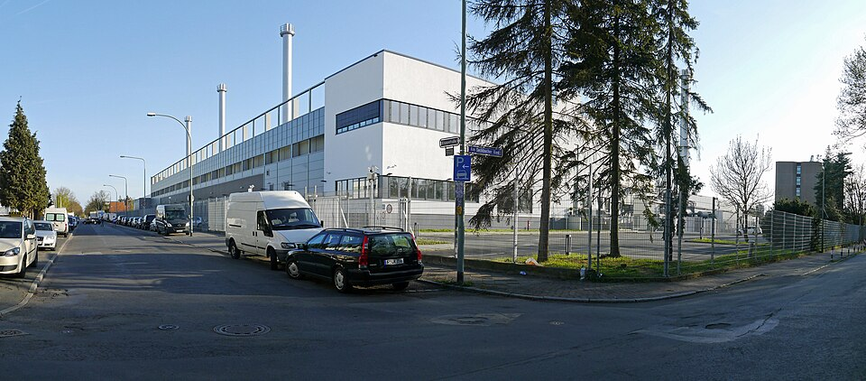

On November 13, 2023, **[Germany](kloom:e/germany)** enacted the _Energieeffizienzgesetz_, the Energy Efficiency Act. Most of it sets national targets for using less energy, but one section, by the economy ministry's account the first such standards in Germany, tells every **[data center](kloom:e/data-center)** with 300 kilowatts or more of connected power how efficient it must be, how much of its electricity must be renewable, and how much of its heat it must put to use. "Each unit of energy should in the future be used as efficiently as possible," said Robert Habeck, then economy minister, when the Bundestag passed it; waste heat, his ministry added, "has a lot of potential for energy efficiency."

## What the law asks

| Requirement (section 11)                | Centers opened before July 2026               | Centers opening from July 2026                                          |
| --------------------------------------- | --------------------------------------------- | ----------------------------------------------------------------------- |
| PUE, at most                            | 1.5 from July 2027; 1.3 from July 2030        | 1.2, reached within two years                                           |
| share of energy reused, as heat         | no fixed share                                | 10%; 15% planned for centers opening from July 2027, 20% from July 2028 |
| electricity from renewables, on balance | 50% from January 2024; 100% from January 2027 | the same                                                                |

The renewable rule is met "on balance": a data center may buy certificates or contracts for green power over the year rather than run on it hour by hour. The heat rule has exits. It does not apply if a nearby town or heat network operator has signed an agreement to build a network that can take the heat within ten years, or if a network operator turns down an offer of the heat at cost for six months. The electricity a heat pump uses to raise the heat's temperature is left out of the **[power usage effectiveness](kloom:e/power-usage-effectiveness)**, the PUE. Operators must also run an energy management system, certified at the larger sites, and publish their figures by March 31 each year and send them to a federal register. The plate sets the steps on one time line.

## Europe's rules

The [European Union](kloom:e/european-union)'s recast energy efficiency directive of 2023 asks less: data centers of 500 kilowatts of computing or more report their energy, water, heat reuse and renewable power each year, from September 2024, to a European database. Its numbers are published only in aggregate. The European Commission's first report, in September 2026, counted 770 data centers that had reported, about 36% of those it estimated should have. Their average PUE in 2024 was 1.36, measured by the operators themselves. Only 67 reported reusing any heat at all, about 1.8% of the heat the reporting centers made, and the Commission named the "lack of heat off-takers" among the reasons. It has proposed a rating scheme, with the first labels expected in 2027, and is consulting on minimum standards.

## Frankfurt

Germany's data centers cluster around **[Frankfurt](kloom:e/frankfurt)**, where **[DE-CIX](kloom:e/de-cix)** runs one of the world's largest internet exchanges. In June 2022 the city council adopted a plan that steers new colocation data centers into seven districts and some industrial parks, keeps them out of the city's other commercial land, and calls for a citywide plan to use their heat. The regional chamber of commerce counted 76 data center sites in the Frankfurt Rhine-Main region in 2024, about 30% of Germany's, in a study it presented in December 2025; the chamber speaks for the region's businesses, and it called the city's plan a signal that discourages investment.

## The argument, and the second law

When the cabinet took the law up again in June 2026, Bitkom, the digital industry's association, answered its heat rule. Operators "are ready to hand over heat at no cost," its chief executive Bernhard Rohleder said, in our translation, but "without suitable buyers" a one-sided obligation "falls short," and new investment "threatens to move abroad." The heat needs a buyer: a **[district heating](kloom:e/district-heating)** network near enough to take it, which _Reusing a data center's heat_ follows. The **[Umweltbundesamt](kloom:e/umweltbundesamt)**, the federal environment agency, read the new register differently in September 2026: of the 319 centers in it, about 70% already met the 1.5 limit and 80% already matched all their power with renewables. Those are the operators' own figures, and the agency itself said that many large international operators were missing from the register.

That summer the government sent the Bundestag a bill to bring the law back toward the European minimum. Older centers would face limits of 1.6 and 1.4, new ones would get four years to reach 1.2, the 100% renewable rule would wait until 2030, and the heat rule would bind only where a heat network is within reasonable reach. The government's reasons included the redundancy that older centers, some of them critical infrastructure, are built for. Bitkom asked for a further change, a limit of 1.3 for new centers. At the hearing in October the German Datacenter Association welcomed the efficiency requirements but asked for a new way of computing the PUE, one that operators can check and influence. AlgorithmWatch, a nonprofit research and advocacy group, told the same hearing that the changes would raise energy use and that the present limits should stand.

As of late November 2026 the Bundestag had not voted on it. No one yet knows how much heat German data centers will deliver, or whether the register's numbers hold once every operator reports. Four countries have chosen four levers; _Moratoriums and local votes_ follows the American ones.
