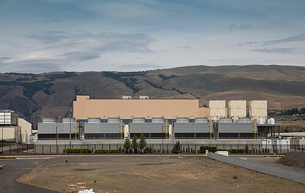

In 2005 officials at **[The Dalles](kloom:e/the-dalles-oregon)**, a town of about 13,000 beside the **[Columbia River](kloom:e/columbia-river)** in Oregon whose aluminum smelter had closed, began negotiating with a Delaware company called Design LLC over land at the port. Design LLC was **[Google](kloom:e/google)**. The project was known locally as "Project 02" (or "O2", in one telling), and those who negotiated it signed nondisclosure agreements. In 2006, by Google's account, it began there to build and run data centers of its own; until then it had grown in buildings run by others, as the companies of _Carrier hotels and colocation_ did.

## Why there

Google said that cheap power was the chief attraction, _Willamette Week_ reported in 2008. The power is hydroelectric: **[The Dalles Dam](kloom:e/the-dalles-dam)**, just upstream of the town, finished by the Army Corps of Engineers in 1957 and rated at 1,878 megawatts, is one of the federal dams whose output the **[Bonneville Power Administration](kloom:e/bonneville-power-administration)** sells at cost, in Google's case through the local public utility district. Its reservoir flooded **[Celilo Falls](kloom:e/celilo-falls)**, long a center of fishing and trade for the river's Native peoples. The second reason was fiber: the city had built its own fiber-optic loop, and the region had a surplus of long-distance fiber left from the dot-com years. The third was a tax break.

| The deal's numbers                                          | Value                                           | Kind, and who gave it                         |
| ----------------------------------------------------------- | ----------------------------------------------- | --------------------------------------------- |
| Property-tax exemption on what Google built                 | 15 years                                        | reported by _Willamette Week_, 2008           |
| Condition: average pay of the expected 200 jobs             | $42,600, 150% of the county average             | the city's development director, 2008         |
| Google's payments to local governments under its agreements | $2.85 million a year                            | said at a city council meeting, 2021          |
| Tax bill once the exemption ran out                         | $5.26 million, on $334.5 million assessed       | measured: Wasco County's 2022–23 tax roll     |
| Electricity drawn                                           | about 30 megawatts                              | an unattributed estimate, 2008                |
| Google's price for power, against the market's              | about $219,000 against $500,000 a megawatt-year | claimed: the Northwest Energy Coalition, 2008 |

The last line is an advocacy group's estimate. Its analyst argued that the difference, about $8.5 million a year, was paid by other customers of the utility; the utility would not disclose Google's use or price. The city's community development director gave the case for the break: "Without the tax-exemption program, they wouldn't have considered building in The Dalles."

## The secrecy

On June 14, 2006, **[The New York Times](kloom:e/the-new-york-times)** put the site on its front page. "It is hard to keep a secret," John Markoff and Saul Hansell wrote, "when it is a computing center as big as two football fields, with twin cooling plants protruding four stories into the sky." The city attorney and the city manager told them they could not comment, having signed confidentiality agreements with Google the year before. Google's senior vice president for operations, **[Urs Hölzle](kloom:e/urs-holzle)**, gave the company's reason: "Companies are historically sensitive about where their operational infrastructure is." The port's marketing director, one of about a dozen officials who signed, recalled in 2008 that she "couldn't even say the name of the company." The mayor refused to sign, so that he could still speak to the press and the public. By 2007 Google's site manager was telling the local paper that "transparency was important." Whether such agreements are a reasonable way to bargain or keep residents from a say is argued in _NDAs and code names_.

## What it became

The two halls of 2006 were followed by more: Google reports investing more than $7 billion in Oregon since then, its own figure. Google expected 200 permanent jobs; a local report put its employees and contractors at 150 in 2013, and in 2021 Wasco County listed it among employers of 100 to 250 people. In 2008 Google began publishing the **[power usage effectiveness](kloom:e/power-usage-effectiveness)** of its fleet, 1.21 over the year to that autumn, by its own measurement; for the year to the end of 2025 it reports 1.10 and 1.06 for its two older campuses there, and 1.07 for a third in its last quarter. How such figures are made, and what they leave out, is taken up in _Prineville and the Open Compute Project_ and _The efficiency argument_.

The campus's water became a fight of its own. When _The Oregonian_ asked in 2021 how much the data centers used, the city sued to keep the figure secret as Google's trade secret, and settled in December 2022 by releasing ten years of it; Google paid the city's legal costs and its share of the newspaper's. _Small water systems, big campuses_ tells what those records show. How much electricity the campus draws now is not in any of the sources here: Google publishes each building's efficiency, not its total use. Five years later Facebook built its own in Oregon's high desert, and published how.
