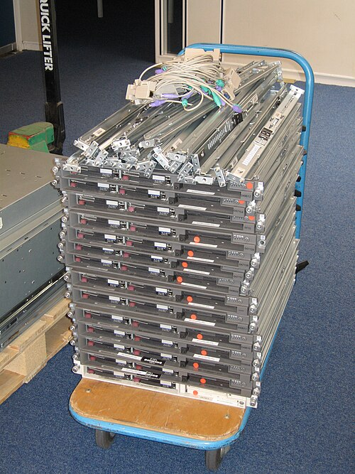

Most of the argument about data centers' carbon is about the electricity they use. A growing share of the companies' own accounts is about something else: the emissions of making the chips, the servers and the buildings before any of them runs. These are **[embedded emissions](kloom:e/embedded-emissions)**, usually called embodied carbon, and in the accounting standard companies follow they fall under _Scope 3_, the emissions in a company's value chain, as "capital goods." When the machines are retired they become **[electronic waste](kloom:e/electronic-waste)**. Both grow with how much is built and how often it is replaced.

## The companies' own figures

**[Meta](kloom:e/meta-platforms)**'s 2026 sustainability report puts its net emissions for 2025 at 11.8 million tonnes of carbon dioxide equivalent, up 45% in a year, and capital goods at 8.7 million of them: 73%. **[Microsoft](kloom:e/microsoft)**'s, for its fiscal year to June 2025, puts capital goods at 9.0 million of 21.1 million tonnes, 43% by our arithmetic and its largest category. Both are the companies' own counts, largely estimated from suppliers' data and emission factors; Microsoft's were reviewed, not audited, by the accounting firm Deloitte.

| Fiscal year, to June | Microsoft's capital goods emissions, million t CO₂e (company-reported) |
| -------------------- | ---------------------------------------------------------------------: |
| 2020                 |                                                                   3.43 |
| 2021                 |                                                                   4.09 |
| 2022                 |                                                                   4.79 |
| 2023                 |                                                                   5.99 |
| 2024                 |                                                                   6.29 |
| 2025                 |                                                                   9.04 |

The share depends on how electricity is counted, which _Counting a data center's carbon_ explains. Meta's 73% sets capital goods beside electricity counted after its clean-energy contracts, which brings that nearly to zero. Counted on the grid's average mix, Meta's own location-based total for 2025 is 21.7 million tonnes, of which its data centers' electricity is 7.8 million and capital goods 40%, by our arithmetic. Either way, in Meta's 2025 accounts the making is at least as large as the running, because a company building fast counts in one year the making of machines that will run for years. Microsoft calls concrete and steel among the largest sources of embodied carbon in construction, and says it aims to cut the embodied carbon of each new design by 30%, and Meta that its latest designs have about 77% less than its original ones. Those are the companies' claims about their own designs.

## How long a server lives

How much is made depends on how often it is replaced. In the Uptime Institute's 2026 survey of data center operators, one in three said they typically refresh their servers every three years or less, and 18% every six years or more. Newer chips do more work for each kilowatt-hour, so a refresh can save running emissions while it adds making emissions. How long an AI chip earns its keep is also a question about money, which _Is it a bubble?_ takes up.

In 2025 **[Google](kloom:e/google)** published a life-cycle study of its own AI chips, **[tensor processing units](kloom:e/tensor-processing-unit)**, from its own data. For one chip of its TPU v6e, deployed in 2024, over an assumed six-year life:

| Stage, per chip                           | kg CO₂e, grid mix | Share | kg CO₂e, after clean-energy contracts | Share |
| ----------------------------------------- | ----------------: | ----: | ------------------------------------: | ----: |
| Its share of building the data center     |               109 |    2% |                                   109 |    4% |
| Making and shipping the chip and its host |               583 |    9% |                                   583 |   21% |
| Running it for six years                  |             5,759 |   89% |                                 2,141 |   76% |

The shares are our arithmetic from the study's table 1, which gives no separate figure for retirement. Six published studies of ordinary servers, reviewed by Ji and colleagues and cited by Google's authors, put running at 39% to 97% of the total, depending on the server and the grid. The cleaner the electricity, the more the making matters. The plate draws the loop.

## Waste, measured and projected

The _Global E-waste Monitor 2024_, by the **[International Telecommunication Union](kloom:e/international-telecommunication-union)** and the **[United Nations Institute for Training and Research](kloom:e/united-nations-institute-for-training-and-research)**, estimated that the world generated 62 billion kilograms of electronic waste in 2022, of which 22.3% was documented as collected and recycled properly, and projected 82 billion by 2030. In _Nature Computational Science_ in 2024, Peng Wang and colleagues at the Chinese Academy of Sciences, funded by China's national science foundation, modeled the waste from generative AI's servers: 1.2 to 5.0 million tonnes in total over 2020 to 2030, under scenarios of how fast AI grows, more if chip import restrictions or quick turnover shorten servers' lives, and 16% to 86% less with reuse and recycling. Even the high end, spread over a decade, is under a tenth of one year's e-waste worldwide, by our arithmetic. By that measure the AI share is small; the study's concern is how fast it could grow.

Companies report what they recover. Microsoft says it reused or recycled 92% of its decommissioned servers and components in its 2025 fiscal year, through seven Circular Centers that reuse, refurbish and recycle them. The figure joins reuse and recycling, and the report does not give each share. Meta says it harvests memory modules from retired servers and retests them for its own fleet.

No public meter counts what a server's making emits; every figure here rests on suppliers' data and models, and the newest AI chips are the least studied. How long they will be kept is unknown. Those questions, and the subject's others, are gathered in _What no one knows yet_.
