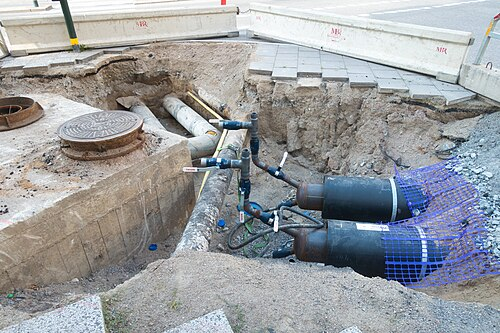

Nearly every kilowatt-hour a data center draws leaves it as heat, which its cooling plant throws into the air or evaporates away. In a few cities that heat warms homes. It goes through a **[district heating](kloom:e/district-heating)** network, pipes of hot water laid under the streets to many buildings, and the heat has to be made hotter first, because what comes off servers is lukewarm by a heating engineer's standards. Its supporters, [Meta](kloom:e/meta-platforms) and Nordic heating companies among them, see a waste turned into a resource; operators and utilities elsewhere say that without a buyer close by, the heat is worth little. Which is right depends mostly on whether a network is near.

## Lifting low-grade heat

The Copenhagen Centre on Energy Efficiency, a United Nations center, describes data center heat as "low quality," usually at most 50 °C. [Odense](kloom:e/odense)'s network takes water at 70 to 75 °C. A **[heat pump](kloom:e/heat-pump)** closes the gap. It is a refrigerator run for its warm side: a fluid boils in the _evaporator_ by taking heat from the data center's water, a _compressor_ driven by electricity squeezes the vapor until it is hotter than the network's water, the _condenser_ hands that heat over, and an expansion valve drops the pressure to begin again. The plate draws the cycle.

The lift costs electricity, and **[Carnot](kloom:e/nicolas-leonard-sadi-carnot)**'s rule sets the floor. A worked example, with invented temperatures: take water from the data center at 30 °C and deliver it at 72 °C. The best any heat pump could do is the delivery temperature in kelvins over the lift, 345 ÷ 42, about 8 units of heat for each unit of electricity, by our arithmetic. Real machines do worse. At an invented 4 units, each 4 megawatt-hours sent to homes would be 3 from the servers and 1 bought from the grid.

## Odense

The best-known case is in **Odense**, Denmark. In 2017 the district heating company Fjernvarme Fyn agreed with Facebook, now **Meta**, to take the heat of its new data center there. Water from Fjernvarme Fyn's plant runs through copper coils in the building's 176 cooling units, picks up the servers' heat and returns to the plant, where ammonia heat pumps raise it for the city's network. Meta gives the heat away, by its own account. Each figure in the table is what someone with a stake in the project said; no meter reading published by the utility was found.

| Said by, when                 | Heat                                                 | Homes               |
| ----------------------------- | ---------------------------------------------------- | ------------------- |
| Meta, July 2020               | goal of 100,000 MWh a year                           | 6,900               |
| case study, Copenhagen Centre | first 24 MW of heat pumps; about 6% of Odense's heat | 7,000               |
| Ramboll, the plant's engineer | 45 MW in all; "will recover 215,000 MWh"             | over 12,000 in 2023 |
| Meta, 2026                    | 165,000 MWh of surplus heat delivered                | up to about 9,000   |

Meta also estimated in 2020 that the heat would cut Odense's demand for coal by up to 25%, a claim tied to the city's plan to close its coal-fired plant.

## Stockholm and Espoo

**[Stockholm](kloom:e/stockholm)** has had district heating since the 1950s, and in 2017 the city, its heating company Stockholm Exergi, its grid company Ellevio and its fiber company Stokab began Stockholm Data Parks, offering data centers sites near the network. There the data center sells its heat. By a case study the European Union's Covenant of Mayors published in 2023, Stockholm Exergi pays about €190,000 a year for each megawatt of heat delivered, the cost of making the heat another way, while the data centers pay for the heat pumps. Its open district heating program took more than 100 gigawatt-hours from 20 suppliers in 2022, by the same study: 1.5% of what Stockholm Exergi's customers needed.

In March 2022 **[Microsoft](kloom:e/microsoft)** and the Finnish utility **[Fortum](kloom:e/fortum)** announced what Fortum calls the largest such plan anywhere: Microsoft's data centers in **[Espoo](kloom:e/espoo)** and Kirkkonummi, near Helsinki, would "eventually provide approximately 40 percent" of the district heat in the area, Fortum says, using about three quarters of the data centers' heat in a year, since little is wanted in summer. That is a projection. Fortum's heat pump plant at Kirkkonummi was to begin heating in the 2025–26 season "initially independently," from the air and electric boilers, with the data center there "to be built later."

## Why it is rare

In the United States, a 2018 study for the Energy Information Administration worked from a count of 660 district energy systems, found mostly on campuses, at hospitals and in downtowns, where buildings stand close together. Networks that serve clusters of buildings rather than whole cities leave a data center few places to send its heat. Germany chose to require reuse instead, as _Germany's Energy Efficiency Act_ tells.

Where there is no buyer, the industry's case is plain. "Data center operators are mostly ready and willing to give away their waste heat," the researcher Ralph Hintemann of the Borderstep Institute told Bloomberg in 2023; "the challenge here is finding someone who can use that heat economically." Béla Waldhauser, chief executive of the operator Telehouse, said feeding it into a city network "doesn't make ecological or economical sense," and Germany's association of municipal utilities called low-temperature heat "more complex and expensive." Meta and Fortum make the other case: where a network exists, the heat displaces coal or other fuel that would be burned, and Odense and Stockholm show it can be done.

How much heat these projects deliver in a year, net of the heat pumps' electricity, has not been published by an independent party. Nor is it known whether the warmer water from liquid-cooled AI chips will make the lift cheaper. What becomes of the servers themselves is the next question, in _Embodied carbon and e-waste_.
