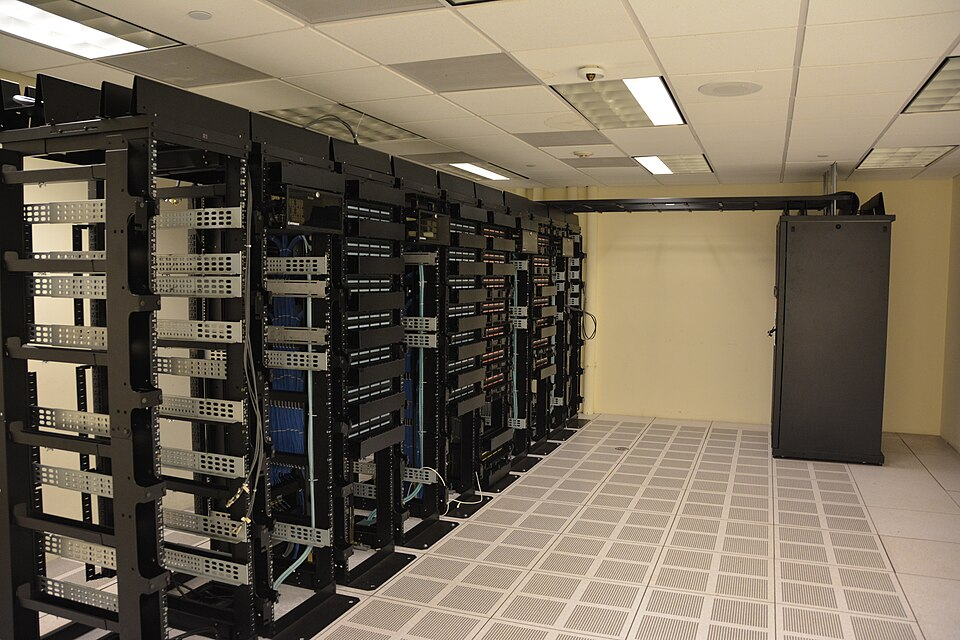

A **[data center](kloom:e/data-center)** is a building, or a room in one, whose whole job is to keep computers running without a break. Electricity comes in, nearly all of it becomes heat in the chips, and the building's other machinery carries that heat away and keeps the power from ever stopping. **[Lawrence Berkeley National Laboratory](kloom:e/lawrence-berkeley-national-laboratory)**, which estimates the country's data center energy use for the Department of Energy, sorts American data centers from network closets of under 150 square feet to the modules of a "hyperscale" campus, which average about 30,000 square feet each. A campus may hold dozens of them.

## Four systems in one building

Every data center, from a closet to a campus, has the same four parts. What changes with size is how much of each, and how much is duplicated in case one fails.

| System    | What it does                                     | Its main parts                                                                                                                       |
| --------- | ------------------------------------------------ | ------------------------------------------------------------------------------------------------------------------------------------ |
| Computing | the work itself                                  | servers, storage and switches, stacked in steel racks                                                                                |
| Power     | brings electricity in and never lets it stop     | a substation and transformers, switchgear, batteries in an uninterruptible power supply, diesel generators, power distribution units |
| Cooling   | moves the heat out of the building               | fans and air handlers or liquid loops inside; chillers, dry coolers or cooling towers outside                                        |
| Network   | connects the servers to each other and the world | fiber, switches and routers, a "meet-me room" where carriers connect                                                                 |

The power runs in a chain. If the grid fails, the batteries of the **[uninterruptible power supply](kloom:e/uninterruptible-power-supply)** carry the load for the seconds it takes **[diesel generators](kloom:e/diesel-generator)** to start. How often they run, and what they emit, is the subject of _Backup diesel generators_.

The cooling runs in a chain too, and that is where water enters the story. Inside, fans blow cold air through the racks, or, for the densest chips, a liquid loop carries heat straight off them. That indoor loop is closed: its water or coolant goes around and around rather than being used up. The heat it collects still has to leave the building. A **[chiller](kloom:e/chiller)** with air-cooled coils, or a dry cooler, gives it to the outside air and uses almost no water on site, though it generally needs more electricity than evaporation does, most of all on a hot day. A **[cooling tower](kloom:e/cooling-tower)** evaporates water to carry the heat off. The laboratory's 2024 report calls water-cooled chillers with towers highly efficient and notes that their evaporation "has raised concerns regarding data center water consumption." _Where a data center's water goes_ follows that choice in full.

## Two ratios

The industry measures its buildings by two ratios, both published by **[The Green Grid](kloom:e/the-green-grid)**, an industry consortium. **[Power usage effectiveness](kloom:e/power-usage-effectiveness)** (PUE) is all the electricity a site uses divided by what reaches its computers. A PUE of 1.0 would mean no overhead at all; 1.5 means half again as much power goes to cooling, power conversion and lighting as to the servers. **[Water usage effectiveness](kloom:e/water-usage-effectiveness)** (WUE) is the liters of water a site consumes for each kilowatt-hour its computers use.

| Year | Average PUE reported | Year | Average PUE reported |
| ---- | -------------------: | ---- | -------------------: |
| 2007 |                 2.50 | 2021 |                 1.57 |
| 2011 |                 1.98 | 2022 |                 1.55 |
| 2014 |                 1.65 | 2023 |                 1.58 |
| 2018 |                 1.58 | 2024 |                 1.56 |
| 2019 |                 1.67 | 2025 |                 1.54 |
| 2020 |                 1.59 |      |                      |

These are measured, but by the operators themselves: 681 of them answered the Uptime Institute's 2025 survey, which found the average "virtually stood still" for a sixth year. **[Google](kloom:e/google)** reports a fleet average of 1.09 for 2025, its own measurement of its own buildings. The Berkeley report _models_ the national average falling from 1.6 in 2014 to 1.4 in 2023 as work moved into large, efficient buildings. A PUE says nothing about whether the computing is worth doing. It can also hide a trade: a site that evaporates more water may run its chillers less and post a better PUE.

## How big

Data centers are sized by power, not floor space. In 2026, 69% of the operators Uptime surveyed said their most common rack drew under 10 kilowatts. A rack built around **[Nvidia](kloom:e/nvidia)**'s GB200 NVL72, 72 AI chips (**[graphics processing units](kloom:e/graphics-processing-unit)**) cooled by liquid, is designed for about 132 kilowatts. Together, by the Berkeley laboratory's estimate, American data centers used 176 terawatt-hours in 2023, 4.4% of the country's electricity, an average draw of about 20 gigawatts by our arithmetic. The same report projects 325 to 580 terawatt-hours by 2028, 6.7% to 12% of the total. The range is that wide because no one knows how many AI chips will be built, how hard they will be run, or how they will be cooled.

The rooms built around computers begin with [ENIAC](kloom:e/eniac)'s, in 1946.
