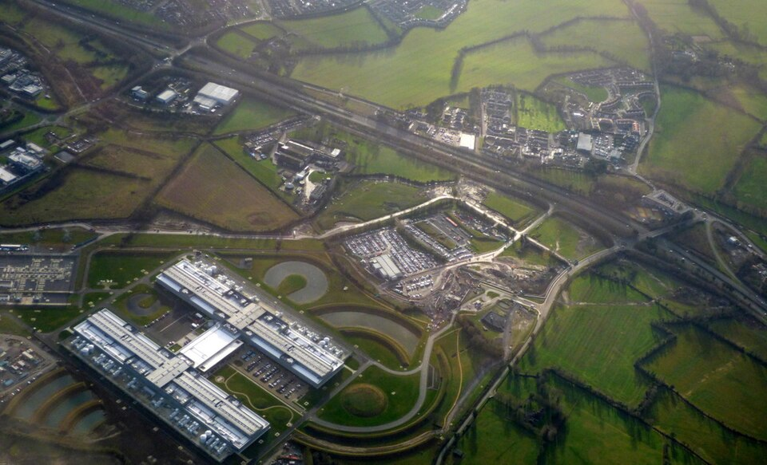

In July 2026 [Ireland](kloom:e/republic-of-ireland)'s **[Central Statistics Office](kloom:e/central-statistics-office-ireland)** reported that **[data centers](kloom:e/data-center)** had used 7,663 gigawatt-hours of electricity in 2025, 23% of all the electricity metered in the country. In 2015 the share was 5%. All the homes in Ireland, urban and rural together, used 28%. The figure is measured: the office reads the meter data of the national network, about 2.6 million meters, and finds the data centers among them by searching for known operators' names, checking the business of every large user and examining every meter that used more than a gigawatt-hour a year. It publishes that method, and says the figures may be revised as it finds meters it missed.

## A fifth of the grid

| Year | Share | Year | Share | Year | Share |
| ---- | ----: | ---- | ----: | ---- | ----: |
| 2015 |    5% | 2019 |    9% | 2023 |   21% |
| 2016 |    6% | 2020 |   11% | 2024 |   22% |
| 2017 |    7% | 2021 |   14% | 2025 |   23% |
| 2018 |    8% | 2022 |   18% |      |       |

Ireland's grid is small: the whole island's peak demand is about 7.5 gigawatts, and it has no alternating-current link to the rest of Europe. Most of the data centers stand around **[Dublin](kloom:e/dublin)**. **[EirGrid](kloom:e/eirgrid)**, the state-owned operator of the transmission grid, has contracted about 2 gigawatts of data center demand, which it says will be nearly a third of the country's demand once those centers are built out and draw their full contracted load. That is a projection, as is the regulator's citation of EirGrid's forecast that data centers will reach 31% of demand by 2034.

Why Ireland? The government's own statement on data centers (2022), drawing on BloombergNEF, says Dublin drew them through "its success in attracting technology companies, temperate climate and large wind energy resources," and that the buildings anchor those companies' presence in the country. Ireland also taxes companies' trading profits at 12.5%, a rate in force since 2003; since the end of 2023, groups with revenue of €750 million or more pay an effective 15%.

## Dublin is full

In May 2021 EirGrid warned the **[Commission for Regulation of Utilities](kloom:e/commission-for-regulation-of-utilities)** of a risk to the security of supply from new data centers. The commission considered a moratorium and, in November 2021, called one "disproportionate." Instead it told the grid operators to weigh each application by whether it stood in a constrained region and whether it brought its own generation or could cut its demand on request. In January 2022 EirGrid called the Dublin region "constrained": operators had been told, as the _Business Post_ first reported and RTÉ confirmed, that no new data center there would be connected before 2028. The industry later called it a "de facto moratorium."

On December 12, 2025, the commission replaced those criteria with a connection policy for data centers alone.

| A new data center's requested capacity | What the 2025 policy asks                                                                                 |
| -------------------------------------- | --------------------------------------------------------------------------------------------------------- |
| under 1 MVA                            | only that the grid has room where it connects                                                             |
| 1 to 10 MVA                            | its own generating unit, covering its full capacity, selling into the wholesale market                    |
| 10 MVA or more                         | generation or storage on site or nearby, matching its capacity, selling into the market                   |
| all of 1 MVA or more                   | at least 80% of annual demand matched by new renewable generation in Ireland, within six years of opening |

In May 2026 EirGrid published how it would apply the policy. It still judged the greater Dublin region "fully constrained." It estimated that 150 to 300 megawatts of new data centers might connect near Galway, Limerick and Cork, and that companies had expressed interest in a further 6 gigawatts.

## The sides

For the industry, the policy ends a long wait. Digital Infrastructure Ireland, which represents data center companies, said it was "hopeful this will end the four-year de facto moratorium." The American Chamber of Commerce Ireland said that "vital digital infrastructure is foundational to Ireland's ability to attract and retain investment." In 2022 IDA Ireland, the state's investment agency, counted about 16,000 people employed directly by data center operators, or 27,000 with contractors; that is a claim, made by an agency whose work is attracting the investment. To the worry about supply, EirGrid's answer is that data centers connected under the new rule are "not expected to add to the security of supply concerns," since each brings generation or storage to match its demand.

Environmental groups argue that the rule will not cut emissions. Friends of the Earth called matching renewables over a year "merely an accounting exercise," and said data centers' demand "inevitably means more use of fossil fuel power plants." With **[ClientEarth](kloom:e/clientearth)** and Friends of the Irish Environment, Friends of the Earth Ireland has sued the commission under Ireland's climate law: as the groups read the rule, a data center's own generation may burn fossil fuel for its first six years, and a fifth of its demand may still come from gas or oil after that. A study by Seán Fearon for the Centre for the Understanding of Sustainable Prosperity, commissioned by Friends of the Earth Ireland and Beyond Fossil Fuels, estimated (modeled) that data centers' demand added €360 to the average household's electricity bills between 2015 and 2023, by making gas set the wholesale price more often. The commission's chair told legislators in May 2026 that "data centres carry their fair proportion of network charges," and opened a review of network tariffs to confirm it.

## Not yet settled

The High Court heard the groups' challenge on November 17 and 18, 2026; the judge reserved his decision. Whether data centers raise household prices has not been measured, only modeled, and the tariff review is not finished. No one knows how much of the 6 gigawatts will be built, or where. Germany chose a different lever: rather than the grid connection, the building's own efficiency, written into law.
