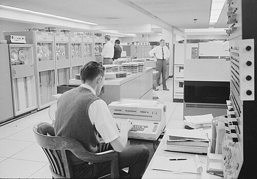

**[IBM](kloom:e/ibm)** announced the **[System/360](kloom:e/ibm-system-360)** in April 1964, one family of computers for every size of customer, and its story is told in the computing subject. With the machines came a manual for the room, IBM's _Installation Manual: Physical Planning_, which told customers how to build a home for one. Its recipe was a floor lifted off the slab, air conditioning of the room's own that cooled all year, instruments that recorded the temperature and humidity day and night, and in the largest models, water piped to the processor.

## The raised floor

IBM recommended a **[raised floor](kloom:e/raised-floor)**, 12 inches above the building's own, and gave four reasons for it: the room could be rearranged without rebuilding, the cables between the machines and their power receptacles were protected, people were safer, and the space between the two floors could carry air. Its panels had to be steel, aluminum or fire-resistant wood, with no bare metal underfoot: a hazard, IBM said, that could also cause static discharges.

In the manual's underfloor system, the void beneath was a supply plenum. Cooled air left it through registers around the edge of the room and through the cable holes cut beneath each machine, and returned through registers in the ceiling above the machines. The manual warned the designer to keep the floor from growing uncomfortably cold. The perforated tiles of a modern cold aisle, which _Inside a data center_ draws, are a later arrangement of the same idea.

## Precision air

"A separate air conditioning system is recommended," the manual said: the heat from the machines meant it had to "maintain a cooling cycle year-round," and it was not to draw power from the computer's own panel. IBM set a design point for every part of the system and the limits around it.

| Condition                  | IBM's design point | Machines running | Machines off |
| -------------------------- | ------------------ | ---------------- | ------------ |
| Temperature                | 75°F (24°C)        | 60–90°F          | 50–110°F     |
| Relative humidity          | 50%                | 20–80%           | 8–80%        |
| Held by normal controls to | ±2°F, ±5%          |                  |              |

Humidity mattered as much as heat. Damp air made punched cards and paper feed badly and condensed on cold walls and windows. Dry air let static charges build up on carpets, chairs and people, and a discharge could interfere with the machines. In most places, IBM noted, moisture had to be added. It asked every customer for a recorder with a seven-day chart and an alarm, and after too much humidity the machines might need a "drying-out period" before they ran.

Machines built for that job came next. In the company's own history, as Wikipedia gives it, Ralph Liebert, who ran a refrigeration business in Columbus, Ohio, built a prototype precision air conditioner for computer rooms and showed it to IBM in Chicago early in 1965. His Liebert Corporation, founded that year, called itself the first maker of computer room air conditioners. It is now part of **[Vertiv](kloom:e/vertiv)**.

## Water to the processor

IBM's own engineers trace the company's water cooling back to the **[System/360 Model 91](kloom:e/ibm-system-360-model-91)** of the mid-1960s, and describe it beginning as air cooling whose heat was passed to water, before cold plates were fixed to the modules themselves. The same manual shows how far it went. Of the heat from the Model 85's processing unit, 210,180 BTU an hour went into water and 39,850 into the room's air: by our arithmetic about 62 kilowatts to water and 12 to air. A coolant distribution unit took 30 gallons a minute of the customer's water at 60°F through six hoses under the floor, keeping the computer's own loop apart from the building's.

In 1980 IBM announced the **[IBM 3081](kloom:e/ibm-308x)**, whose logic sat in _thermal conduction modules_: a ceramic square 90 millimeters across holding up to 118 chips, each touched by a piston in a cap filled with **[helium](kloom:e/helium)**, which conducts heat well, under a cold plate with water flowing through it. Each module could shed up to 300 watts, its designers wrote. The 3081 drew 23 kilowatts, a third of the 68 drawn by the 3033 it succeeded, and ran about twice as fast. Liquid to the chip is where the densest AI racks have returned, as _The AI training cluster_ shows.

## What the room taught

The manual listed every unit's heat in BTU an hour so that the customer could size the air conditioning to match: every watt the computer drew became a watt the room had to remove, and removing it took more power. In the Uptime Institute's earliest survey figure, for 2007, operators reported an average of 2.50: the building used one and a half watts for every watt that reached its computers. That ratio, **[power usage effectiveness](kloom:e/power-usage-effectiveness)**, is where _Inside a data center_ begins. The next rooms were rented to many companies at once: the carrier hotels of the 1990s.
