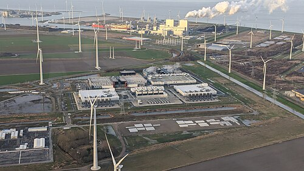

In July 2019 **[Amsterdam](kloom:e/amsterdam)** and its neighbor **[Haarlemmermeer](kloom:e/haarlemmermeer)**, around Schiphol airport, each stopped granting permits for new data centers for up to a year while they wrote rules for them. "Up to a point we will have to accept the infrastructure that goes with it, but space in Amsterdam is scarce," said Marieke van Doorninck, the responsible alderman (in our translation). By the account of the Dutch Data Center Association, the industry's group, the draft rules of 2020 confined growth to four clusters in each municipality, capped new grid connections at 670 megavolt-amperes in Amsterdam and 750 in Haarlemmermeer until 2030, and asked new buildings for a PUE of 1.2.

## Zeewolde

The national argument began in **[Zeewolde](kloom:e/zeewolde)**, a municipality of reclaimed polder land. **[Meta](kloom:e/meta-platforms)** planned a campus of 166 hectares there, the largest data center in the **[Netherlands](kloom:e/netherlands)**, and on December 16, 2021, with thirteen residents speaking against it and farmers and climate protesters outside, the council changed the zoning plan to allow it, 11 votes to 8. Supporters pointed to property tax, money for the community, jobs and waste heat for a future heat network, though how much of each was unknown. Opponents objected to its size and its electricity, which NOS, the public broadcaster, estimated at as much as 460,000 households use.

The new national coalition had written the day before that such data centers take "a disproportionately large share of the available renewable energy relative to their social and/or economic added value" (in our translation). In March 2022 Leefbaar Zeewolde, a local party against the campus, won 10 of the council's 19 seats. On March 22 the **[Senate](kloom:e/senate-netherlands)** passed a motion asking the government to stop the zoning plan being carried out, and a week later the lower house asked for a halt; Meta paused within the hour. In June the state, which owned part of the land, declined for now to sell it, its conditions on energy and sustainability not met. On June 30 Meta withdrew: "Ultimately we decided that building a data center in Zeewolde is not the right investment" (in our translation). In 2023 the **[Council of State](kloom:e/council-of-state-netherlands)**, the highest administrative court, annulled the zoning plan as not certain enough to be carried out.

## Two addresses

On February 16, 2022, the housing minister, **[Hugo de Jonge](kloom:e/hugo-de-jonge)**, paused for nine months any change of land use that would let a "hyperscale" data center be built: one of more than 10 hectares with a grid connection of 70 megawatts or more. Two places were exempt, where such buildings already stood: **[Eemshaven](kloom:e/eemshaven)** in Groningen, home to **[Google](kloom:e/google)**, and the Agriport business park near **[Middenmeer](kloom:e/middenmeer)** in Hollands Kroon, home to **[Microsoft](kloom:e/microsoft)** and Google. "The Netherlands is too small and scarcity too great to deal carelessly with our space or our energy," he said in June (in our translation). The pause was renewed until a national rule took effect on January 1, 2024, written into the decree that governs local plans; municipalities have until 2032 to bring theirs into line. Its explanatory note names the reasons: land, an overloaded grid and high water use.

The rule needs both size and power. In January 2026 a data center for Microsoft in Amsterdam, 78 megawatts in three 85-meter towers on about 2.3 hectares, fell outside it; its permit dated from five years before, said the minister, Mona Keijzer. In March the lower house passed a motion asking the government to sharpen the criteria, and the industry association told NOS that at least seven large projects with permits would go ahead. We found no new definition by November 2026.

## What was measured

| Year | Share of Dutch electricity | Year | Share of Dutch electricity |
| ---- | -------------------------: | ---- | -------------------------: |
| 2017 |                       1.5% | 2022 |                       4.0% |
| 2018 |                       2.1% | 2023 |                       4.2% |
| 2019 |                       2.4% | 2024 |                       4.6% |
| 2020 |                       2.8% | 2025 |         5.0% (provisional) |
| 2021 |                       3.3% |      |                            |

**[Statistics Netherlands](kloom:e/statistics-netherlands)** measures what is delivered to data centers: 5,664 gigawatt-hours in 2025, 5.0% of the country's electricity. In 2024 only Ireland's share was higher in the European Union. Data published by the government's enterprise agency showed Microsoft's campus at Middenmeer alone used 1.17 terawatt-hours in 2025, about 1% of the national total; Google declined to publish its own, calling it "competition-sensitive information" (in our translation).

Water was measured too, and disputed. Microsoft and Hollands Kroon had put the campus's need at 12 to 20 million liters a year; in the drought of 2022 the _Noordhollands Dagblad_ found that it had drawn 84 million liters in 2021. Microsoft replied that much of it was for construction, that 36 million liters went back to the region's supply, and that the finished campus was "on track to consume 10 million liters each year": its own projection, beside a measured withdrawal.

## The arguments, and what is not known

**The case for**, as the industry makes it: hospitals, universities and the tax authority need data centers too, said Stijn Grove, chair of the Dutch association, in 2026, and the large ones politicians oppose "are more efficient, more energy-saving and take up less space than the many small data centers we would otherwise need" (in our translation), his trade's claim; Microsoft says its Middenmeer campus employs about 400 people. **The case against**, as Pieter Grinwis of the ChristenUnie put it in the lower house: "That houses cannot be built and entrepreneurs cannot go green, but in Amsterdam a mega-sized data center appears for the American Microsoft?" (in our translation).

Not known: whether a sharper definition will follow, how much water the campuses use now, and whether projects refused here were built elsewhere. Ireland, where data centers take the largest share of electricity in the European Union, comes next.
