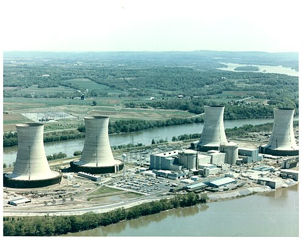

On September 20, 2024, **[Constellation Energy](kloom:e/constellation-energy)** said it would bring back a reactor that had shut in 2019: Unit 1 of the **[Three Mile Island Nuclear Generating Station](kloom:e/three-mile-island-nuclear-generating-station)** in Pennsylvania, renamed the Crane Clean Energy Center, 835 megawatts. **[Microsoft](kloom:e/microsoft)** agreed to buy its power for twenty years. The other unit there, Unit 2, partly melted down in 1979 and never ran again. Since then the largest technology companies have signed for power from existing reactors, restarted ones and reactors not yet built. **[Nuclear power](kloom:e/nuclear-power)** has the advocates' strongest claim to be firm and carbon-free at once, and the critics' strongest claim to be slow and costly.

## Restarts

Crane's reactor is a pressurized-water reactor: it sustains a fission chain reaction, as Fermi's pile in Chicago first did in 1942, and uses the heat to raise steam for a turbine. The plate draws its three loops of water.

A restart is the fastest new nuclear power on offer, and it is still slow. Constellation set a target of 2028. Its quarterly filing of November 2026 gives no date: the restart still awaits the Nuclear Regulatory Commission's review, and the grid operator's study found transmission upgrades some of which might not be finished until December 2030. In June 2026 federal regulators let Constellation move an old plant's grid connection rights to Crane, to shorten that list. The Department of Energy guaranteed a $1 billion loan for the project in November 2025.

The **[Palisades Nuclear Generating Station](kloom:e/palisades-nuclear-generating-station)** in Michigan, closed in 2022 and bought by Holtec, returned to operating status in August 2025, the first American plant to do so after closing for good. Its power is sold to Wolverine Power Cooperative, a rural utility, not to a data center. Loading its fuel stopped on August 30, 2026, when a fuel assembly tilted in the reactor; the NRC approved a plan to remove it in October.

## Co-location and the grid

At the **[Susquehanna Steam Electric Station](kloom:e/susquehanna-steam-electric-station)**, **[Talen Energy](kloom:e/talen-energy)** sold **[Amazon](kloom:e/amazon-company)** a data center campus beside the plant, wired to take 300 megawatts directly. In 2024 the grid operator, **[PJM Interconnection](kloom:e/pjm-interconnection)**, asked the **[Federal Energy Regulatory Commission](kloom:e/federal-energy-regulatory-commission)** to approve raising that to 480. Exelon and American Electric Power, utilities that own transmission lines in PJM, objected that up to $140 million a year would shift to other customers, their own estimate. PJM's independent market monitor wrote that the plan's "benefits to the co-located load come at the expense of other customers," and that if every nuclear plant did it, "emissions would also be expected to increase" as gas and coal plants filled in. Talen replied that co-location "brings service to the customer quickly and without expensive transmission upgrades."

The commission rejected the amendment, two votes to one, on November 1, 2024. Commissioner Mark Christie wrote that PJM "has failed to meet its burden of proof on this record"; Chairman Willie Phillips, dissenting, called the decision "a step backward for both electric reliability and national security." In June 2025 Talen and Amazon rewrote the deal: up to 1,920 megawatts through 2042, delivered over the grid, with the local utility, PPL, carrying it on its own lines. That switch took place in April 2026, Talen reports. In December 2025 the commission ordered PJM to write rules for co-located loads, which were still being settled in late 2026. Who pays for the wires is told in _Who pays for the grid_.

## New reactors, on paper

| Deal                                             | Announced               | What is promised                                                                    | Status, as last reported                                                                   |
| ------------------------------------------------ | ----------------------- | ----------------------------------------------------------------------------------- | ------------------------------------------------------------------------------------------ |
| Google and Kairos Power                          | October 2024            | up to 500 MW of small reactors, the first by 2030, the rest by 2035                 | its first, Hermes 2, 50 MW, broke ground in April 2026                                     |
| Amazon, X-energy and Energy Northwest            | October 2024            | four reactors, about 320 MW, in the early 2030s                                     | not yet licensed; X-energy's first permit, for a Dow plant in Texas, came in November 2026 |
| Meta and Constellation, Vistra, TerraPower, Oklo | June 2025, January 2026 | Clinton's output for 20 years; up to 6.6 GW in all by 2035, existing plants and new | contracts; the new units are not built                                                     |
| Amazon and Constellation                         | September 2026          | 690 MW from Calvert Cliffs for 20 years; 190 MW more by 2032                        | contract                                                                                   |
| Google and Constellation                         | October 2026            | about 890 MW added to 11 existing reactors, the first in 2028                       | contract                                                                                   |

A **[small modular reactor](kloom:e/small-modular-reactor)** is meant to be built in a factory and shipped, which is how its makers say costs will fall. The first American attempt is the cautionary case. **[NuScale Power](kloom:e/nuscale-power)**'s plant for Utah's public power systems was to sell power at $58 a megawatt-hour in 2021; by January 2023 the target was $89 even after a federal subsidy, and the cost had risen to $9.3 billion for 462 megawatts. Too few of its buyers signed up, and it was canceled in November 2023.

## Firm, clean, slow

The case for, in the words of Constellation's chief executive, Joe Dominguez: "nuclear plants are the only energy sources that can consistently deliver on that promise" of carbon-free power around the clock. **[Google](kloom:e/google)** called its reactors "round-the-clock" power. The case against, from the Institute for Energy Economics and Financial Analysis, a research group that argues for renewables instead: small reactors "still look to be too expensive, too slow to build, and too risky." Google answers that smaller designs can shorten construction and make delivery more predictable. Uprates and restarts add power to the grid; a contract for an existing plant's output moves it from one customer to another.

The public is warmer to the plants than to the buildings. In March 2026 Gallup found 53% of Americans opposed a nuclear plant in their area, against 71% for a data center. What is not known is whether Crane and Palisades run on schedule, whether any small reactor is built at the cost promised, and how the commission's co-location rules settle. How the companies count the carbon these contracts avoid is the next question.
