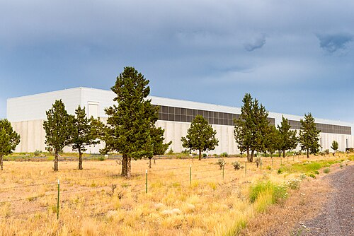

On April 7, 2011, **[Facebook](kloom:e/meta-platforms)** published the designs of its first company-built data center, at **[Prineville](kloom:e/prineville-oregon)** in the high desert of central Oregon, down to its mechanical drawings and the servers inside. It called the effort the **[Open Compute Project](kloom:e/open-compute-project)**. Five years before, [Google](kloom:e/google) had kept the same kind of building at The Dalles a secret. Facebook, now Meta, put the specifications online under an open license for anyone to use.

## What it left out

The design was a list of things removed. "Do we need a centralized UPS, PDUs, or chillers?" the designers asked themselves, as Facebook's data center design director, Jay Park, wrote, and they answered no to all three. Cooling uses the outside air. It enters through louvers in a penthouse above the data hall, passes filters and a room of high-pressure nozzles that mist it with purified water when it is too warm or too dry, then falls through shafts to the cold aisles, and leaves the servers' hot aisles to be exhausted or mixed back in. There are no chillers or compressors: the climate, whose 50-year extreme was 105.6°F at nearby Redmond, was "ideal for using an evaporative cooling system," by the specification's own account.

Power comes in at 480 volts and reaches each server at 277, with no step down to 208 volts and no central **[uninterruptible power supply](kloom:e/uninterruptible-power-supply)**. Instead, cabinets of 48-volt batteries stand in the aisles, enough for 45 seconds at full load until the diesel generators start. Facebook gave the losses it said this avoided:

| Stage                       | Typical data center, as Facebook described it in 2011 | Prineville               |
| --------------------------- | ----------------------------------------------------- | ------------------------ |
| Utility voltage to 480 V    | 2%                                                    | 2%                       |
| Central UPS, AC to DC to AC | 6–12%                                                 | none (standby batteries) |
| Transformer, 480 V to 208 V | 3%                                                    | none                     |
| Server power supply         | about 10%                                             | about 5.5%               |
| Total lost                  | 21–27%                                                | 7.5%                     |

Both columns are Facebook's own figures, a claim from the builder rather than a measurement anyone else made.

## The numbers it reported

Facebook said the building ran at a **[power usage effectiveness](kloom:e/power-usage-effectiveness)** of 1.07 at full load, verified during commissioning, and between 1.06 and 1.1 from April to September 2011. Operators answering the Uptime Institute's survey that year reported an average of 1.98. Both are self-reported; Facebook's is one new building, the survey's a mix of old and new. Facebook also said its capital costs had been lowered by 45%, without saying against what.

A low PUE leaves water out of the count, and evaporative cooling consumes water. Facebook later published that too: after adding water meters, it measured a **[water usage effectiveness](kloom:e/water-usage-effectiveness)** of 0.22 liters per kilowatt-hour for the second quarter of 2012, its own figure. About 85% of the misted water evaporates, and a quarter of the water drawn is discharged by the purification system. Nor does PUE say where the power comes from. Facebook's case for the building was efficiency itself: its vice president Jonathan Heiliger spoke of the "negawatt," "the watt you never see and never use." The case against it, which **[Greenpeace](kloom:e/greenpeace)** made in a campaign in 2010, was that the site's utility, Pacific Power, then made most of its electricity from coal, however efficiently the building used it. Who was right about the power is a question of how carbon is counted.

The design had a failure, which Facebook also published. In late June 2011 an error in the controls closed the outside-air dampers, the building recirculated its own hot air, the misting ran at full output, and the cold aisles passed 80°F at over 95% humidity. Water condensed, servers rebooted and some power supplies failed until the sequence was corrected.

## Why publish

Facebook's specification named "openness" as its aim, and the companies that followed gave their own reasons. **[Microsoft](kloom:e/microsoft)** joined in January 2014 and published its cloud servers' designs; sharing them, its server engineering manager Kushagra Vaid said, "will help us accelerate the growth of cloud computing." Google joined in March 2016 with a 48-volt rack, which it said was at least 30% more energy efficient, by its own measure. By 2025 the project counted over 400 member companies. What the open designs did to the cost of building across the industry has not been measured independently in any source here; _The efficiency argument_ weighs the larger claim that big, efficient buildings use less energy than the small rooms they replace.

## Prineville since

Meta says it has invested more than $2 billion in Oregon since it broke ground in Prineville in 2010, supports more than 350 jobs there, pays the full cost of its power and water, and will restore twice the water the campus consumes. It also says it matches all its electricity use with clean and renewable energy, including three Oregon projects of 220 megawatts; matching is an accounting method, which _Counting a data center's carbon_ examines. These are the company's own statements; no independent count of the campus's water use is in the sources here, and _Where a data center's water goes_ shows why the choice of cooling decides it. The next frame, _The AI training cluster_, turns to buildings made for AI's chips.
