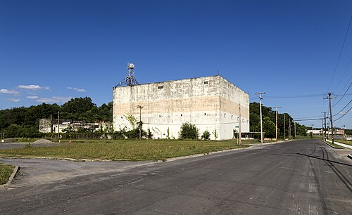

In the summer of 1958 the **[United States Air Force](kloom:e/united-states-air-force)** began operating the first direction center of **[SAGE](kloom:e/semi-automatic-ground-environment)**, the Semi-Automatic Ground Environment, at **[McGuire Air Force Base](kloom:e/mcguire-air-force-base)** in New Jersey. From the road it was a concrete cube without windows. Inside was the **[AN/FSQ-7](kloom:e/an-fsq-7-combat-direction-central)**, the largest computer of vacuum tubes and discrete parts ever built, and beside it a second building that did nothing but power and cool it. The machine, its tubes and its memory belong to _Whirlwind and core memory_ in the computing subject, which tells of the MIT computer SAGE grew from. This frame is the building, planned around what the computer needed, and its numbers are ones every later [data center](kloom:e/data-center) has had to answer.

## A building around a computer

**[IBM](kloom:e/ibm)**, which built the computers, described the typical center in its manual of 1959: "four stories high, 150 feet square, shock-resistant, and contamination proof." In IBM's account, **[Western Electric](kloom:e/western-electric)** contributed the construction. Each center held a duplex: two complete computers, A and B, one running the air battle while the other stood by for maintenance or a failure, with a switch from one to the other every day.

The manual's floor plans show how the building was arranged around them. The second floor was the computers. Much of the first floor below it was plenums and air handlers feeding cooled air up to them, beside the telephone equipment that brought in the radar data. Above were the operations rooms, where operators watched tracks on round screens, and the command post. Next door stood a one-story power and air-conditioning building, 110 feet square and about 21 feet high, joined to the blockhouse by a 22-by-100-foot bay that carried "steam, water, and power lines." The manual's drawing of the site shows a **[cooling tower](kloom:e/cooling-tower)** beside it and fuel oil tanks.

## Power the computer never saw

A center drew roughly 3,000 kilowatts, the computer historian Bernd Ulmann writes, and only a third of it reached the computers.

| Load at a direction center            | Kilowatts | Share |
| ------------------------------------- | --------: | ----: |
| The duplex computer and its equipment |     1,000 |   33% |
| Lighting and air conditioning         |     2,000 |   67% |
| Whole center                          |     3,000 |  100% |

The shares are our arithmetic from Ulmann's round figures. Each center made its own power, he explains, because an outage was disastrous for vacuum tubes. The air conditioning was so large because heat does not leave a cool room for a warm summer afternoon by itself: the **[second law of thermodynamics](kloom:e/second-law-of-thermodynamics)** says moving it there takes work, and the work here was compressors, pumps and fans. The Air Force's history of the radar network recalls "huge air conditioning units" keeping both the tubes and the "watch standers" cool. By our arithmetic, the whole center drew three times what its computers did, about twice the average ratio operators reported to the Uptime Institute in 2025. Decades later that ratio was named **[power usage effectiveness](kloom:e/power-usage-effectiveness)**.

## Hardened, but not much

IBM called the blockhouses shock-resistant. The Air Force's own history, written by David F. Winkler in 1997, calls them "extraordinarily vulnerable": "hardened to withstand overpressures of only five pounds per square inch." After Sputnik in 1957, planners saw that **[intercontinental ballistic missiles](kloom:e/intercontinental-ballistic-missile)** fired from the Soviet Union could destroy the system before a single bomber arrived. Transistor computers could have been put underground, but those plans were never carried out; the money went to American missiles instead. Only the center at North Bay, Ontario, was built underground, and it opened in 1963.

The cost is an estimate. IBM's history puts the whole program at about $8 billion, a figure others give as $8 to $12 billion, without saying in which year's dollars. IBM counts SAGE as the system that made it a leader in online computing, and the source of the Sabre airline reservation system.

## Obsolete in place

The centers were finished in 1963, already facing the missile threat they could not meet. Their tube computers ran on for two decades. The last two came down at McChord Air Force Base, Washington, in August 1983 and Luke Air Force Base, Arizona, early in 1984 (IBM gives January, a site history February). Many blockhouses still stand. Stewart's, in New York, sat empty in 2016. Montgomery's, in Alabama, is listed in Wikipedia as a data center of the Defense Information Systems Agency: a building made for a computer, still housing computers. The machine room of the next decade brought the same needs, power and cool air, into ordinary offices.
