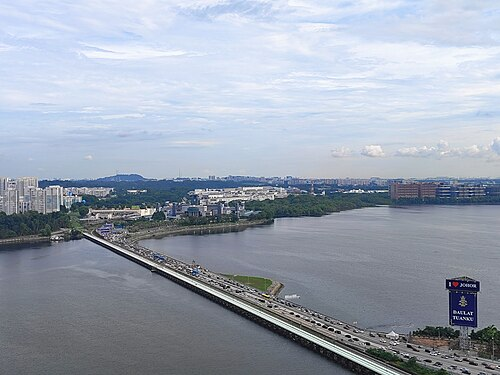

In 2019 the government of **[Singapore](kloom:e/singapore)** told the data center industry, without a public announcement, that it would release no more state land for new data centers and allow no new ones on the state land it had already leased. The pause became public in pieces: a joint statement to a newspaper at the end of 2020, then a written answer in Parliament on February 1, 2021, in which the trade minister, Chan Chun Sing, gave the reason in numbers. In the previous five years 14 data centers with 768 megawatts of IT capacity had been approved on industrial state land, against 12 with 307 megawatts in the five years before. "We will strive for quality, not quantity," he wrote.

Singapore is a city-state on an island, and about 95% of its electricity is made from imported natural gas. A data center turns that electricity into heat that has to be carried away, all year, in a tropical climate. By the government's count, from the electricity market regulator's statistics, data centers used about 5.3% of Singapore's electricity in 2019 (2.75 terawatt-hours) and about 7% in 2020: measured figures, though the 2020 one covered only January to July. By 2021 there were more than 70 operational data centers, with about 1,000 megawatts of IT capacity. The government's case was scarcity: data centers, in Chan's words, "are intensive users of water and electricity"; the agencies later added land, and the country's climate commitments.

## Reopening by allocation

In January 2022 the new trade minister, Gan Kim Yong, told Parliament the review was complete and the government would be "more selective." What followed was not a return to open approvals but a series of allocations, each with conditions, run by the **[Economic Development Board](kloom:e/economic-development-board)** and the **[Infocomm Media Development Authority](kloom:e/infocomm-media-development-authority)**.

| When          | Step                                                      | Capacity                                                   | Conditions                                                                                                 |
| ------------- | --------------------------------------------------------- | ---------------------------------------------------------- | ---------------------------------------------------------------------------------------------------------- |
| July 2022     | Pilot call for applications                               | up to 60 MW planned, as reported                           | PUE of 1.3 or better at full IT load; top green building certificate                                       |
| July 2023     | Pilot awards: AirTrunk–ByteDance, Equinix, GDS, Microsoft | about 80 MW                                                | liquid cooling, efficient servers                                                                          |
| May 2024      | Green Data Centre Roadmap                                 | at least 300 MW "in the near term," more with green energy | capacity freed partly by making existing buildings more efficient                                          |
| December 2025 | Second call                                               | at least 200 MW                                            | PUE of 1.25 or better; at least half the power from "green energy pathways" such as biomethane or hydrogen |
| August 2026   | Second awards, 50 MW each, all on Jurong Island           | 200 MW                                                     | more than half the power from green energy; liquid cooling                                                 |

The figures are allocations, the government's own, not measured use. The pilot's 60 megawatts was reported by the trade press from an industry briefing; the agencies' release gave the conditions but no total. The winners of the pilot were **[Equinix](kloom:e/equinix)**, GDS, **[Microsoft](kloom:e/microsoft)** and a consortium of AirTrunk and ByteDance, and of the second call Digital Realty, Equinix, Keppel Data Centres and ST Telemedia, whose sites will be on **[Jurong Island](kloom:e/jurong-island)**, where the state is laying out a low-carbon data center park. In September 2026 the government put Singapore's total at more than 1.6 gigawatts. On October 7, 2026, Parliament passed a Digital Infrastructure Bill that licenses every data center of 3 megawatts or more and lets the regulator set **[power usage effectiveness](kloom:e/power-usage-effectiveness)** limits for old buildings as well as new ones. In the consultation, operators asked for time to meet the limits, the ministry's closing note says.

## Across the causeway

Across the causeway, a kilometer long, in **[Johor](kloom:e/johor)**, **[Malaysia](kloom:e/malaysia)**, data centers multiplied in the same years, and ISEAS, a Singapore research institute, names Singapore's pause as one of the reasons. Johor's own data center committee put the state's capacity at 10 megawatts at the start of 2021 and about 1,300 megawatts by November 2024, figures the committee reported and ISEAS relayed. Malaysia's utility, Tenaga Nasional, had signed supply agreements with data centers for 5.9 gigawatts of maximum demand by December 2024, while the load they actually drew that month was 405 megawatts: a measured gap between what was booked and what was used, though loads rise in phases. Johor then tightened its own rules. In November 2025 the state stopped approving lower-tier data centers, and investors were asked to wait until about mid-2027 for new water-cooled capacity, as the _South China Morning Post_ reported. In January 2026 it said every application goes to a technical committee and must show a **[water usage effectiveness](kloom:e/water-usage-effectiveness)** below 1.8, "the same standard as Singapore" in an official's words, with recycled sewage water preferred for cooling.

## For and against

**The case for**, as Singapore's ministers make it: the island's land, power and water are scarce, and new capacity should go to the most efficient builders that bring the most to the economy. "We are not seeking to attract every megawatt of [data centre] capacity we can," Tan Kiat How, a senior minister of state, told Parliament in October 2026.

**The case against**, from two directions. The industry argued the limits were too tight to keep Singapore a hub. "The moratorium has not really ended in my opinion," Wong Wai Meng, head of Keppel's data center business, told _Nikkei Asia_ in 2023, and analysts at BMI, a research firm, judged in 2024 that large investments were "unlikely to go back to Singapore." Environmental critics see the cost across the causeway: ISEAS's analyst noted that renewable sources made only 8.3% of Tenaga Nasional's electricity in 2023 and judged that Malaysia "appears to have overcommitted to data centre expansion, especially in Johor." Singapore's agencies have described links to data centers offshore as a way "to complement Singapore's capacity," and Johor's officials point to their new water rules.

## What is not known

No one has published a measurement of how much computing moved from Singapore to Johor because of the pause, or what it emitted there. Johor's capacity figures are the state's own tallies. How strict the new efficiency limits will be is not yet written. In 2022 the Netherlands made its own rule about where the largest buildings may go.
