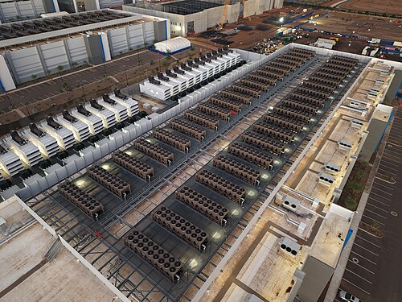

Nearly all the electricity a data center draws ends as heat, and getting that heat out of the building is what uses water. Two short accounts of it circulate. One, often heard from the industry's side, is that servers are cooled by a closed loop of water, filled once and never used up. The other, often heard from critics, is that a data center "drinks" millions of gallons a day. Each is partly right. Which part holds at a given site depends on one design choice made outside the building, and on the weather.

## From the chip to the wall

Inside, most servers are still cooled by air. In **[Lawrence Berkeley National Laboratory](kloom:e/lawrence-berkeley-national-laboratory)**'s model of American data centers in 2023, liquid cooling appears only in buildings made for AI, where it cools about two-thirds of the equipment by our reading of its chart; the large cloud buildings were modeled as all air-cooled inside. Fans push air through the racks, and coils in air handlers pass its heat into a loop of chilled water. For the densest AI racks a liquid loop runs to a cold plate on each chip. Either way, the indoor loop is closed: its water or coolant goes around rather than being used up. In **[Microsoft](kloom:e/microsoft)**'s description of its newest design, the loop is "filled during construction" and will "continually circulate water." That much of the common account is right, and _Inside a data center_ draws the path.

The loop ends at a **[heat exchanger](kloom:e/heat-exchanger)**, which hands the heat to a second loop that carries it outside. What happens there decides the water.

## The choice at the wall

There are three ways to give the heat to the outside air. A **[cooling tower](kloom:e/cooling-tower)** lets part of the water evaporate, which carries heat off using little electricity; the vapor is gone, and fresh "make-up" water replaces it. A dry cooler, or a **[chiller](kloom:e/chiller)** with air-cooled coils, blows air over a radiator and evaporates nothing. An adiabatic cooler is a dry cooler whose intake air is cooled, on hot days, by wetting pads, an **[evaporative cooler](kloom:e/evaporative-cooler)** in front of a radiator. The laboratory's 2024 report simulated nine cooling systems at 965 weather stations, in liters per kilowatt-hour of computing, the ratio the industry calls **[water usage effectiveness](kloom:e/water-usage-effectiveness)**. Its figures are modeled, not measured, and assume equipment runs as designed:

| How the heat leaves                                                   | Water on site, liters per kWh of computing (simulated, 2024 report) |
| --------------------------------------------------------------------- | ------------------------------------------------------------------: |
| Chillers with cooling towers, no economizer (small and midsize sites) |                                                       about 2.1–4.1 |
| Towers and a waterside economizer (large sites)                       |                                                       about 1.7–2.8 |
| The same, with liquid-cooled chips                                    |                                                       about 1.6–2.5 |
| Outside air, with evaporative cooling when hot (large sites)          |                                                         about 0–1.6 |
| Dry coolers with adiabatic assist (large sites)                       |                                                         about 0–0.6 |
| Air-cooled chillers, dry coolers, room air conditioners               |                                         nearly 0 (humidifying only) |

The ranges are our reading of its figure 4.4. The report states the trade plainly: "While air-cooled chillers use no water, they use more energy." Moving heat out without evaporation, on a day hotter than the coolant, takes a compressor's work, and Microsoft says its zero-water design "will increase our power usage effectiveness," which it calls "a nominal increase" in its annual energy use. _Zero-water cooling_ follows that trade. Liquid cooling does not by itself remove the water: the laboratory modeled liquid-cooled racks with towers at 1.6 to 2.5 liters per kilowatt-hour, and projects the national average to rise from just over 0.36 in 2023 to 0.45–0.48 by 2028, partly because of them.

## Climate sets the hours

Evaporative cooling is common in humid and temperate places too, because it saves electricity. In its 2026 report **[Google](kloom:e/google)** lists every site's water for 2025, its own metered and estimated figures: the largest was **[Council Bluffs](kloom:e/council-bluffs-iowa)**, Iowa, which withdrew 1.75 billion gallons and consumed 1.35 billion, followed by sites in Oklahoma, South Carolina and Ohio. Its Phoenix site, which the report says is air-cooled, used half a million gallons. In the same desert, Microsoft's Phoenix data centers withdrew 981 million liters in the year to June 2025, its second-largest site. The climate decides how many hours a site must evaporate. **[Amazon](kloom:e/amazon-company)** says its direct evaporative designs need water less than 10% of the year where the weather permits, a claim about its own buildings. The laboratory's high ends are for poorly run sites in hot, humid weather. A hot, dry place is where evaporation works best and where water is often scarcest. Whether the photograph's rooftop units are wetted on hot days cannot be told from outside.

The power plants that supply the electricity consume water too, in their cooling and from reservoirs. The laboratory estimates about 800 billion liters in 2023 for data centers' electricity, about twelve times their 66 billion on site by our arithmetic. Both are estimates; _The water behind the electricity_ explains them.

## What the claims get right

| What is said                                  | What holds                                                                                                                                                   | What does not                                                                                                                        |
| --------------------------------------------- | ------------------------------------------------------------------------------------------------------------------------------------------------------------ | ------------------------------------------------------------------------------------------------------------------------------------ |
| "Servers are cooled by a closed loop."        | The loop to the chip, and the chilled-water loop, are closed                                                                                                 | Most servers are air-cooled, and the heat still leaves through a tower or a dry cooler outside                                       |
| "Closed loop means no water."                 | True where the outside rejection is dry, as in Microsoft's 2024 design                                                                                       | With towers, a closed indoor loop still evaporates 1.6–2.5 L/kWh (simulated); the dry route costs electricity                        |
| "Data centers use water only in deserts."     | Water matters most where it is scarce, and desert sites can be large users: Microsoft's Phoenix withdrew 981 million liters in fiscal 2025                   | Google's largest users are in Iowa, Oklahoma, South Carolina and Ohio; its Phoenix site is air-cooled                                |
| "A data center uses as much water as a town." | Council Bluffs withdrew about 4.8 million gallons a day in 2025, the home use of up to about 16,000 families at the EPA's "more than 300 gallons" a day each | It is Google's largest; the median of its 40 listed sites consumed about 140 million gallons in the year, and ten consumed under one |

The town figures are ours, from Google's table and the EPA's estimate of household use; the claim itself, "up to 5 million gallons per day," comes from the **[Environmental and Energy Study Institute](kloom:e/environmental-and-energy-study-institute)**, a nonprofit, citing a press report. What no one has measured is how most sites actually run: the laboratory notes that systems rarely perform as designed, and that some large operators report 0.1 to 0.3 liters per kilowatt-hour for designs it simulated near zero. The trail _Water, measured_ takes up withdrawal and consumption, the cooling tower, the ratio and the power plants; _How much water data centers use_ adds it up.
