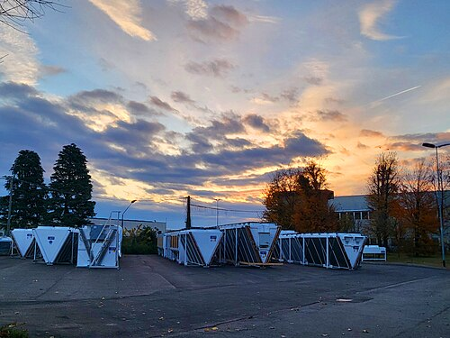

On December 9, 2024, **[Microsoft](kloom:e/microsoft)** said that every data center it designed from August of that year would "consume zero water for cooling." The water would not be evaporated at all. It would circulate in a closed loop between the chips and chillers outside, which give the heat to the air. The company's own announcement named the price: "Replacement of evaporative systems with mechanical cooling will increase our power usage effectiveness (PUE)." Less water on the site means more electricity. That trade is the whole subject of this frame, and both sides of the argument over data centers use it.

## Two choices, not one

A cooling design makes two choices. The first is how heat leaves the chip: in air blown through the servers, or in liquid that runs through a metal cold plate pressed onto each chip. The second is how heat leaves the building: by evaporating water in a **[cooling tower](kloom:e/cooling-tower)**, which costs water and saves power, or through dry coolers and air-cooled chillers, finned coils with fans, which cost power and save water. A closed loop at the chip does not by itself mean zero water; Microsoft's design is zero-water because it makes the dry choice outside too.

The first choice can save both. In a life-cycle study published in _Nature_ in 2025, Microsoft's engineers and the consultancy WSP found that cold plates and **[immersion cooling](kloom:e/immersion-cooling)**, where servers sit in a tank of fluid that does not conduct electricity, cut energy use by 15% to 20% and water consumption by 31% to 52% against air-cooled halls, over the whole life cycle, power plants included. It is peer-reviewed but modeled, and written by the company whose designs it assesses.

## Where it stands

The company planned the first sites in **[Phoenix](kloom:e/phoenix-arizona)** and Mount Pleasant, Wisconsin, for 2026, and the rest from late 2027, each saving, it estimated, more than 125 million liters a year against its 2024 average of 0.30 liters for each kilowatt-hour. In September 2025 it described Fairwater, its Mount Pleasant campus, as cooled through a closed loop for over 90% of its capacity, "requiring water only once during construction," with 172 fans outside; the rest uses outside air and water on the hottest days, under 5% of the year by its Wisconsin fact sheet. By June 2026 Microsoft reported a fleet average of 0.27 liters per kilowatt-hour and said about 90% of its owned fleet used little or no water for cooling. **[Meta](kloom:e/meta-platforms)** says its standard design for AI campuses of a gigawatt, the first due to run later in 2026, also uses a closed liquid loop with dry coolers. These are the companies' own figures. No zero-water site's metered water and electricity had been published by November 2026 that we could find, so the savings remain projected.

## Other water, and other places

A second answer is not to use drinking water. **[Google](kloom:e/google)** has cooled its campus in **[Douglas County](kloom:e/douglas-county-georgia)**, Georgia, with recycled water since 2012; in 2025, by its own report, 394 of the 441 million gallons the site withdrew were reclaimed wastewater. Microsoft reports 79% recycled or non-potable water at San Antonio, and **[Amazon](kloom:e/amazon-company)** recycled water at 24 data centers. **[Loudoun Water](kloom:e/loudoun-county-sanitation-authority)**'s reclaimed system is told in _Small water systems, big campuses_.

A third answer is a pledge. Each company has promised to be "water positive" by 2030, returning more water than it uses through projects such as watershed restoration and clean-water access, whose benefit is estimated rather than metered.

| Company   | Pledge, by 2030                                         | Latest progress (its own report)            |
| --------- | ------------------------------------------------------- | ------------------------------------------- |
| Google    | replenish 120% of freshwater consumed                   | 78% in 2025                                 |
| Microsoft | replenish more than it consumes                         | more than it withdrew globally, fiscal 2025 |
| Amazon    | AWS returns more than its data centers use              | 75% in 2025                                 |
| Meta      | restore 200% in high-stress regions, 100% medium-stress | not stated on its water page                |

A pledge can be met in one place and missed in another: water restored in one river basin does nothing for the aquifer under another. Google counts only projects in the watersheds its sites draw on; Microsoft stated its milestone globally. The authors of the 2026 preprint "Small Bottle, Big Pipe" add that a pledge counts gallons over a year, while a town's problem is its hottest day.

## The trade, stated fairly

**For** the zero-water designs, as the companies make the case: they end evaporation where water is scarcest, and the extra electricity is, in Microsoft's word, "nominal." **Against** them, as water researchers at HARC and the preprint's authors reply: power plants evaporate water too, about 4.52 liters for each kilowatt-hour American data centers used in 2023 by the Berkeley laboratory's estimate, so a dry-cooled site can move water use to the power plant rather than end it, and its extra demand comes on the hottest afternoons, when the grid is strained. _The water behind the electricity_ works that arithmetic through. Immersion has its own trade: most two-phase fluids, which boil on the chip, are **[PFAS](kloom:e/pfas)**, and **[3M](kloom:e/3m)**, which made fluorinated fluids among its products, said in December 2022 it would stop making them, and all other PFAS, by the end of 2025.

Not yet known: what the zero-water sites actually consume, on site and at the power plant, once they run full. _Data centers in dry places_ shows where the choice matters most.
