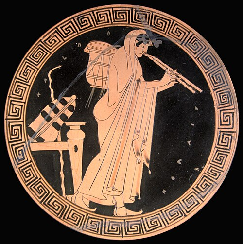

Sing a note, then a note a fifth above it, then go back and sing a fourth above the first. The gap between the fourth and the fifth is a whole tone. The Pythagoreans said that tone was the ratio 9:8, and that no whole-number ratio could split it into two equal halves. **[Aristoxenus](kloom:e/aristoxenus)** of Tarentum, writing in the second half of the fourth century BC, said a tone was simply what you hear between those two notes, and that a semitone is exactly half of it. His _Elements of Harmonics_, the **[_Elementa harmonica_](kloom:e/elementa-harmonica)**, is the oldest treatise on music theory to survive in substance, and it starts its argument from the ear.

## A musician's son at the Lyceum

Aristoxenus was born about 375 BC at Tarentum, a Greek city in southern Italy where Pythagoreans had long been at home. His father, Spintharus, was a musician who taught him first; he then learned from Xenophilus, a Pythagorean, and finally from **[Aristotle](kloom:e/aristotle)**, at the **[Lyceum](kloom:e/lyceum-classical)** in Athens. He hoped to lead the school after Aristotle, and the Byzantine encyclopedia called the _Suda_ says that when Aristotle chose **[Theophrastus](kloom:e/theophrastus)** instead, Aristoxenus insulted his memory; another ancient writer, Aristocles, says he always spoke of Aristotle with respect. He was said to have written 453 books. Three incomplete books on harmonics survive, and part of one on rhythm.

## Trust the ear

He opens by dismissing both camps before him. Some, in Henry Macran's translation of 1902, rejected "the senses as inaccurate," "asserting that height and depth of pitch consist in certain numerical ratios and relative rates of vibration—a theory utterly extraneous to the subject and quite at variance with the phenomena"; others "confined themselves to isolated dogmatic statements." His own method rests "on an appeal to the two faculties of hearing and intellect. By the former we judge the magnitudes of the intervals, by the latter we contemplate the functions of the notes." It is Aristotle's way of working, turned to sound: first, he wrote, "the phenomena themselves must be correctly observed"; the reasoning comes after. A generation earlier **[Plato](kloom:e/plato)** had mocked both kinds of theorist in the [_Republic_](kloom:e/republic-plato): the empirics who "put their ears close alongside of the strings," setting "their ears before their understanding," and the Pythagoreans who never asked why some numbers are harmonious.

For Aristoxenus pitch is a continuous line, and intervals are lengths along it that can be added. "A tone is the excess of the Fifth over the Fourth; the Fourth consists of two tones and a half." The parts of a tone used in melody are the half, the third and the quarter, and nothing smaller. He warned that he did not mean singers should climb a tone in three equal steps: "to employ the third part of a tone is a very different thing from dividing a tone into three parts and singing all three."

## The tetrachord and its genera

Greek scales were built from the **[tetrachord](kloom:e/tetrachord)**, four notes spanning a fourth. The outer two, _hypate_ below and _mese_ above, were fixed; the inner two, _parhypate_ and _lichanos_, moved, and where they stood made the genus. Aristoxenus himself counts in twelfths of a tone, and Macran drew the fourth as a line of thirty such parts. The plate draws his six named divisions, listed here from the bottom note up:

| Genus and shade    | Hypate to parhypate | Parhypate to lichanos | Lichanos to mese |
| ------------------ | ------------------- | --------------------- | ---------------- |
| Enharmonic         | 3 (a quarter tone)  | 3                     | 24 (two tones)   |
| Soft chromatic     | 4 (a third of one)  | 4                     | 22               |
| Hemiolic chromatic | 4½                  | 4½                    | 21               |
| Tonic chromatic    | 6 (a semitone)      | 6                     | 18               |
| Soft diatonic      | 6                   | 9                     | 15               |
| Sharp diatonic     | 6                   | 12 (a tone)           | 12               |

Sing the sharp diatonic down from the top and it is the familiar run of tone, tone, semitone: A, G, F, E. Sing the enharmonic and the melody drops a whole major third from A to F, then creeps down to E in two quarter tones, a slide that no keyboard can play. The diatonic, he wrote, is "the first and oldest," and the enharmonic "the third and most recondite; and it is only at a late stage, and with great labour and difficulty, that the ear becomes accustomed to it." It was already going out of fashion: musicians of his day, "striving after sweetness," pulled it toward the chromatic, and he called the old enharmonic style "perhaps the noblest of all."

## Pipes, lyres and keys

The instruments he heard were the **[kithara](kloom:e/kithara)**, the seven-stringed lyre of professional players, and the **[aulos](kloom:e/aulos)**, a pair of reed pipes played together, which accompanied the chorus in the theater. He would not let either define the scale. Theorists who set out the keys, the Hypodorian, Dorian, Phrygian, Lydian and the rest, from "the boring of finger-holes" on the pipes had given no reason for it, and the aulos was "an instrument especially liable to aberrations." (Macran translates _aulos_ as "clarinet.")

## Numbers against the ear

By the end of the fourth century, Huffman writes, theorists had split into Pythagoreans, who treated intervals as ratios, and the followers of Aristoxenus, who treated them as lengths. The two pictures meet at one point. For Aristoxenus the octave is exactly six tones. For a Pythagorean, six tones of 9:8 overshoot the octave, by our arithmetic, by 531,441:524,288, the Pythagorean comma. Each side thought the other's answer could not be heard or could not be true. **[Ptolemy](kloom:e/ptolemy)**, five centuries later, tried to give both reason and the ear their due, and that settlement is told on the Tuning trail.
