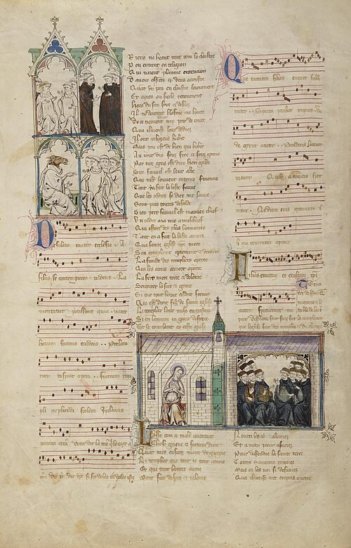

Around 1320 two Paris scholars wrote of a "new art" of music. **[Johannes de Muris](kloom:e/johannes-de-muris)**, a mathematician and astronomer at the Sorbonne, called his treatise _Ars novae musicae_; a set of writings of about 1322 is credited to **[Philippe de Vitry](kloom:e/philippe-de-vitry)**, a royal secretary who would also be a diplomat, a soldier and bishop of Meaux, and whom [Petrarch](kloom:e/petrarch) called the keenest seeker of truth of his age. Their name for it stuck. Since the German scholar Johannes Wolf used it in 1904, **[ars nova](kloom:e/ars-nova)** has named the music of fourteenth-century France, from the 1310s to the death of its greatest composer in 1377. Whether Vitry wrote a treatise called _Ars nova_ at all is another matter: in an article of 1985 titled "A Phantom Treatise of the Fourteenth Century?", Sarah Fuller doubted that it ever existed as one work, and his authorship of it is still questioned.

## Notes that carry their own time

At Notre-Dame a note's length depended on its place in a pattern. The new notation gave each shape a length of its own, in a ladder from the long, through the breve and the semibreve, to a newly invented smallest note, the minim. Each note could be split into three of the next (a division called perfect) or into two (imperfect), and the two choices, made at two levels, gave four kinds of time. The division of the breve was its _tempus_, of the semibreve its _prolatio_. In time a sign at the start of a piece said which was meant: a circle for perfect tempus, a broken circle for imperfect, and a dot inside for major prolation.

| Sign             | Tempus    | Prolation | Minims to a breve | Modern meter, a minim as an eighth note |
| ---------------- | --------- | --------- | ----------------- | --------------------------------------- |
| circle with dot  | perfect   | major     | 9                 | 9/8                                     |
| circle           | perfect   | minor     | 6                 | 3/4                                     |
| half circle, dot | imperfect | major     | 6                 | 6/8                                     |
| half circle      | imperfect | minor     | 4                 | 2/4                                     |

The plate draws the four as trees. The broken circle survives: it is the C at the head of a modern score, read today as "common time," though it was never a C. This **[mensural notation](kloom:e/mensural-notation)**, measured music, served composers until about 1600 and is the ancestor of the notes we read now.

## A horse, and a pope

The new notes appear first in a book of satire. The **[_Roman de Fauvel_](kloom:e/roman-de-fauvel)**, a poem of 1310 and 1314 generally credited to Gervais du Bus, a clerk of the royal chancery, tells of a fallow horse who rises to rule the world while the great of church and state groom him. About 1317 Chaillou de Pesstain copied it out with 169 pieces of music woven into its pages, 124 in Latin and 45 in French; some of its motets are thought to be Vitry's, and a few, such as _In nova fert_, use red notes, one of the new notation's devices.

Not everyone liked it. In 1324 or 1325 **[Pope John XXII](kloom:e/pope-john-xxii)**, at Avignon, issued the decree _Docta sanctorum patrum_ against "certain disciples of a new school" who, "while they busy themselves measuring time," sing the church's chants "in semibreves and minims." "They chop up the melodies with hockets," he wrote, in our translation, "make them slippery with discants, and sometimes stuff them with upper parts and motets in the vulgar tongue. … They run and never rest; they intoxicate the ear and do not soothe it." Singers who went on were to be suspended for eight days. The pope allowed one thing on feast days: an octave, fifth or fourth sung above the plain chant.

## Machaut

The style's master was **[Guillaume de Machaut](kloom:e/guillaume-de-machaut)**, born about 1300 in the country around Reims, who served John of Luxembourg, King of Bohemia, as secretary for more than twenty years and became a canon of **[Reims Cathedral](kloom:e/reims-cathedral)** in 1337. He lived through the **[Black Death](kloom:e/black-death)**. In his poem the _Jugement dou roy de Navarre_ (1349) he tells how, afraid, he made his confession and shut himself in his house until one day he heard, in our translation, "bagpipes, trumpets, kettledrums, and more than seven pairs of instruments": the survivors were marrying and feasting, and the plague had passed. He had heard it said that of every hundred only nine were left.

His **[_Messe de Nostre Dame_](kloom:e/messe-de-nostre-dame)**, written for Reims before 1365, sets all six parts of the Mass's unchanging text, from the Kyrie to the _Ite, missa est_, for four voices, the earliest complete setting by one composer; the older Mass of Tournai is a gathering of pieces by several hands. Its Kyrie is built by **[isorhythm](kloom:e/isorhythm)**: the tenor sings a chant melody of 28 notes, the _color_, to a pattern of four durations, the _talea_, repeated seven times. The first recording, a partial one of 1936 by Guillaume de Van's choir with brass, was issued as the Mass "of the coronation of Charles V, 1364," an old attribution. A rubric at Reims points instead to the cathedral's Saturday Mass of the Virgin, and Machaut and his brother Jean, also a canon there, may have meant it to be sung in their memory; for what service it was first sung is not known. He also wrote some 400 poems, 235 of them ballades, set many to music, and saw to the copying of his collected works himself, which is why so much survives. A hundred years later, printed notes would carry the measured music far beyond the books he watched over.
