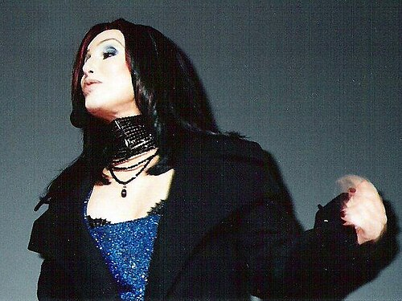

Thirty-six seconds into **[Cher](kloom:e/cher)**'s "**[Believe](kloom:e/believe-cher-song)**," released in October 1998, her voice does something no voice had done on a hit before. On "I can't break through" it goes glassy, as the critic Simon Reynolds heard it, "like the singer suddenly disappeared behind frosted glass"; in the next verse it warbles robotically between notes. There is no slide from one pitch to the next, only steps, as if the voice were a keyboard. The chorus is mostly Cher's own full voice. The steps were made by **[Auto-Tune](kloom:e/autotune)**, a program written to hide exactly what it now made everyone hear: that a singer's pitch had been corrected.

## From seismic to singing

Andy Hildebrand, its inventor, had earned a doctorate in 1976 and spent his first career in oil. In **[reflection seismology](kloom:e/reflection-seismology)** a sound is sent into the ground and its echoes from the rock layers recorded; his work for Exxon, and then for Landmark Graphics, the company he cofounded in 1979, was finding the pattern in those echoes, with a method called **[autocorrelation](kloom:e/autocorrelation)**. He retired, he told _Time_, at forty. He had paid for college by teaching the flute.

How he turned to singing is his own story, and he has told it differently. To _Time_ in 2009 it was a guest at a dinner party who challenged him to invent a box that would let her sing in tune; to the writer Zachary Crockett in 2016 it was a friend's wife at a lunch at the NAMM music trade show in 1995, and everyone at the table looked down at their plates. He built the program in 1996 (early in the year, in one account; late, in another), showed it at NAMM in 1997, and it went on sale that September. His patent, filed by Auburn Audio Technologies and granted in October 1999, sets out how it works.

## Hearing a pitch

A sung note is a wave that repeats, and its pitch is how often. To find the period, the patent compares the wave with a copy of itself delayed: when the delay equals one period, the two match. Earlier tuners had timed zero crossings or peaks, and lost track when noise or a vowel changed the wave's shape; pitch shifters built on the **[fast Fourier transform](kloom:e/fast-fourier-transform)** worked on blocks of sound and could not bend pitch smoothly, the patent said. Autocorrelation had been thought too costly to compute. Hildebrand kept running sums so that each trial delay cost "four multiple-adds" a sample. His patent specifies:

| What the patent specifies   | Value                                   |
| --------------------------- | --------------------------------------- |
| Sampling                    | 44,100 samples a second, 16 bits        |
| Search for a new note       | every eighth sample, delays of 2 to 110 |
| Pitches it can find         | 2,756 Hz down to 50.1 Hz                |
| Cost of tracking each delay | four multiply-adds a sample             |
| Accuracy of correction      | within one cycle in 80 seconds          |

Then it retunes. The target is the nearest note of a scale the user chooses, its notes the semitones of **[equal temperament](kloom:e/equal-temperament)**, or a note sent from a keyboard by MIDI. The program replays the voice slightly faster or slower, adding or dropping whole cycles to keep time. A user-set coefficient smooths the change, because "the voice does not instantly change pitch." Sold as _retune speed_, it runs from 0 to 400. "If you set it to 10, that means that the output pitch will get halfway to the target pitch in 10 milliseconds," Hildebrand told _Time_. "But if you let that parameter go to zero, it finds the nearest note and changes the output pitch instantaneously." The plate shows both on an invented line. At zero, vibrato vanishes, and a slide between notes becomes a staircase. "I never figured anyone in their right mind would want to do that," he said.

## The Cher effect

"Believe" was produced by Mark Taylor and Brian Rawling at their Dreamhouse studio in Kingston upon Thames. In February 1999 Taylor told _Sound On Sound_ that the effect was a **[vocoder](kloom:e/vocoder)** pedal, a Digitech Talker fed with notes that he had nudged just behind Cher's melody, and that he had processed only a syllable here and there. Reynolds later called that a cover story to keep the trick secret; it was Auto-Tune at its fastest setting, which Antares's manual for its fifth version called the "Cher effect." The record went to number one in 23 countries.

In 2003 the singer and rapper **[T-Pain](kloom:e/t-pain)** stumbled on the same setting and built a career on it. **[Kanye West](kloom:e/kanye-west)** flew him to Hawaii to explore it, and sang **[_808s & Heartbreak_](kloom:e/808s-and-heartbreak)** (2008), an album of grief after his mother's death, through it. In 2009 the backlash came: Death Cab for Cutie wore blue ribbons to the Grammys against it, and **[Jay-Z](kloom:e/jay-z)** released "D.O.A. (Death of Auto-Tune)." In 2010 _Time_ put it on a list of the fifty worst inventions.

Meanwhile it had become the inaudible norm. None of the half-dozen engineers _Time_ interviewed in 2009 could remember a pop session without it. From 2001 **[Celemony](kloom:e/celemony-software)**, of Munich, sold Melodyne, which draws each recorded note as a shape that can be dragged in pitch and time by hand. To the charge that pitch correction was a deception, Hildebrand answered with a question: "My wife wears makeup, does that make her evil?"

The voice, trained, sold, examined and amplified along this trail, could now be rewritten note by note: a long way from where the trail began, with Monteverdi's _Orfeo_.
