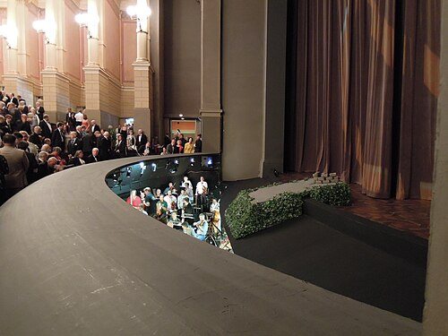

On 13 August 1876, in a new theater on a hill outside the small Bavarian town of Bayreuth, the gaslights went out. **[Pyotr Ilyich Tchaikovsky](kloom:e/pyotr-ilyich-tchaikovsky)**, there as a correspondent for a Moscow paper, described it: "the whole theatre is plunged into total darkness, and from the depths of the hidden orchestra pit below there swell up the beautiful sounds of the prelude." The prelude was to [_Das Rheingold_](kloom:e/das-rheingold), the first evening of **[Richard Wagner](kloom:e/richard-wagner)**'s **[_Der Ring des Nibelungen_](kloom:e/der-ring-des-nibelungen)**, four music dramas on Germanic and Norse legend that take about fifteen hours to play. Wagner had written them over twenty-six years, from 1848 to 1874, and built the house to give them complete, as he wanted them, for the first time.

## A king's money

The theater was paid for, in the end, by **[Ludwig II of Bavaria](kloom:e/ludwig-ii-of-bavaria)**, who had come to the throne at eighteen in 1864 and paid off Wagner's debts. Ludwig wanted the theater in Munich, and had the _Ring_'s first two parts staged there in 1869 and 1870 against the composer's wishes; Wagner chose quiet Bayreuth, which gave him the land. The foundation stone was laid on 22 May 1872, and Wagner conducted **[Beethoven's Ninth Symphony](kloom:e/symphony-no-9-beethoven)** in the town's old opera house to mark it. He sold patrons' certificates, founded Wagner Societies and toured as a conductor; the new German Reich, asked through Bismarck and the Kaiser, gave nothing. In January 1874, with the work about to stop, Ludwig lent him 100,000 thalers. Kaiser Wilhelm I came to the first night, and Ludwig came secretly to the dress rehearsals and the third cycle. The festival ended about 150,000 marks in debt, and there was no second one until 1882.

## A house for listening

**[The Bayreuth Festspielhaus](kloom:e/bayreuth-festspielhaus)** was built round what Wagner wanted the audience to do: look at the stage and nothing else. The seats rise in one steep wedge of curved rows, with galleries only at the back and no boxes, so that nobody faces anybody else. The hall was darkened, then a rare thing. The orchestra sits out of sight in the "mystic abyss," on six steps that descend under the stage, the loud brass and drums at the back. In front of the first row of seats a curved wooden hood covers it, and a second hood starts from the front of the stage, leaving a slot between them "through which the sound of the orchestra ascends with wonderfully blended effect," in the words of the 1911 _Britannica_. The sound strikes the stage first and reaches the hall softened, under the singers rather than over them. The players cannot see the singers, and the pit is said to be the hardest anywhere to conduct from.

| The house in measures                             | Figure                                      |
| ------------------------------------------------- | ------------------------------------------- |
| The auditorium, in plan                           | about 35 by 35 meters                       |
| Seats in 1876                                     | 1,345 in the stalls, about 300 in galleries |
| Seats today, after a press gallery and new chairs | 1,925                                       |
| Volume of the hall, without the stage house       | about 10,800 cubic meters                   |
| Reverberation time, empty                         | 2.4 seconds                                 |
| Reverberation time, full                          | about 1.6 seconds                           |
| The pit                                           | six steps, partly under the stage           |

## Motifs that remember

The prelude Tchaikovsky heard shows the method of the whole cycle. It is a single chord of E-flat major held for 136 bars: a low E-flat in eight double basses, almost too soft to hear, then a B-flat added by the bassoons, then the horns entering one after another on a rising arpeggio, and at last the strings in waves, the river from which the story starts. That rising figure comes back, changed, all through the cycle. In the minor it is the music of the earth goddess Erda; turned to fall, it becomes the music of the gods' downfall. Such recurring figures are now called the **[leitmotif](kloom:e/leitmotif)**. Wagner did not use the word. Hans von Wolzogen's guide of 1876 named the _Ring_'s motives one by one, and Wagner complained that people would think "all this nonsense" was done at his request. In July 1904 the Gramophone Company recorded festival singers in a Bayreuth hotel, among them the three Rhinemaidens singing their "Wallalala." One was the contralto **[Ottilie Metzger](kloom:e/ottilie-metzger)**, the festival's Erda.

## "A rooted dislike"

In 1850 Wagner published, under a false name, **[_Das Judenthum in der Musik_](kloom:e/das-judenthum-in-der-musik)**, which set out to explain "a rooted dislike of the Jewish nature" and called the Jew "innately incapable" of expressing himself in art. It attacked **[Felix Mendelssohn](kloom:e/felix-mendelssohn)**, a convert born to a Jewish family, and, unnamed, Giacomo Meyerbeer. In 1869 he reissued it under his own name. Hermann Levi, the son of a rabbi, conducted the premiere of _Parsifal_ at Bayreuth in 1882. After Wagner's death his widow, Cosima, ran the **[Bayreuth Festival](kloom:e/bayreuth-festival)**, and it became more and more a center of antisemitism. **[Winifred Wagner](kloom:e/winifred-wagner)**, his English-born daughter-in-law, who ran it from 1930 to 1945, befriended **[Adolf Hitler](kloom:e/adolf-hitler)** in 1923 and sent him paper while he was in prison; in **[Nazi Germany](kloom:e/nazi-germany)** the festival had his money and a tax exemption. The historian Hannes Heer has traced 51 of the festival's Jewish artists who were persecuted after 1933. Twelve were murdered, Ottilie Metzger at Auschwitz in 1942 or 1943. Scholars still disagree how much of the essay is in the dramas themselves. Asked in the festival's own magazine in 2025 whether Beckmesser, the butt of _Die Meistersinger_, is a caricature of a Jew, the director of its new production answered, "That may be true."

The festival reopened in 1951 with Wilhelm Furtwängler conducting Beethoven's Ninth. Wagner's great-granddaughter Katharina Wagner has run it since 2008, and in 2026, its 150th year, it staged a new _Ring_ with projections made by artificial intelligence. In New York seventeen years later, a Czech composer gave his own answer to what a nation's music should grow from, in the New World Symphony.
