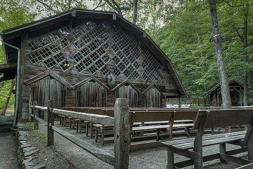

On the evening of 29 August 1952 the pianist **[David Tudor](kloom:e/david-tudor)** gave a recital of new piano music at the **[Maverick Concert Hall](kloom:e/maverick-concert-hall)**, a wooden hall open to the woods near Woodstock, New York. He sat at the piano with a stopwatch, closed the keyboard lid, and played nothing. The audience heard what the room held: the wind, in Cage's telling, stirring outside. After thirty seconds he raised the lid and lowered it again. In the second movement rain began to patter on the roof; in the third, people talked, and some walked out. After four minutes and thirty-three seconds Tudor stood up. The piece was **[_4′33″_](kloom:e/433)**, by **[John Cage](kloom:e/john-cage)**, and its title was its length.

## Choosing by chance

Cage, born in Los Angeles in 1912, had studied with **[Arnold Schoenberg](kloom:e/arnold-schoenberg)** and made his name writing for percussion and for the prepared piano. In early 1951 the young composer Christian Wolff gave him the **[_I Ching_](kloom:e/i-ching)**, the ancient Chinese _Book of Changes_, in the first complete English translation, published by Wolff's father. It is a book for divination: tossing coins builds one of 64 six-line figures, the hexagrams, and the reader turns to its chapter. Cage used it to stop choosing. For **[_Music of Changes_](kloom:e/music-of-changes)**, written for Tudor that year, he drew charts of eight cells by eight, one cell for each hexagram, holding sounds, durations and loudnesses, and let the coins pick from them. Only the odd-numbered cells of the sound charts held a sound; the even ones held silence. Tudor played the whole work for the first time on 1 January 1952.

## Two sounds in a quiet room

Cage had wanted a silent piece for years. In a lecture at Vassar College in 1947 or 1948 he said he would like "to compose a piece of uninterrupted silence and sell it to Muzak Co.," three or four and a half minutes long, the standard lengths of canned music, and call it _Silent Prayer_. He held back, afraid it would seem a joke.

Two things changed his mind, in his telling. One was a visit, usually dated to 1951, to the **[anechoic chamber](kloom:e/anechoic-chamber)** at **[Harvard University](kloom:e/harvard-university)**, a room built in 1943 for wartime research on noise and communication, its walls of sound-deadening concrete and fiberglass made to swallow sound rather than reflect it. In a lecture of 1957 Cage said only that it was "several years ago": "I entered one at Harvard University several years ago and heard two sounds, one high and one low." The engineer in charge, he said, told him the high one was his nervous system working and the low one his blood circulating. That is Cage's story of what an engineer told him, not a measurement; the media scholar Mack Hagood notes that the tale spread by retelling, and that some have doubted its physiology. Cage drew his conclusion: "Until I die there will be sounds."

The other was **[Robert Rauschenberg](kloom:e/robert-rauschenberg)**'s _White Paintings_ of 1951, canvases painted flat white with house paint, on which the room's light and the shadows of the people looking at them were all there was to see. "The white paintings came first," Cage wrote; "my silent piece came later."

## Three movements of what the room did

The score Cage dedicated to Tudor in August 1952 is lost. It was written on staves, in measures of four beats at a set tempo, with each movement's length added at its end. Later scores differ, and nobody knows why:

| Score                                    | Date      | How it is written                                            | Movements         |
| ---------------------------------------- | --------- | ------------------------------------------------------------ | ----------------- |
| Woodstock manuscript (lost)              | 1952      | Empty measures on a staff, as Tudor later reconstructed them | 30″, 2′23″, 1′40″ |
| Kremen manuscript (Museum of Modern Art) | 1952/1953 | Vertical lines on blank pages, "1 PAGE = 7 INCHES = 56″"     | 30″, 2′23″, 1′40″ |
| First _Tacet_ edition (Peters, EP 6777)  | 1960      | Each movement marked _tacet_, "be silent"                    | Any length        |

In the 1960 edition Cage wrote that the premiere's movements had lasted 33″, 2′40″ and 1′20″, which also add up to 4′33″, and that a performance may last any length of time. The plate draws both sets of timings to scale, with the Kremen score's proportional lines between them. Accounts of the lid disagree too: a note in Cage's hand says Tudor kept it closed during each movement and opened it between them, while the philosopher Stephen Davies, in 1997, has him close it once at the start, reopen it at the end, and mark the movements with his arms.

What Cage meant by it he said often. The Woodstock audience, he said later, "missed the point. There's no such thing as silence." The writer Calvin Tomkins reported that the Woodstock audience took it as "either a joke or an affront."

## Is it music?

Philosophers still argue. Davies asked it in 1997; in 2018 Julian Dodd argued that the work's performances are silence, not the sounds of the room, and that it is performance art rather than music. The critic Kyle Gann calls it a thought experiment; Cage called it his most important work.

It also became a test of who owns silence. In 2002 the songwriter Mike Batt put "A One Minute Silence," credited to "Batt/Cage," on an album by his group The Planets. A royalty was claimed on behalf of Cage's publisher, Peters Edition, and in September the BBC reported that Batt had paid "an undisclosed six-figure sum" to the John Cage Trust; the publisher said a silent piece credited to Cage was "a valuable artistic concept in which there is a copyright." In 2010 Batt said it had been staged: there was no court case, and he had given the trust £1,000.

Two summers after Woodstock, in a storefront studio in Memphis, the sound of a room was being caught on tape on purpose, and played back a fraction of a second late.
