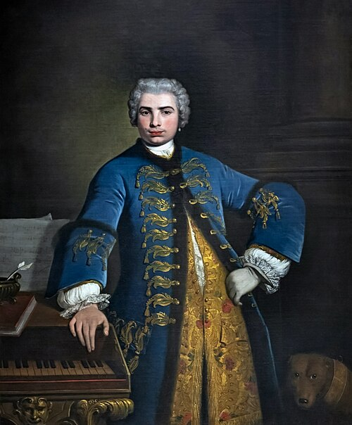

On 29 October 1734 the London opera season opened at the **[King's Theatre](kloom:e/his-majestys-theatre-london)** in the Haymarket with _Artaxerxes_, and the hero in chains was sung by a man of twenty-nine, trained in **[Naples](kloom:e/naples)**. In the aria "Son qual nave", written for him by his brother, the first note "was taken with such delicacy, swelled by minute degrees to such an amazing volume, and afterwards diminished in the same manner, that it was applauded for full five minutes," the historian **[Charles Burney](kloom:e/charles-burney)** was told. Then came runs the violins could hardly follow. The singer was Carlo Broschi, called **[Farinelli](kloom:e/farinelli)**, and he was a **[castrato](kloom:e/castrato)**: as a boy he had been castrated so that his voice would never break.

## What was done to boys

The operation was done before puberty, usually to boys of about eight to ten, sometimes under opium, which killed some of them. It was illegal almost everywhere it was done. Burney, touring Italy in 1770, asked where it was done: "I was told at Milan that it was at Venice; at Venice, that it was at Bologna; but at Bologna the fact was denied, and I was referred to Florence; from Florence to Rome, and from Rome I was sent to Naples." In Naples he was told that boys were brought to a conservatory to have their voices tried, "and then are taken home by their parents for this barbarous purpose," though the law punished the surgeon with death and everyone concerned with excommunication. For Farinelli the excuse given was a fall from a horse, after his father's death in 1717 left the family without an income.

The demand came from the Church and the stage. Women were forbidden to sing in church, and boys' voices broke after a few years; there were castrati in the papal choir by 1558, though not yet called so, and in 1589 Pope Sixtus V reorganized the choir of St Peter's to include them. By 1680 they held the leading roles in Italian opera. How many boys were cut is not known. The historian John Rosselli estimated several hundred castrati alive at any one time between 1630 and 1750, about a hundred in Rome alone in 1694. Most never had a career; they sang in church choirs if they sang at all, and could not marry.

## The voice it made

Without testosterone the larynx stays near a child's size while the body grows on. Years of daily training built breath and agility. In Naples the greatest teacher was **[Nicola Porpora](kloom:e/nicola-porpora)**, Farinelli's master. In 1726 the flutist **[Johann Joachim Quantz](kloom:e/johann-joachim-quantz)** heard Farinelli and gave his range as the A below middle C to the D two octaves above it; the plate draws it, with the F his own aria reaches. Burney thought nothing in him astonished people so much as the _messa di voce_, a single note swelled and diminished on one breath, held so long that hearers suspected "the latent help of some instrument." Burney's story of a contest in Rome in 1722, which Farinelli won by trilling on after a trumpeter ran out of breath, cannot be checked: no aria he is known to have sung has a trumpet part.

| Year | Where the castrati stood                                     |
| ---- | ------------------------------------------------------------ |
| 1558 | Castrati in the papal choir, not yet named as such           |
| 1589 | Sixtus V reorganizes the choir of St Peter's to include them |
| 1734 | Farinelli in London, at the height of their fame             |
| 1861 | The Kingdom of Italy's penal code forbids the operation      |
| 1878 | Leo XIII stops the Church hiring new castrati                |
| 1903 | _Tra le sollecitudini_ gives the high parts to boys          |
| 1913 | Moreschi, the last in the Sistine Chapel Choir, retires      |

## London and Madrid

The **[Opera of the Nobility](kloom:e/opera-of-the-nobility)**, founded by nobles in 1733 to rival **[George Frideric Handel](kloom:e/george-frideric-handel)**'s company, had Porpora as composer. Farinelli, paid £1,500 a season, which gifts may have raised to £5,000, made it solvent for a time. In 1737 the queen of Spain summoned him to sing to her husband, **[Philip V of Spain](kloom:e/philip-v-of-spain)**, who suffered from deep depression. He never sang in public again. He told Burney that for ten years, until Philip died in 1746, he sang the same four airs to the king every night, for a pension of more than £2,000 a year. Burney gave his time in Spain as twenty-four years, a study of 2011 as twenty-three; he arrived in 1737 and left in 1759, which by our arithmetic is twenty-two.

## The last castrati

The **[unification of Italy](kloom:e/unification-of-italy)** in 1861 carried the Kingdom of Sardinia's penal code, which forbade castration, across the new state; Rome, where the papal choirs still kept castrati, joined it in 1870. Pope Leo XIII stopped the hiring of new castrati for the Church in 1878, and on 22 November 1903 Pius X's [_Tra le sollecitudini_](kloom:e/tra-le-sollecitudini) gave the high parts in church choirs to boys.

The last castrato of the **[Sistine Chapel Choir](kloom:e/sistine-chapel-choir)** was **[Alessandro Moreschi](kloom:e/alessandro-moreschi)**, born in 1858. In 1902 and 1904 he recorded in Rome for the **[Gramophone Company](kloom:e/gramophone-company)**, seventeen sides in all, among them Gounod's _Ave Maria_ on 11 April 1904: the only solo recordings of a castrato. Their listeners describe a voice like a very high tenor below, with a falsetto-like top, many notes launched by a scoop from as much as a tenth below, and a sob in the phrasing that listeners today often hear as a fault. He retired in 1913 and died in 1922.

In July 2006 a team from the universities of Bologna and Pisa exhumed Farinelli's bones. His larynx was long gone, but the skeleton showed what castration does: a height of about 190 centimeters, estimated from a 315-millimeter ulna, growth lines in the shoulder blade and hip that normally close by twenty-three, and a thickening inside the skull common in women after menopause and very rare in men. The trail turns next to a woman's voice, sold by a showman: Jenny Lind's in America.
