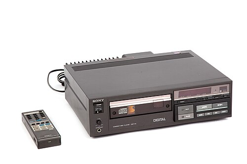
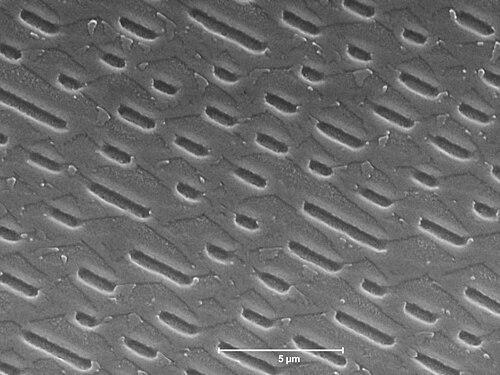

On 1 October 1982 shops in Japan began selling a record player that never touched its record. **[Sony](kloom:e/sony)**'s CDP-101 cost 168,000 yen, and beside it the CBS/Sony label put out fifty albums on discs twelve centimeters across. The first catalog number, 35DP-1, went to Billy Joel's _52nd Street_ of 1978, which is why it is often called the first CD. **[Philips](kloom:e/philips)**, Sony's partner, was not ready, so Europe and North America waited until March 1983. The **[compact disc](kloom:e/compact-disc)** carried music as numbers, and a laser read them.

## Two halves of one disc

Philips had the optics, from the laser videodisc its laboratory had built. From 1974 a small group set up by **[Lou Ottens](kloom:e/lou-ottens)**, director of its audio division, tried to put sound alone on such a disc, first in analog, which proved hardly less vulnerable to dust and scratches than an LP, then as digits. Sony had the digits. Its engineers, among them Heitaro Nakajima and **[Toshitada Doi](kloom:e/toshitada-doi)**, had recorded digital sound on videotape, and in September 1978 Sony showed a 30-centimeter disc of 16-bit audio with an error-correcting code. In 1979 the two firms agreed to make one standard, and their engineers met by turns in Eindhoven and Tokyo. **[Kees Schouhamer Immink](kloom:e/kees-schouhamer-immink)**, the electronics engineer in Philips's optics group, summed up the bargain: "the videodisc 'physics' was provided by Philips and the digital audio experience by Sony." At their meeting of 20 December 1979 each side wrote down what it wanted:

| In December 1979 | Philips         | Sony            | The standard of 1980 |
| ---------------- | --------------- | --------------- | -------------------- |
| Samples a second | 44,000–44,500   | 44,100          | 44,100               |
| Bits a sample    | 14              | 16              | 16                   |
| Playing time     | 60 min          | 60 min          | 74 min 33 s          |
| Diameter         | 115 mm          | 100 mm          | 120 mm               |
| Channel code     | Philips M3      | to be discussed | EFM, Philips's       |
| Error correction | to be discussed | to be discussed | CIRC, Sony's         |

## Numbers in plastic

The standard, the Red Book of **[Compact Disc Digital Audio](kloom:e/compact-disc-digital-audio)**, samples each of two channels 44,100 times a second, sixteen bits each time: 1,411,200 bits for every second of music. The rate came from video. Studios recorded digital masters through adaptors onto videotape, whose lines and frames fixed what would fit, and 44.1 kHz was chosen over 44.056, Immink wrote, "simply for the reason that it was easier to remember."

Sony's **[cross-interleaved Reed–Solomon code](kloom:e/cross-interleaved-reed-solomon-coding)** adds check bytes, one for every three of music, and spreads each frame's bytes along the track, so that a scratch becomes many small errors rather than one large one. It corrects a burst of about 4,000 bits, some 1.5 millimeters of track; beyond that the player fills a lost sample in from its neighbors, out to about 7.5 millimeters. Immink called the CD the first mass-market product "equipped with fully-fledged error correction", the kind of code **[Claude Shannon](kloom:e/claude-shannon)** had proved in 1948 could make a noisy channel nearly clean.

Immink's own code turns each byte into fourteen channel bits, with three more to join them, so that between two 1s come at least two and at most ten 0s. A 1 is an edge, pit to land or land to pit. The pits are pressed into clear polycarbonate, half a micrometer wide, in a spiral 5.38 kilometers long, read from the inside out at 1.2 to 1.4 meters a second. A laser of 780 nanometers is focused through 1.2 millimeters of plastic, and seen from below each pit is a bump about a quarter of a wavelength high: light from its top comes back half a wavelength out of step with light from the land around it, and the two cancel. The music is read in the dark edges of that interference, and nothing touches the disc.

## Seventy-four minutes

Why 74 minutes? In Philips's official history, **[Norio Ohga](kloom:e/norio-ohga)**, Sony's vice-president and a trained baritone, wanted his wife's favorite piece, **[Beethoven](kloom:e/ludwig-van-beethoven)**'s **[Ninth Symphony](kloom:e/symphony-no-9-beethoven)**, to fit on one disc: "the playing time was determined posthumously by Beethoven." Karajan's recording lasted 66 minutes, but **[PolyGram](kloom:e/polygram)**, the record company Philips half owned, found a longer one, **[Wilhelm Furtwängler](kloom:e/wilhelm-furtwangler)**'s mono performance at the reopened **[Bayreuth Festival](kloom:e/bayreuth-festival)** in 1951, of 74 minutes. Sony's obituary of Ohga in 2011 credits his "instincts as a trained musician" with the 12-centimeter disc.

Immink, who was at the meetings, told the Audio Engineering Society in 1998 that such stories "you should not believe". In 2007 he quoted the minutes of May 1980, which simply record 120 millimeters and 75 minutes with no reason given. His account is commercial: PolyGram had built a plant at Hanover for 115-millimeter discs, and a larger disc took away that head start. When Sony accepted his EFM code on 19 June 1980, its 30 percent gain was spent on looser tolerances, not a smaller disc. The Furtwängler Ninth itself, in the Internet Archive's transfer of its LP sides, runs 17:50, 12:01, 19:41 and 25:08, 74:40 by our sum, the Adagio nearly twenty minutes long. Because masters went through videotape cassettes of 72 minutes, Immink notes, it did not reach a single CD until 1988.

## Pressed, sold, and passed

The first test pressing was Strauss's _An Alpine Symphony_ under Karajan. Pressing began at the Philips group's plant at Langenhagen, near Hanover, on 17 August 1982, and Philips says the first disc made there was ABBA's _The Visitors_; Wikipedia names Claudio Arrau's Chopin waltzes instead.

| Year | CDs shipped in the US (millions) |
| ---- | -------------------------------- |
| 1985 | 22.6                             |
| 1990 | 286.5                            |
| 1995 | 722.9                            |
| 2000 | 942.5                            |
| 2005 | 705.4                            |
| 2010 | 225.8                            |
| 2015 | 122.9                            |
| 2020 | 31.6                             |
| 2025 | 29.5                             |

American shipments peaked in 2000, then fell as music moved to files and streams. In 2025 the RIAA counted 29.5 million CDs worth $312.4 million wholesale, under a third of what vinyl earned. Before the first CDs reached Europe, rival synthesizer makers had already wired their instruments together with a five-pin cable called MIDI.
