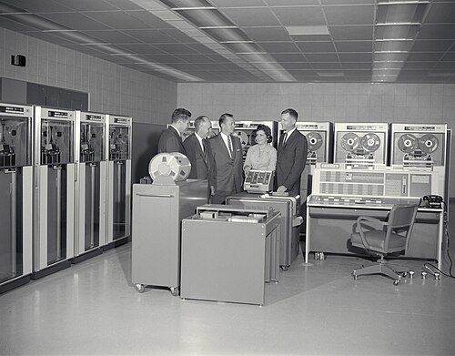

In 1956 two engineers from **[Bell Labs](kloom:e/bell-labs)** went to a piano recital, by one account at Drew University in New Jersey. **[Max Mathews](kloom:e/max-mathews)** was studying how to compress speech for the telephone, and he had built equipment that turned numbers on a computer's tape into sound. His boss, **[John R. Pierce](kloom:e/john-r-pierce)**, played the piano and composed a little himself. The pianist played some Schoenberg, which they liked, and some Schnabel, which they "detested," Mathews remembered half a century later; in the intermission Pierce suggested that a computer could do better, and that Mathews could write the program. That, Mathews said, "was the actual provocation for my writing Music I."

**[MUSIC I](kloom:e/music-n)** ran in 1957 on an **[IBM 704](kloom:e/ibm-704)** in New York City. Its first piece was written by Newman Guttman, a linguist and acoustician at Bell Labs, and heard on or about May 17, 1957. Sources do not agree on its name or length: Mathews recalled "a 17 second composition," and later program notes call it _The Silver Scale_ or _In the Silver Scale_, twenty seconds long. MUSIC I could play one voice with one triangle-shaped wave. "The timbres and notes were not inspiring," Mathews said in 1997, "but the technical breakthrough is still reverberating."

## A tune as a list of numbers

Mathews described the method in the _Bell System Technical Journal_ in May 1961, for its third version, MUSIC III, on IBM's newer **[IBM 7090](kloom:e/ibm-7090)**. The computer wrote "successive digitized samples of the acoustic output" onto magnetic tape, each a four-digit number. A converter turned each number into a pulse of that height, a low-pass filter smoothed the pulses into a continuous wave, and the wave drove a loudspeaker. The converter took 20,000 samples a second, "permitting frequencies up to 10,000 cps to be produced." No one could type 20,000 numbers for each second of a piece, so MUSIC III let a composer build instruments from parts Mathews called _unit generators_, and play them from a score punched on cards:

| Unit generator (1961) | What it does                                                                                          |
| --------------------- | ----------------------------------------------------------------------------------------------------- |
| G1, output            | adds the instrument's sample to the music and hands control back                                      |
| G2, periodic function | reads a stored wave shape over and over: an oscillator, its amplitude and frequency set by its inputs |
| G3 to G5, adders      | add two to four signals                                                                               |
| RAND                  | random noise of a chosen bandwidth                                                                    |

One oscillator fed into another's amplitude gave a note an attack and a decay; a slow oscillator added to a fast one's frequency gave it vibrato. A score card named the instrument, the duration and the pitch, which Mathews's example wrote as octave and semitone: middle C was 3.0, the A above it 3.9. Speed was the price. On the 7090 the simplest instrument needed about 4 seconds of computing for each second of music at the full rate, the vibrato instrument 10, and the cost "may typically come to as much as $100 per minute of music."

## Why twice the highest note

Mathews's footnote for the 10,000-cycle limit was **[Claude Shannon](kloom:e/claude-shannon)**'s paper of 1948 on the mathematics of communication. "If a function of time _f_(_t_) is limited to the band from 0 to _W_ cycles per second," Shannon wrote, "it is completely determined by giving its ordinates at a series of discrete points spaced 1/2*W* seconds apart." That is the **[sampling theorem](kloom:e/nyquist-shannon-sampling-theorem)**: a sound with nothing above _W_ needs 2*W* samples a second, and no more. Anything higher is not lost but disguised. By our arithmetic, a 12,000-cycle tone sampled 20,000 times a second gives exactly the samples of an 8,000-cycle one, so it must be filtered out before the numbers are made. The plate draws a sine wave sampled at equal steps and the converter's stair-step output before the filter smooths it. The theorem has many fathers: Harry Nyquist's papers of 1924 and 1928 never stated it, E. T. Whittaker had the interpolation formula in 1915, and Vladimir Kotelnikov proved it in 1933, but its name stuck to Shannon, who never claimed it as his own.

## The computer sings

Mathews's paper of 1961 already listed "control signals for a speaking machine" among the program's uses. That year at Murray Hill the physicist **[John Kelly](kloom:e/john-larry-kelly-jr)**, better known for the Kelly criterion of betting, and the programmer Carol Lochbaum made a computer sing by calculating a model of the human vocal tract, and Mathews wrote the accompaniment. The song was **["Daisy Bell"](kloom:e/daisy-bell)**, Harry Dacre's music-hall hit of 1892, with its chorus "Daisy, Daisy, give me your answer, do." The record that carried it, _Music from Mathematics_ (1962), says the computer was programmed "not only ... to sing but also to simulate a Honky Tonky type of piano accompaniment." Even here the sources differ: Bell Labs dated it 1962 and put it on an IBM 704; A. Michael Noll's timeline of Bell Labs computer music says 1961 and the 704; Wikipedia says 1961 and the 7090.

**[Arthur C. Clarke](kloom:e/arthur-c-clarke)**, visiting his friend Pierce, heard it, and in the film _2001: A Space Odyssey_ (1968) the computer **[HAL 9000](kloom:e/hal-9000)** sings "Daisy Bell" as an astronaut disconnects it, its voice slowing as its power ebbs. So Bell Labs and the Library of Congress tell it; the recording joined the National Recording Registry in 2009.

## What came after

Mathews's _Science_ article of 1963 reached two young musicians who mattered most, he said: **[Jean-Claude Risset](kloom:e/jean-claude-risset)**, who came to Bell Labs to study why brass sounds like brass, and John Chowning, at Stanford. MUSIC V followed in Fortran, and its descendants, Csound among them, still run. Mathews advised **[IRCAM](kloom:e/ircam)** in Paris from 1974 to 1980 and joined Stanford in 1987. At Stanford, Chowning was about to hear something new in a vibrato: FM synthesis.
