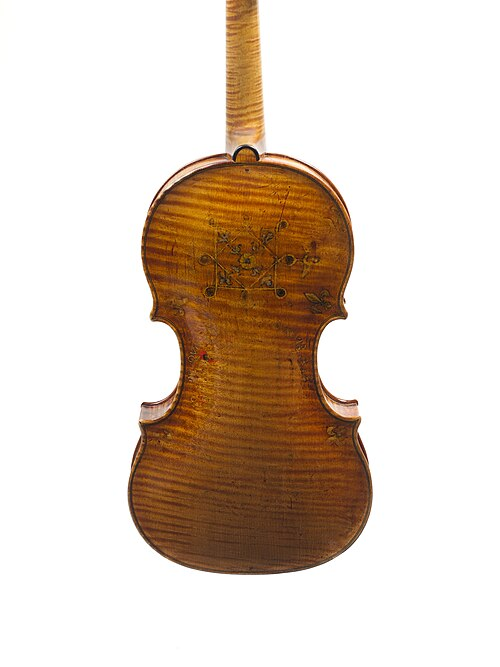
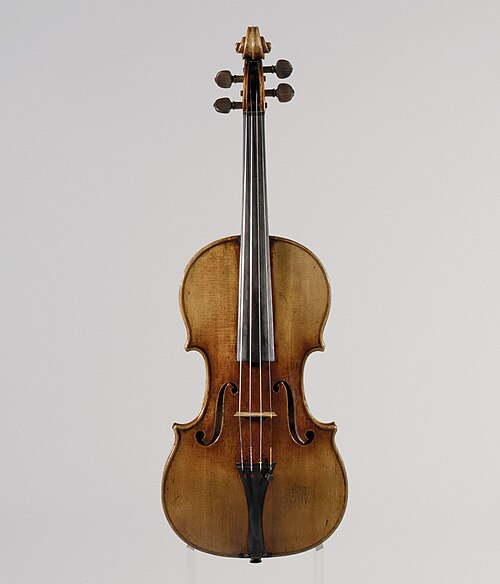

The label inside an instrument of 1666 says, in Latin, that a pupil of Nicola Amati made it that year: _Alumnus Nicolai Amati, faciebat anno 1666_. It is the first trace of its maker, **[Antonio Stradivari](kloom:e/antonio-stradivari)**, at work. **[Cremona](kloom:e/cremona)**, a town on the Po in Lombardy where Monteverdi was born a century earlier, had by then been making violins for more than a hundred years, and its Amati, Guarneri and Stradivari families made the instruments soloists still most want.

## The first violins

Violins with three strings appear in paintings in northern Italy from about 1530. The **[Amati family](kloom:e/amati)** of Cremona made the form last. **[Andrea Amati](kloom:e/andrea-amati)** (c. 1505–1577) built violins, violas and cellos to fixed proportions, on a mold, with four strings, f-shaped sound holes and a scroll. Catherine de' Medici, regent of France, ordered a set painted with the arms and motto of her son, the boy king **[Charles IX](kloom:e/charles-ix-of-france)**; how many and when is told three ways in Wikipedia's own articles: 24 violins ordered in 1560, some 38 instruments made between 1560 and 1574, or a set delivered in 1564. Most were lost in the French Revolution. One, at the Ashmolean Museum in Oxford and dated 1564, is often called the oldest **[violin](kloom:e/violin)** to survive. The **[Metropolitan Museum of Art](kloom:e/metropolitan-museum-of-art)** dates its own Amati, the "Kurtz," to about 1560, and suggests from its decoration that it belonged to a set for the wedding of Philip II of Spain in 1559.

## Seventy parts

A Cremonese violin is built around an inside mold, a board cut to the shape of the body. Blocks of wood are glued at its top, bottom and four corners, and the ribs, strips of maple bent to their curves with heat, are glued round them and stiffened with linings. The garland of ribs is lifted off the mold, and the top and back, each carved to an arch inside and out, are glued to it. The English writer Edward Heron-Allen counted seventy parts in 1885, twenty-four of them the slips of the inlaid border, the purfling.

| Part        | Wood                    | What it does                                                       |
| ----------- | ----------------------- | ------------------------------------------------------------------ |
| Top         | spruce, two halves      | the soundboard, cut with two f-holes                               |
| Back, ribs  | maple, often flamed     | the stiff box that holds the top's edges                           |
| Bass bar    | spruce, glued inside    | runs lengthwise under the bridge's bass foot                       |
| Soundpost   | spruce dowel, not glued | stands between top and back near the treble foot, held by pressure |
| Bridge      | maple                   | carries the strings' vibration into the top                        |
| Fingerboard | ebony                   | the hard surface the fingers press the strings against             |

What a listener hears starts at the bow. The hair drags the string aside until it slips back and is caught again, hundreds of times a second; **[Helmholtz](kloom:e/hermann-von-helmholtz)** showed in the 1860s that the string bends into a sharp corner that races back and forth along it. The strings themselves move almost no air. They rock the bridge, which presses down on the top with about 89 newtons under the tension of all four. The **[soundpost](kloom:e/sound-post)**, beside the treble foot, acts as a pivot, the bass foot drives the top and the bass bar moves with it, and the air inside resonates through the f-holes.

## Stradivari's long career

Whether Stradivari was Nicola Amati's apprentice, as the label says, is doubted: the Met notes that the census never lists him in the Amati household, and his work lacks a small hole that Amati's pupils used in gauging a plate's thickness. He worked for seventy years, later with his sons Francesco and Omobono. Wikipedia's article estimates 1,116 instruments, 960 of them violins, and about 650 surviving; the Met says over 600. From about 1700 came what is called his golden period, to 1720 in the Met's dating and 1725 in Wikipedia's. Around 1680 he paid 7,000 lire for the house he worked in; when he died in 1737 six finished violins were valued at 1,000 lire together. The 1721 "Lady Blunt" sold in 2011 for nearly £10 million. His younger neighbor **[Giuseppe Guarneri](kloom:e/giuseppe-guarneri)** "del Gesù" (1698–1744) could not command such prices; fewer than 200 of his violins survive.

## Can anyone hear it?

In 2010, at a violin competition in Indianapolis, Claudia Fritz and Joseph Curtin had 21 violinists play three new violins against two by Stradivari and one by Guarneri del Gesù, in a hotel room, wearing welders' goggles in dim light. The old violins were worth about $10 million, a hundred times the new. Only 8 of the 21 chose an old violin to take home, the least liked was a **[Stradivarius](kloom:e/stradivarius)** of about 1700, and only 3 of 17 guessed rightly whether their favorite was old or new. In 2014 ten soloists tried six old Italian violins, five by Stradivari, against six new ones near Paris; six of the ten chose a new one, and of 69 guesses about age, 31 were right and 33 wrong. In 2017 listeners in halls in Paris and New York heard the new violins carry better. The tests have limits: few instruments, the new ones chosen by a team that included a maker of new violins, and old ones that could not be adjusted as lent.

Others look in the wood. In 2003 Lloyd Burckle and Henri Grissino-Mayer proposed that the cold of the **[Maunder Minimum](kloom:e/maunder-minimum)**, 1645 to 1715, in the depths of the **[Little Ice Age](kloom:e/little-ice-age)**, grew slow, dense spruce. In 2026 a team led by Mauro Bernabei read 314 sets of rings in 284 Stradivari instruments: the rings average under a millimeter, the trees grew very high in the Alps, in his golden period most likely in the Val di Fiemme in Trentino, and one tree often served several instruments. Hwan-Ching Tai's group found in 2017 that his maple had been treated with minerals.

The models, tools and papers of Stradivari's workshop are in Cremona's **[Museo del Violino](kloom:e/museo-del-violino)**, opened in 2013. Bach's _Well-Tempered Clavier_, and how a keyboard was tuned, come next.
