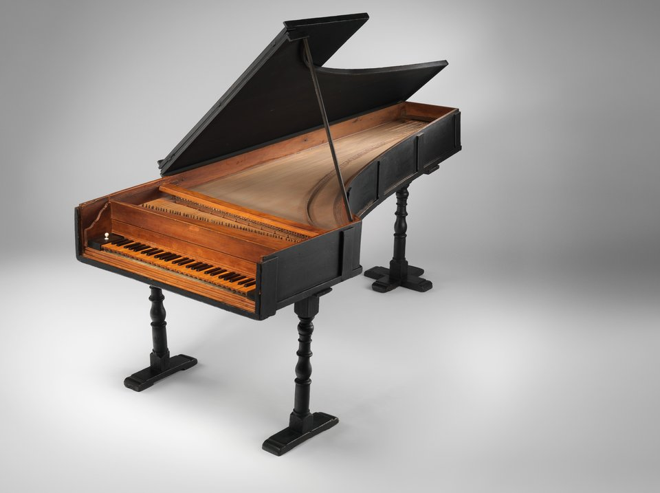

In 1688 **[Ferdinando de' Medici](kloom:e/ferdinando-de-medici-grand-prince-of-tuscany)**, Grand Prince of Tuscany and heir to his father Cosimo III, hired a harpsichord maker from Padua to look after his instruments in **[Florence](kloom:e/florence)**. **[Bartolomeo Cristofori](kloom:e/bartolomeo-cristofori)** was 33, and the prince paid him 12 scudi a month, more than his predecessor had earned. Cristofori tuned, mended and moved the court's **[harpsichords](kloom:e/harpsichord)**, built new kinds of spinet, and worked on an idea of his own. An inventory of the prince's instruments dated 1700 lists the first **[piano](kloom:e/piano)**: "an _Arpicembalo_ by Bartolomeo Cristofori, of new invention, _che fa il piano, e il forte_," that plays soft and loud. Our word for it is what is left of that phrase.

## A keyboard that answers the finger

A harpsichord plucks. Pressing a key lifts a jack, and a quill on the jack catches the string and snaps past it. However hard the player strikes the key, the pluck sounds the same; the only way to be louder is to add strings. The **[House of Medici](kloom:e/house-of-medici)**'s new instrument struck its strings with small hammers instead, and a hammer thrown harder strikes harder.

In 1711 the writer **[Scipione Maffei](kloom:e/francesco-scipione-maffei)**, one of the editors of the _Giornale de' letterati d'Italia_ in Venice, published an account of it, with a folding plate drawn from his notes and a rough sketch. Cristofori had made three so far, "of the usual size of other harpsichords," and Maffei said exactly what was new: "The production of greater or less sound depends on the degree of power with which the player presses on the keys, by regulating which, not only the piano and forte are heard, but also the gradations and diversity of power, as in a violoncello." (He spelled the maker's name Cristofali; the translation here is Edward Rimbault's of 1860.)

The hard part was letting go. A hammer pushed all the way to the string would rest against it and choke the note, and one that bounced would strike again. Maffei describes Cristofori's answer part by part, lettered on his plate:

| Letter | Maffei's name for it                  | What it does                                                          |
| ------ | ------------------------------------- | --------------------------------------------------------------------- |
| C      | _tasto_, the key or first lever       | its far end rises when the player presses it                          |
| E, F   | _seconda leva_ and its pivot          | a second lever, lifted near its pivot by the key's block, D           |
| G      | _linguetta mobile_, the hopper        | a sprung tongue on the second lever that pushes the hammer up         |
| I, L   | a fixed brass wire and a brass spring | hold the hopper upright, then let it slip aside                       |
| N, O   | the hammer's _rotella_ and the hammer | pivoted in a comb, struck close to its pivot, its head leathered      |
| P      | crossed silk threads                  | catch the falling hammer so it cannot strike twice                    |
| Q, R   | the lever's tail and the dampers      | the tail drops as the key goes down, taking the damper off the string |

The hopper is the invention. It pushes the hammer "and strikes firmly; but, having struck the blow, it suddenly becomes loose," so the hammer flies the last distance by itself, touches the string and falls back while the key is still held. The plate redraws Maffei's section with that motion computed. Because the hopper meets the hammer near its pivot, a small movement of the key throws the head a long way. Cristofori later reworked the action: in his surviving pianos the hopper sits in the key itself and lifts an intermediate lever, and a check catches the falling hammer where Maffei's silk threads did.

## Three survivors

Only three of Cristofori's pianos are known today, all from the 1720s, and all signed in Latin as the work of "Bartolomeo Cristofori of Padua, inventor." The **[Metropolitan Museum of Art](kloom:e/metropolitan-museum-of-art)** in New York has the earliest, of 1720. It is the oldest piano known, but it is not the piano Cristofori made: its soundboard was replaced in 1938, its 54 notes were shifted about half an octave, and it was restrung in brass in 1970. The 1722 piano in Rome's Museo nazionale degli strumenti musicali is worm-eaten and silent, and the 1726 piano in Leipzig's university museum cannot be played now either. Both have four octaves and a stop that slides the hammers onto one string of each pair, the ancestor of the soft pedal.

What did it sound like? Maffei admitted that some players found the tone "more soft and less distinct" than the harpsichord's silvery pluck, and too quiet; he answered that the ear soon prefers it, and that it "sounds yet more sweet at some distance." Builders of replicas describe a sound halfway between harpsichord and modern piano, its attacks less sharp than a pluck, its loudness answering the touch.

## A slow start, and a German detour

In 1725 Maffei's article was translated into German, and by 1732 the organ builder **[Gottfried Silbermann](kloom:e/gottfried-silbermann)** of Freiberg was building pianos; his mature ones copy Cristofori's later action closely. According to **[Johann Friedrich Agricola](kloom:e/johann-friedrich-agricola)**, who had studied with **[Johann Sebastian Bach](kloom:e/johann-sebastian-bach)**, Silbermann showed Bach one of his first two. Bach praised its tone, but, in our translation of Agricola's note of 1768, "found fault that it sounded too weak in the treble and was far too hard to play." Silbermann was angry for a long time, then spent years on improvements; a later instrument won Bach's "complete approval," and in 1747 Bach played the Silbermann pianos of **[Frederick the Great](kloom:e/frederick-the-great)** at Potsdam.

Elsewhere the piano spread slowly. It was costly, its sound was quiet, and players had to learn a new touch: Maffei blamed the general want of knowledge "of how, at first, to play it." Its best customer was Portugal: **[John V of Portugal](kloom:e/john-v-of-portugal)** paid 200 louis d'or for Cristofori's instruments, and the first music printed for the piano, **[Lodovico Giustini](kloom:e/lodovico-giustini)**'s twelve sonatas of 1732 "for the harpsichord with soft and loud, commonly called with little hammers," was dedicated to his brother. They ask for sudden contrasts of soft and loud that no harpsichord could make. Cristofori died in 1731, and later in the century Silbermann was thought in France to have invented the piano. The next frame in this trail moves north to Augsburg, where Silbermann's family trained the maker whose pianos Mozart loved.
