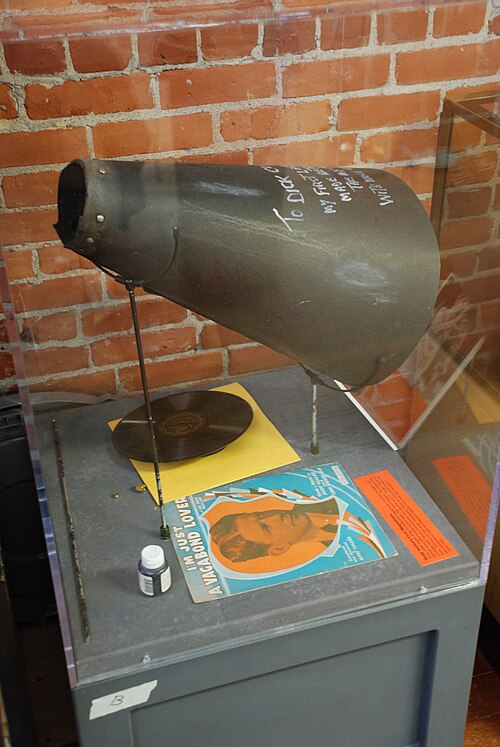
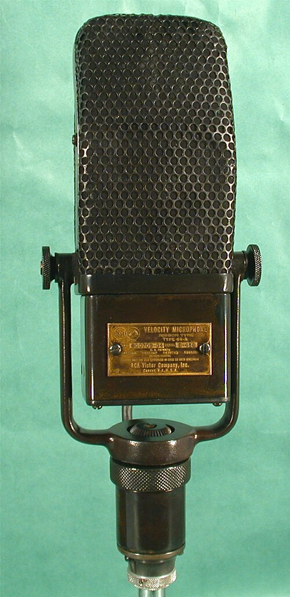

For as long as there had been records, a singer sang into a horn, moving a diaphragm with nothing but breath, and the singers who recorded well were the ones who belted to the back rows of a theater. Electrical recording, from 1925, put a **[microphone](kloom:e/microphone)** and an amplifier between the voice and the wax, and radio put one between a voice and millions of homes. A few singers found that the new machine rewarded the opposite of what they had been taught. Sung quietly from a few inches away, a voice sounded as though it were in the room, singing to one listener. The style was called _crooning_, at first as an insult, and the **[crooner](kloom:e/crooner)** was the first star the microphone made.

## A voice not strong

**[Rudy Vallée](kloom:e/rudy-vallee)** was a saxophonist from Maine with a light tenor. In January 1928 he took a band of eight into the Heigh-Ho Club in New York, and from February the small station WABC broadcast them, Vallée singing the choruses and reading his own announcements. In his memoir of 1930 he was plain about it: "My voice is not strong and is essentially adapted to the microphone where no effort is involved." In big theaters he sang through a megaphone whose flare he had widened himself; on the air he put it down: "when I broadcast, I do not use the megaphone, rather do I sing very softly, and this same soft quality is amplified and brought to you over the air."

His "I'm Just a Vagabond Lover," recorded for Victor in New York on April 1, 1929, is a dance record of its day: Victor's ledger lists two violins, three saxophones, brass, banjo, piano and drums playing a fox trot, with Vallée's tenor singing the refrain. He heard a French nasal color in his own voice, most "on the 'n' and 'm' syllables, especially over the air." Young women mobbed his shows, and the press warned of a "Vallée peril."

## Bing

**[Bing Crosby](kloom:e/bing-crosby)** came up through jazz. **[Paul Whiteman](kloom:e/paul-whiteman)** hired him in 1926 for what became a singing trio, the Rhythm Boys, and Crosby learned to phrase like his bandmate Bix Beiderbecke's horn and to bend notes. His voice was a baritone, and the crooners' fashion moved from tenor to baritone with him. On March 30, 1931, in Los Angeles, he recorded "Out of Nowhere" for Brunswick, a best seller by April; on September 2 his nationwide radio show began on CBS. Where Al Jolson had belted to reach the back seats, Crosby used the microphone's intimacy, in an emotional, often pleading style; the critic Henry Pleasants heard in his conversational ease a new way of "singing in American."

## What the microphone hears

The _condenser_ microphone, which E. C. Wente of Western Electric described in 1917, is a thin stretched diaphragm a hair's breadth from a fixed plate, the two charged as a capacitor; sound pressure moves the diaphragm and changes the voltage. It hears pressure alone, every pitch alike at any distance. The **[ribbon microphone](kloom:e/ribbon-microphone)**, an idea of Walter Schottky and Erwin Gerlach in Germany that **[Harry F. Olson](kloom:e/harry-f-olson)** developed at RCA and described in 1931, hangs a corrugated strip of aluminum loosely between the poles of a magnet. Moving air moves the ribbon, and a conductor moving in a magnetic field has a voltage induced in it, [Michael Faraday](kloom:e/michael-faraday)'s discovery of exactly a hundred years before. Open at front and back, the ribbon answers to the difference in pressure between its two faces, and hears in a figure eight.

That difference is a gift to a crooner. Close to the mouth, the pressure on the ribbon's near face is markedly greater than on its far face, and at low frequencies that difference dominates: the bass rises as the singer leans in, the **[proximity effect](kloom:e/proximity-effect-audio)**. Olson charted it in his textbook of 1940. By our arithmetic from the same formula, a ribbon gives this much more than a condenser at the same spot:

| Distance from the mouth | At 100 Hz | At 200 Hz | At 1,000 Hz |
| ----------------------- | --------: | --------: | ----------: |
| 5 cm                    |   20.8 dB |   14.9 dB |      3.4 dB |
| 15 cm                   |   11.5 dB |    6.3 dB |      0.5 dB |
| 60 cm                   |    2.6 dB |    0.8 dB |      0.0 dB |

Leaning in also makes everything louder: five centimeters is twenty times nearer than a meter, about 26 decibels more. A singer could murmur and still be the loudest thing in the room.

## "Whiners and bleaters"

Not everyone welcomed the intimacy. On January 10, 1932, **[Cardinal O'Connell](kloom:e/william-henry-oconnell)**, the archbishop of Boston, called crooners "whiners and bleaters defiling the air," their singing a "base art" and the songs "ribald and revolting to true men," as _The New York Times_ reported the next day. A music teachers' organization called crooning a "corrupter of youth." The historian Allison McCracken has argued that the attack was about men and women as much as music: the crooners' audience was largely young women, and their critics painted soft-voiced men as effeminate. In wartime Britain, in July 1942, the BBC's new Dance Music Policy Committee banned "slushy" songs and male crooners; in the end it banned more than thirty singers and cautioned nearly sixty, according to the historian Christina Baade.

The style outlasted the sermons. Crosby sold records for four more decades, and his impatience with singing his radio show live, twice a night for two coasts, would later put his money behind magnetic tape. By the end of the century the microphone did more than carry a voice: it could correct one, as Auto-Tune did.
