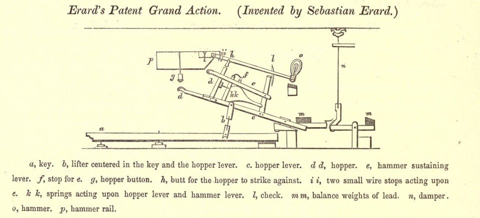
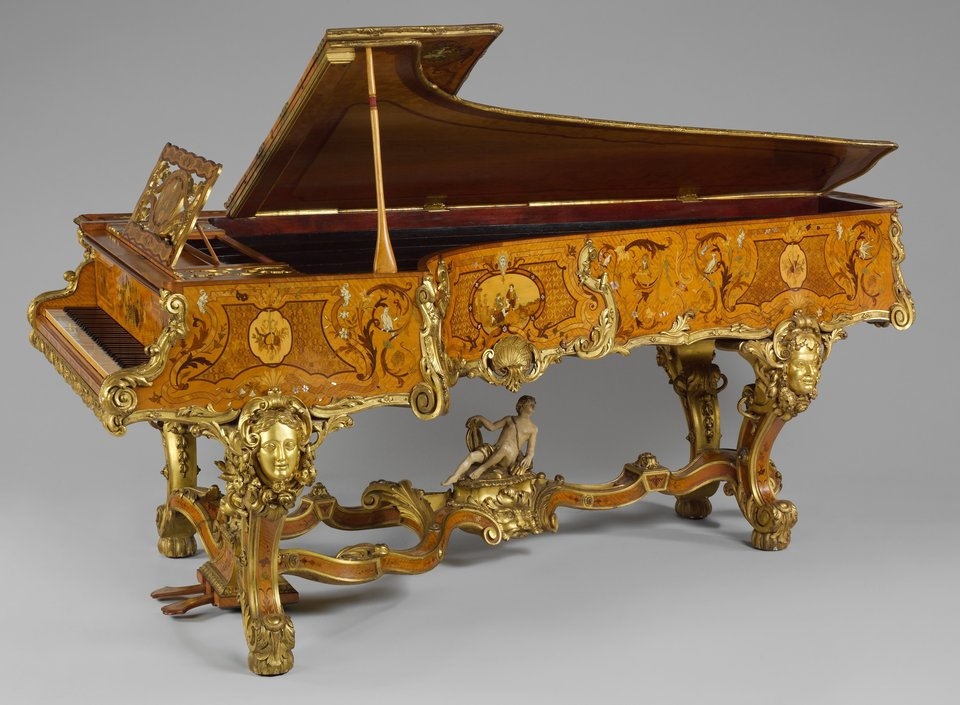

On 22 December 1821 Pierre Érard, a musical instrument maker of Great Marlborough Street in London, was granted an English patent for "certain improvements on piano fortes and other keyed instruments." He had them, the patent said, "in consequence of communications made to him by a certain foreigner residing abroad." The foreigner was his uncle, **[Sébastien Érard](kloom:e/sebastien-erard)** of Paris, then 69, and the improvement was the **[action](kloom:e/action-piano)** that every grand piano has used since: the double escapement, or repetition action.

## Paris and London

Érard was born in Strasbourg in 1752, the son of an upholsterer, and came to Paris at sixteen to work for a harpsichord maker, who dismissed him, as the story goes, for asking too many questions. The Duchesse de Villeroi gave him a workshop in her house, where he built his first piano, in 1777 by most accounts (the 1911 _Britannica_ says 1780). His instruments sold so well that the Paris instrument makers' guild tried to seize his work, and he answered with a warrant from **[Louis XVI](kloom:e/louis-xvi)** to make pianos in Paris. In 1792 he opened a London house; Wikipedia says he went to escape the **[French Revolution](kloom:e/french-revolution)**, his clients at court having put him at risk, while Edward Rimbault, writing in 1860, says he went to open new markets and always meant to return. He did return in 1796, and built Paris's first grand pianos in the English manner.

London made the firm rich on **[harps](kloom:e/harp)**. Érard's double-action harp, patented in 1810, has seven pedals, each able to raise its strings by one semitone or two, so that a harpist can play in any key; it is the pedal harp still played, and he is said to have sold £25,000 worth of them in its first year. The pianos stayed in Paris, where he worked on their action for another dozen years and showed a model grand with the double escapement in 1823.

## A note struck again

The English grand action Érard started from works like Cristofori's: a sprung jack in the key pushes the hammer up and trips just before the blow, and the hammer falls back. But the jack can only slip back under the hammer when the key has risen almost all the way. A note can be repeated only as fast as the key returns, and a quick repeated note or a trill leaves it no time to return. Érard's answer was a second lever, which Rimbault's engraving calls the "hammer sustaining lever" and makers call the repetition lever. Sprung from below, it catches the falling hammer and holds it part of the way up, so the jack can reset beneath it while the key is still down.

In the action of a modern grand, which descends from it, one blow and its repeat go like this; the plate draws three of the states:

| State          | What moves                                                                        | What is heard                               |
| -------------- | --------------------------------------------------------------------------------- | ------------------------------------------- |
| At rest        | the hammer lies on its rail; the jack waits under its knuckle                     | silence, the damper on the string           |
| Key going down | the wippen rises and the jack lifts the hammer; the damper lifts                  | nothing yet                                 |
| Let-off        | the jack's toe meets the let-off button and trips out                             | the hammer flies free and strikes: the note |
| Rebound        | the repetition lever and the back check catch the falling hammer, part way up     | the note sounding on                        |
| Key part-risen | the check lets go, the lever's spring lifts the hammer, the jack slips back under | still sounding                              |
| Key down again | the jack lifts the hammer from where it was held                                  | the note again, before the key ever rose    |

Sigismond Thalberg, writing on the pianos at London's Great Exhibition of 1851, said that the action "gives a more powerful blow than the old grand action, and a far more rapid and delicate effect than the old Vienna action — thus combining the advantages of both systems."

## Liszt, Chopin and the rivals

The prodigy **[Franz Liszt](kloom:e/franz-liszt)** arrived in Paris in 1823, and in Wikipedia's account Érard gave him a grand with the new mechanism; Liszt played Érards for much of his life. Not everyone wanted one. **[Frédéric Chopin](kloom:e/frederic-chopin)** played the pianos of **[Pleyel et Cie](kloom:e/pleyel-et-cie)**, the firm founded by the composer Ignaz Pleyel, and Liszt remembered him improvising at one "which he particularly liked for their slightly veiled, yet silvery sonorousness, and easy touch." Chopin is said to have put the difference this way, in our translation of Édouard Ganche's telling of 1921: "When I am out of sorts, I play on Érard's pianos and easily find a ready-made tone there. But when I feel in good form and strong enough to find my own sound, I use Pleyel's pianos."

Érard died at Passy in 1831. His action was intricate, and the pianist and maker **[Henri Herz](kloom:e/henri-herz)**, who founded his own Paris factory in 1839, simplified it, with the spring that bears his name, into the form in which it spread. Through Herz and the makers after him, the double escapement passed into the grand piano everywhere. The next frame in this trail turns from the action to the frame that had to hold ever heavier strings.
