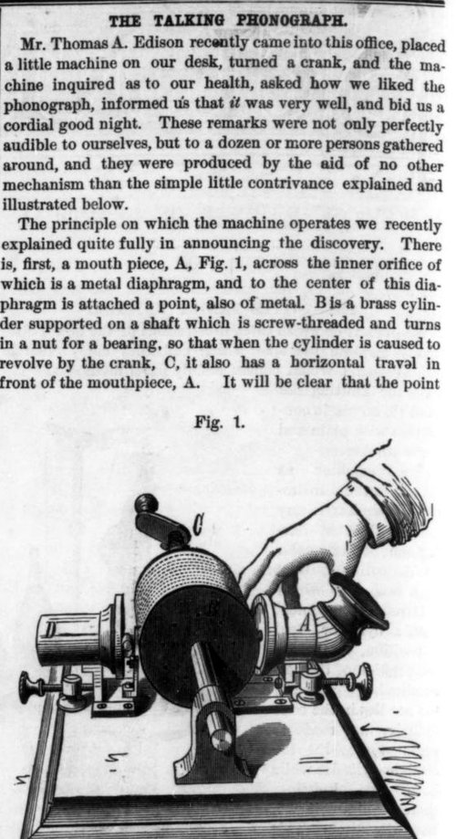

In the summer of 1877 **[Thomas Edison](kloom:e/thomas-edison)**'s laboratory at **[Menlo Park](kloom:e/menlo-park-new-jersey)**, New Jersey, was working on the **[telephone](kloom:e/telephone)** for Western Union, and on a telegraph repeater that embossed messages into paper tape. On 18 July Edison tried the telegraph's trick on a voice: a telephone diaphragm with an embossing point, held against paraffin paper moving fast. The vibrations were "indented nicely," he wrote: "there's no doubt that I shall be able to store up & reproduce automatically at any future time the human voice perfectly." In the story his assistant **[Charles Batchelor](kloom:e/charles-batchelor)** told decades later, the first strip they pulled back under the point said "ary ad elll am": hardly speech, but they cheered.

## Tinfoil on a screw

The machine that made Edison famous was drawn in November and built in the first six days of December 1877 by Edison's machinist **[John Kruesi](kloom:e/john-kruesi)**. A famous drawing inscribed "Kreuzi Make This Edison August 12/77" fixed the invention's date for decades; Paul Israel, who edits Edison's papers, writes that the inscription was added for the fortieth anniversary in 1917. In Edison's own telling, he shouted "Mary had a little lamb" into it and heard it come back: "I was never so taken aback in my life."

On 7 December Edison carried his **[phonograph](kloom:e/phonograph)** into the New York office of **[Scientific American](kloom:e/scientific-american)**. He turned a crank, the magazine reported on 22 December, "and the machine inquired as to our health, asked how we liked the phonograph, informed us that it was very well, and bid us a cordial good night." His patent, applied for on 24 December, was granted on 19 February 1878 as US 200,521. Together, the report and the patent show how it worked:

| Step   | What happens                                                                                                       |
| ------ | ------------------------------------------------------------------------------------------------------------------ |
| Wrap   | A sheet of tinfoil goes round a brass cylinder cut with a spiral groove, ten grooves to the inch                   |
| Speak  | A voice into the mouthpiece shakes a metal diaphragm; the point at its center presses the foil into the groove     |
| Turn   | The crank turns the cylinder; its shaft, threaded ten to the inch, runs in a nut, so each turn moves it one groove |
| Return | The cylinder is wound back to the start                                                                            |
| Play   | A lighter diaphragm, its finer point held to the foil by a spring, rides the dents and sounds them again           |

The point moved in and out of the foil, so the record is a line of hills and dales. "It makes no difference," the magazine explained, "whether a nail moves over a file or a file moves over a nail." Other machines, "the Scott" among them, wrote sound in "peculiar sinuous lines" that still had to be deciphered; even the best of them, a human ear that Clarence Blake of Boston mounted for **[Alexander Graham Bell](kloom:e/alexander-graham-bell)** with a straw to trace speech on a blackened cylinder. Edison, it said, "saves us that trouble by literally making it read itself." In his copy of _On the Sensations of Tone_ by **[Hermann von Helmholtz](kloom:e/hermann-von-helmholtz)**, beside its account of Scott's machine, Edison wrote and later rubbed out "Untrue Record"; no one knows when.

What a tinfoil record sounded like can now be heard. A foil made at a demonstration in St. Louis in June 1878 was scanned in 2012 at [Lawrence Berkeley National Laboratory](kloom:e/lawrence-berkeley-national-laboratory): 78 seconds, a 23-second cornet solo, then a man reciting "Mary Had a Little Lamb" and "Old Mother Hubbard," with laughter between. Foil gave only a few playings before its dents flattened.

## Ten uses, and music

Edison's investors formed the Edison Speaking Phonograph Company on 24 January 1878, paying him $10,000 and a fifth of the profits. In the **[North American Review](kloom:e/north-american-review)** of May–June 1878 he listed its uses. The Library of Congress gives his list as ten uses, with "Reproduction of music" fourth; the article itself takes them under headings, music after letter-writing, dictation, books and education. "The phonograph will undoubtedly be liberally devoted to music," he wrote. "A song sung on the phonograph is reproduced with marvelous accuracy and power." Only quality stood in the way of reproducing the soprano Adelina Patti's voice "in all its purity." But he meant it chiefly for letters and dictation, and he turned to the electric light.

## Wax, and the first records

At Bell's Volta Laboratory in Washington, his cousin Chichester Bell and **[Charles Sumner Tainter](kloom:e/charles-sumner-tainter)** cut the sound into wax rather than pressing it into foil, a cleaner and lasting groove, patented on 4 May 1886 and sold as the **[graphophone](kloom:e/graphophone)**. Edison refused a partnership and answered with wax machines of his own in 1888. The North American Phonograph Company leased both as office dictating machines, and stenographers resisted them. The business that worked was music: in 1889 Louis Glass and William Arnold of the Pacific Phonograph Company put a coin-in-the-slot phonograph in the Palais Royal Saloon in San Francisco, heard through listening tubes, and parlors of them followed.

Each early **[phonograph cylinder](kloom:e/phonograph-cylinder)** was its own performance, recorded on a few machines at once and turning at 120 to 160 revolutions a minute for about two minutes; four-minute cylinders came only in 1908. A phonograph that cost $150 in 1891 cost $20 in 1898, and Edison's Gem $7.50 in 1899. **[George W. Johnson](kloom:e/george-w-johnson-singer)**, born into slavery in Virginia and a street singer in New York, first recorded in 1890 and became the first Black star of records, with "The Laughing Song" and a whistling song, minstrel pieces that mocked Black people for white listeners. He sang them over and over, paid by the session, without royalties. A brown wax cylinder of "The Laughing Song" from 1893 or 1894, now at the University of California, Santa Barbara, opens with a spoken announcement of the song and the singer before he sings, laughing in time with the tune; the library's transfer runs just under two and a half minutes. Once records could be copied from a master, about 1902, the companies needed him less, and he died poor in 1914. The flat disc, pressed from a master, is the next frame, Berliner's gramophone.
