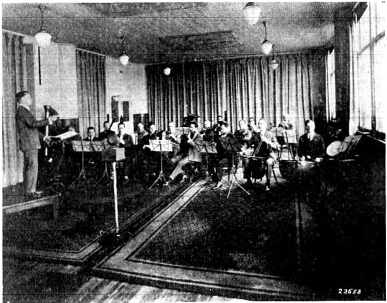

Until 1925 a record was made by the music's own breath. Players and singers stood before a flared metal horn, which gathered their sound onto a thin diaphragm at its narrow end, and a stylus fixed to the diaphragm cut the vibration into a turning disc of wax. A singer stepped back from the horn for a loud or high note, so as not to blast the groove, and leaned in for a soft one, so as not to lose it; such movements, the Library of Congress notes, "could distort the dynamics intended by the composer." The horn caught a band of roughly 100 to 2,500 hertz, and the banjo, the xylophone, the trumpet, the trombone and tenor and baritone voices came through best.

## Crowded round the horn

The photograph shows a Victor session of the acoustic kind. Its account, printed in 1926, says the players are "grouped very closely about the horn," and of the weak-voiced violins only two are ordinary ones. The rest are **[Stroh violins](kloom:e/stroh-violin)**, built with a metal diaphragm and a horn of their own where a violin has its wooden belly, and aimed at the recording horn. A record of the time is thin and pinched: no real bass, little above the voice's middle, a quiet passage lost in the hiss.

How narrow that band was is an estimate. The Library of Congress gives 100 to 2,500 hertz; a history of Canadian recording gives 220 to 3,500, "or worse." Both put it near a telephone's.

## A telephone company's answer

The answer came from the telephone. **[Western Electric](kloom:e/western-electric)**, the Bell System's manufacturing company, whose engineering department became **[Bell Labs](kloom:e/bell-labs)** in 1925, had developed condenser transmitters and vacuum-tube amplifiers for the telephone network. Two of its engineers, Joseph Maxfield and Henry Harrison, applied telephone transmission theory to the phonograph. Their recording system was "a condenser transmitter, a high quality vacuum tube amplifier and an electromagnetic recorder," with a meter showing the power going to the cutter and a loudspeaker on which the engineer heard the record as it was cut. The **[microphone](kloom:e/microphone)** now caught the sound; electricity, not the performers' lungs, drove the stylus.

|                        | Acoustic, to 1925         | Western Electric, 1925                |
| ---------------------- | ------------------------- | ------------------------------------- |
| What gathers the sound | A horn and diaphragm      | A condenser microphone                |
| What drives the cutter | The sound itself          | A vacuum-tube amplifier               |
| The cutter             | A stylus on the diaphragm | An electromagnetic recorder           |
| Band recorded          | About 100–2,500 Hz        | 60–6,000 Hz "with reasonable success" |
| How loudness is set    | By moving the players     | By the amplifier                      |

In their paper of 1926 they wanted 16 to 10,000 hertz, enough for every kind of music, the pipe organ included, and settled for 60 to 6,000, since lower tones would swing the groove into its neighbor and higher ones bend it more sharply than a needle could follow. The ear, they noted, supplies a missing fundamental from its overtones, which is why the old machines had been bearable at all.

## Sold in secret

Western Electric showed its system to the two largest record companies in 1924, and both licensed it. The **[Victor Talking Machine Company](kloom:e/victor-talking-machine-company)** and **[Columbia](kloom:e/columbia-records)** made their first electrical recordings in February 1925; Columbia's first, on 25 February, was by Art Gillham, "the Whispering Pianist." Victor recorded the pianist **[Alfred Cortot](kloom:e/alfred-cortot)** on 21 March, and in April it released the first electrical record put on sale, songs from _Joan of Arkansas_ sung by the Mask and Wig Club of the University of Pennsylvania. The two rivals agreed privately not to advertise the process until November, so as not to make their own catalogs obsolete overnight.

At the Metropolitan Opera House in New York on 31 March 1925, Columbia recorded "Adeste Fideles" by the Associated Glee Clubs of America, 850 men's voices, joined by an audience of 4,000: a crowd no horn could have taken in. _The Gramophone_'s reviewer in September 1925 heard "a kind of hoarseness and some extraneous noise," yet "the gallant 850 Gleemen hold their own quite easily against the 4,000," and the piano "holds its own against the whole gang." A Dundee newspaper that month wrote that "for realism nothing like it has been heard on record."

What counts as first is argued. A record of the burial of the Unknown Warrior at Westminster Abbey in 1920 was made with microphones, and [Orlando Marsh](kloom:e/orlando-r-marsh)'s Autograph Records of Chicago sold electrical discs in 1924; neither had the Western Electric system's quality.

## Hearing it at home

Old phonographs played the new records harshly, so the same engineers designed a player to match. Victor demonstrated the **[Orthophonic Victrola](kloom:e/victor-orthophonic-victrola)**, its long horn folded inside the cabinet, at the Waldorf-Astoria on 6 October 1925, and _The New York Times_ put it on its front page the next day: a range "from 100 to 5,000" cycles, "five and a half octaves." John Philip Sousa told the room, "Gentlemen, that is a band." The cheapest cost $95 and the dearest $300, and after its "Victor Day," 2 November, Victor was "swamped with orders exceeding $20 million," in one history's words.

The change was in the room. The orchestra sat as at a concert, and the microphone heard it, Maxfield and Harrison wrote, "in much the manner that the ears of a listener in the audience would receive it," walls and all. Soft sounds could be recorded, and a singer could sing quietly into a microphone, which made the crooners possible. By 1929 only one budget label still recorded by horn. The groove was still wax, four minutes a side; the next machine kept sound as magnetism on a ribbon of tape.
