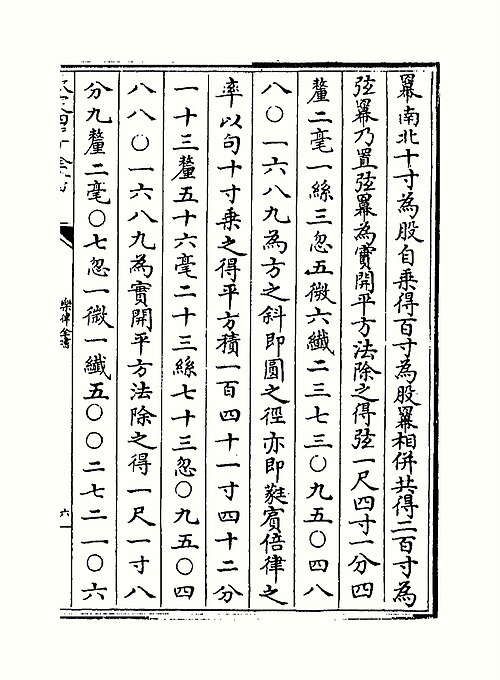

In 1584 a prince of the **[Ming dynasty](kloom:e/ming-dynasty)**, **[Zhu Zaiyu](kloom:e/zhu-zaiyu)**, finished a treatise on the pitch pipes that opened a way out of a problem as old as the Han dynasty. Chinese tuning, like the Greek, built its twelve notes from pure fifths, and twelve fifths never quite come back to the note they started from; Chinese scholars called it "going but not returning." Zhu's answer was to make every step of the scale the same size. Twelve equal semitones fill an octave exactly if each one is the ratio of the twelfth root of 2, about 1.059463, and that number is no ratio of whole numbers at all. So Zhu computed it, to twenty-five digits. The tuning is **[equal temperament](kloom:e/equal-temperament)**, and it is the one most Western instruments use today.

## A prince with an abacus

Zhu was born in 1536 in Henan, the heir of a prince of the imperial house. When he was a boy his father fell foul of the emperor and was stripped of his rank, and by Chen Guanrong's account the son lived alone in a hut outside the palace gate for nineteen years, studying music and the calendar. When his father died in 1591 the title was his, and by Chen's account he petitioned for fifteen years to give it up; Wikipedia has him inherit it in 1593 and pass it to a cousin. In 1606 he presented his works on music to the court.

His method survives on the printed page. To find the note halfway up the octave, he drew a right triangle with two sides of ten _cun_, Chinese inches: the long side squared is 200, and its root, which he wrote out to twenty-five figures, is both the square's diagonal and the ratio of the tritone, the note halfway up the octave: 1.4142135…. The root of that gives the minor third, and a cube root of the minor third gives the semitone: 1.059463094359295264561825. The roots were worked on the **[suanpan](kloom:e/suanpan)**, the Chinese bead abacus. The historian Roger Hart counts nine abacuses for the square root of 200; Chen describes one great frame of eighty-one rods.

The page is from his collected works. Its columns square ten _cun_, add the squares and take the root of 200, the long run of numerals; then multiply by ten and take the root again.

| Semitones up | String length, of the whole | Interval reached |
| ------------ | --------------------------- | ---------------- |
| 0            | 1.000000                    | unison           |
| 1            | 0.943874                    | semitone         |
| 2            | 0.890899                    | whole tone       |
| 3            | 0.840896                    | minor third      |
| 4            | 0.793701                    | major third      |
| 5            | 0.749154                    | fourth           |
| 6            | 0.707107                    | tritone          |
| 7            | 0.667420                    | fifth            |
| 8            | 0.629961                    | minor sixth      |
| 9            | 0.594604                    | major sixth      |
| 10           | 0.561231                    | minor seventh    |
| 11           | 0.529732                    | major seventh    |
| 12           | 0.500000                    | octave           |

Each length is the one before it divided by 1.059463, which only a root can give. The fifth comes out at 0.6674 where a pure one wants 0.6667, too little to hear as more than a slow beat; the major third at 0.7937 where pure is 0.8000, a difference that beats about ten times a second around middle C, by our arithmetic.

Which book first gave the numbers is not settled. Yaya Liu and Alexander Rehding date the discovery to 1584, the year of his first treatise on the pitch pipes, and Wikipedia mentions a new theory of pitch in a work of 1581. Wikipedia's article on equal temperament has the precise figures printed in 1584 in his _Complete Compendium of Music and Pitch_, a collection Chen dates to 1606 and the University of Tokyo's Yuki Tanaka to 1607; Chen places the twenty-five-digit values in the _Lülü jingyi_ of 1594–96. In China it went nowhere: the Qing court's scholars rejected it, and hardly anyone took it up.

## Europe, at the same time

In the Netherlands the engineer **[Simon Stevin](kloom:e/simon-stevin)** worked out the same division in a manuscript on singing, _Vande Spiegheling der Singconst_, about 1605. It was not printed until 1884, and many of his string lengths are off by a unit or two. Here too the date is disputed: Wikipedia's articles offer 1580, 1585 and about 1605, and Yaya Liu 1606. The French friar **[Marin Mersenne](kloom:e/marin-mersenne)** printed equal-tempered string lengths, worked out by others, in his [_Harmonie universelle_](kloom:e/harmonie-universelle) of 1636, and wrote, in our translation, that it was "the most used and the most convenient," since all players agreed that twelve semitones to the octave made their instruments easier to play.

Did the idea travel? The Jesuit Matteo Ricci was in China from 1583, and it has been suggested that he carried Zhu's work west. No document shows it: the music theorist J. Murray Barbour wrote that Zhu's "brilliant solution remains an enigma," and Tanaka finds no evidence that Zhu met a missionary and thinks the two discoveries independent.

## Lutes first, keyboards last

Fretted instruments were nearly there already. A fret runs under every string at once, so it cannot be placed to suit one key on one string and another on the next, and lutes and viols were played in something close to equal semitones from about 1550. **[Vincenzo Galilei](kloom:e/vincenzo-galilei)**, who argued for equal semitones in 1581, fretted the **[lute](kloom:e/lute)** by a rule: each fret an eighteenth of the way along the string left to it, a semitone of 18:17, about 1.0588. The plate sets his frets against equal ones; twelve of them stop the string a little short of half, so the octave needed adjusting.

Keyboards, with their pure meantone thirds, held out for centuries. Equal temperament became the trade practice of English piano makers only around 1846, and of their organ builders in 1854. Between meantone and equal lay a century of compromises, the well temperaments, which the trail reaches next.
