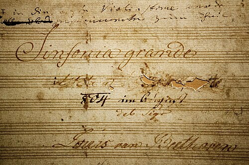

In the spring of 1804 a fair copy of a new symphony in E-flat lay on **[Ludwig van Beethoven](kloom:e/ludwig-van-beethoven)**'s table in **[Vienna](kloom:e/vienna)**. His pupil **[Ferdinand Ries](kloom:e/ferdinand-ries)** remembered its title page: the word "Buonaparte" at the very top, "Luigi van Beethoven" at the very bottom, "but not another word." Beethoven, Ries said, admired **[Napoleon](kloom:e/napoleon)** as First Consul. The work on the table was the **[Symphony No. 3](kloom:e/symphony-no-3-beethoven)**, the _Eroica_, and it was longer, louder and stranger than any symphony an audience had heard.

## Bonaparte, scratched out

On 18 May 1804 Napoleon took the title of Emperor of the French. Ries told the story, in a memoir of 1838, of bringing Beethoven the news, as Thayer's biography translates it:

> He flew into a rage and cried out: "Is then he, too, nothing more than an ordinary human being? Now he, too, will trample on all the rights of man and indulge only his ambition. He will exalt himself above all others, become a tyrant!" Beethoven went to the table, took hold of the title-page by the top, tore it in two and threw it on the floor.

The copy Ries saw is not known to survive, and neither is Beethoven's own score. What does survive, in the archive of the **[Gesellschaft der Musikfreunde](kloom:e/gesellschaft-der-musikfreunde)** in Vienna, is a copyist's score full of Beethoven's corrections, its title page reading "Sinfonia grande", then two words scraped out so hard the paper is holed, then "804 im August". One of the scraped words was "Bonaparte"; in pencil below his name Beethoven wrote "Geschrieben auf Bonaparte", written on Bonaparte. On 26 August 1804, three months after the news, he offered the symphony to the Leipzig publisher Breitkopf & Härtel as a work whose title was "really Bonaparte", in a package of six works for 2,000 florins. The rage may be true; the break was not clean. Money mattered too: the symphony had a buyer in Vienna, Prince **[Joseph Franz von Lobkowitz](kloom:e/joseph-franz-von-lobkowitz)**, who paid for the right to have it played privately. When the parts were printed in Vienna in October 1806 the title was _Sinfonia eroica, composta per festeggiare il sovvenire di un grand Uomo_, "composed to celebrate the memory of a great man", and it was dedicated to Lobkowitz.

## Longer than usual

The first edition carried a warning, and **[George Grove](kloom:e/george-grove)** printed it in 1896: the symphony, "being purposely written at greater length than usual, should be played nearer the beginning than the end of a concert." With its exposition repeated, the first movement alone is nearly as long as a symphony by Haydn or Mozart; in 1929 the Berlin Philharmonic under Hans Pfitzner needed four 78 rpm sides to record it.

| Movement                      | Key     | Form                                       | Typical length |
| ----------------------------- | ------- | ------------------------------------------ | -------------- |
| Allegro con brio              | E-flat  | Sonata form, 690 bars                      | 12–19 minutes  |
| Marcia funebre: Adagio assai  | C minor | A funeral march with a fugue, 247 bars     | 12–18 minutes  |
| Scherzo: Allegro vivace       | E-flat  | Scherzo and trio, the trio for 3 horns     | 5–6 minutes    |
| Finale: Allegro molto, Presto | E-flat  | Variations and fugues on a dance, 475 bars | 9–13 minutes   |

The first movement opens with two hammered E-flat chords from the whole orchestra, and then the cellos, quietly, play the main theme, which in its fifth bar slips onto a C-sharp that does not belong in the key. It is in **[sonata form](kloom:e/sonata-form)**, every part of it swollen. At bars 248 to 279 the development breaks into thirty-two bars of loud chords struck against the beat, and they pile up into a chord in which an E grinds against an F. Then, instead of going home, the oboes play a new tune in the remote key of E minor. Just before the return, the violins hold a quiet tremolo on A-flat and B-flat, and a single horn plays the opening of the theme in E-flat over it, four bars before the orchestra gets there: two harmonies at once. At the first rehearsal Ries, standing beside Beethoven, said the damned horn player had come in wrong, and "narrowly escaped a box on the ear," as Grove tells it. Later conductors and editors "corrected" the passage. The plate draws those bars. The movement ends with a coda of 140 bars in Grove's count, a fifth of the whole.

## First heard in a palace

In October 1802 Beethoven had written at Heiligenstadt the letter to his brothers known as the **[Heiligenstadt Testament](kloom:e/heiligenstadt-testament)**: he was going deaf, and "only art it was that withheld me" from ending his life. The _Eroica_ was sketched soon after.

The first audiences were private. An account of 9 June 1804 shows Lobkowitz hiring 22 extra musicians for two rehearsals, and the prince had it played in his palace and probably on his estates in Bohemia. It was first heard in public at the **[Theater an der Wien](kloom:e/theater-an-der-wien)** on 7 April 1805, announced, oddly, as a symphony "in D-sharp". The reviews were mixed. The _Freymüthige_'s correspondent divided the audience into three parties: friends who called it a masterpiece, enemies who heard only "strange modulations and violent transitions," and a few in between who found its "inordinate length" wearied even connoisseurs. Carl Czerny remembered someone in the gallery calling out, "I'll give another kreutzer if the thing will but stop!"

## A symphony about someone

The _Eroica_ asked to be heard as being about someone, and its funeral march as a death. When Napoleon died in 1821, Beethoven is said to have remarked that he had already written the music for that. Grove thought the symphony as much a portrait of Beethoven as of Bonaparte, and that was the change: from here a symphony could be a personal, heroic statement, and by the Ninth, twenty years later, it was expected to be one. In the concert halls of the next decades, though, the hero on stage was more often the performer.
