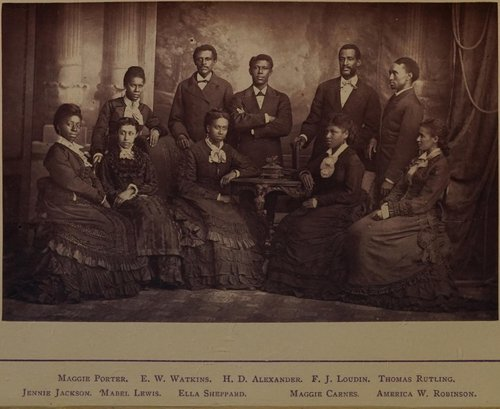

On 6 October 1871 a party of students left **[Nashville](kloom:e/nashville-tennessee)**, Tennessee, for Cincinnati with almost no money, to sing for their school. **[Fisk University](kloom:e/fisk-university)** had opened in January 1866 in the frame barracks of a Union army hospital, founded by the **[American Missionary Association](kloom:e/american-missionary-association)** for people freed from **[slavery in the United States](kloom:e/slavery-in-the-united-states)**, which the **[Thirteenth Amendment](kloom:e/thirteenth-amendment-to-the-united-states-constitution)** had ended only weeks before. Five years on, the barracks were rotting and the treasury nearly empty. Its treasurer, George L. White, a white Union veteran from New York who taught singing, took what money was left, added his own and borrowed more on his own notes. J. B. T. Marsh's history of the singers (1875, revised 1880) names eleven students on the train, among them **[Ella Sheppard](kloom:e/ella-sheppard)**, Maggie Porter, Jennie Jackson, Thomas Rutling, Benjamin Holmes and Isaac Dickerson; later accounts, Du Bois's among them, count nine singers, "four half-clothed black boys and five girl-women." They became the **[Fisk Jubilee Singers](kloom:e/fisk-jubilee-singers)**.

## Songs from the cabins

Of the twenty-four singers the company had by 1880, Marsh wrote, twenty had been enslaved and three of the others were children of enslaved parents. Ella Sheppard's father had bought his own freedom for $1,800, and then bought her, at fifteen months old, for $350; her mother's owner refused to sell her mother. The songs they knew best were the **[spirituals](kloom:e/spirituals)** of the slave quarters. At first, Sheppard recalled in 1911, those songs were never sung in public: "they were sacred to our parents," and the first programs were the music the students had been taught, with Stephen Foster's "Old Folks at Home" among the encores. The tour nearly failed. Hotels in Ohio turned them away for their color, and their first paid concert, at Chillicothe, made under $50, which they gave to the victims of the Chicago fire. At Columbus White named them for the biblical year of jubilee, when slaves went free, and the spirituals became the heart of the program.

They sang for President Grant in March 1872. Henry Ward Beecher, who welcomed them to his Brooklyn church, recommended them to a lecture bureau as singers of plantation hymns "as only they can sing them who know how to keep time to a master's whip," and the press called them "Beecher's Negro minstrels." In 1873, at Argyll Lodge, the Duke of Argyll's house in London, they sang for **[Queen Victoria](kloom:e/queen-victoria)**: "Steal away to Jesus," the Lord's Prayer chanted, and "Go down, Moses."

| Campaign               | Raised          | Source        |
| ---------------------- | --------------- | ------------- |
| First season, 1871–72  | $20,000         | Marsh         |
| Second American season | another $20,000 | Marsh         |
| Britain, 1873–74       | nearly $50,000  | Marsh         |
| Every tour, 1871–78    | $150,000        | Du Bois, 1903 |

## Four parts on the page

In 1872 the musician **[Theodore F. Seward](kloom:e/theodore-frelinghuysen-seward)** took down twenty-four of their songs at "repeated interviews" and printed them as _Jubilee Songs_, sold at concerts for 25 cents. The plate draws the first four bars of "**[Swing Low, Sweet Chariot](kloom:e/swing-low-sweet-chariot)**" as he printed them, in F major in 2/4: the two upper voices sing the call alone, in unison, falling from A to C below, and the four voices answer "coming for to carry me home" in harmony, the bass holding F, the tenor A then C, the alto and soprano climbing to A and C over one F major chord. Seward noticed that none of the songs was in triple time, which he put down to the beating foot, and that more than half used a scale "with the fourth and seventh tones omitted."

Already then, listeners asked whether this was the real thing. People who had heard camp meetings in the South complained, Seward wrote, that it was "too refined," with "too nice a balancing of the parts" to be "a genuine representation of slave-music." He answered that "the singing of these songs is all their own" and that no phrase was printed without the singers' approval. The arrangements were largely Sheppard's own, and the question of how much concert polish a folk song can carry has followed the spirituals ever since.

## The sorrow songs

The tours paid for **[Jubilee Hall](kloom:e/jubilee-hall)**, Fisk's first permanent building, finished in 1876. **[W. E. B. Du Bois](kloom:e/w-e-b-du-bois)**, who studied at Fisk in the 1880s, closed **[_The Souls of Black Folk_](kloom:e/the-souls-of-black-folk)** (1903) with "Of the Sorrow Songs," calling them "the articulate message of the slave to the world." To him Jubilee Hall "seemed ever made of the songs themselves, and its bricks were red with the blood and dust of toil," and it was the Fisk Jubilee Singers, he wrote, who "sang the slave songs so deeply into the world's heart that it can never wholly forget them again."

Who made "Swing Low" is not settled. One account credits **[Wallace Willis](kloom:e/wallace-willis)**, enslaved by a Choctaw planter in the Indian Territory, whose song a school's headmaster taught the singers; John W. Work II said it came from Sheppard's own mother, Sarah. Sheppard's diary notes a "new 'Swing Low'" in the repertory in March 1875, three years after Seward printed one.

Work led the next generation. On 1 December 1909, in Victor's studio at Camden, New Jersey, his Fisk University Jubilee Quartet (Work and James A. Myers, tenors; Alfred G. King and Noah Ryder, basses) recorded "Swing Low, Sweet Chariot" unaccompanied, issued on Victor 16453 in March 1910. In Toni Anderson's description, "the clear, distinct lead voice majestically soars over the rich, soulful harmonic support," winding to a restful close on "comin' for to carry me home." It entered the National Recording Registry in 2002. By then a new kind of sheet music, ragtime, was selling to the same parlor pianos.
