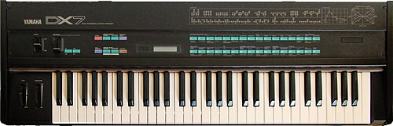

**[John Chowning](kloom:e/john-chowning)** came to **[Stanford University](kloom:e/stanford-university)** as a graduate student in composition after three years in Paris with Nadia Boulanger. He read **[Max Mathews](kloom:e/max-mathews)**'s article of 1963 in _Science_ on the computer as a musical instrument, visited Bell Labs for a day, and in 1964, with Mathews's help, set up a computer music program at Stanford. Through the 1960s he worked on sounds that seemed to move around a room, and moving sounds needed life in them, so he experimented with vibrato: one wave wobbling another's pitch. "I just kept going," he told _Sound on Sound_ in 2015, "until I realised that I was no longer hearing changes in the time domain, but rather I was hearing changes in the frequency domain." A vibrato a few times a second is heard as a wavering note; pushed to hundreds of times a second and made deep, it is heard as a new tone, with a timbre of its own. **[Frequency modulation synthesis](kloom:e/frequency-modulation-synthesis)** was, he said, "altogether a discovery of the ear, not one of mathematics."

When was it found? Chowning dated his first FM work to 1966–67 in a 1985 interview with Tom Darter, and the usual date is 1967; Stanford's licensing office wrote in 1994 that he "came upon the technique while a lecturer in the Music Department in 1971." The two may both be right: by his account, the idea that made FM useful came about 1970, when he remembered **[Jean-Claude Risset](kloom:e/jean-claude-risset)**'s finding at Bell Labs that a trumpet's tone grows brighter as it grows louder. Chowning saw that he could tie the depth of the wobble to the loudness of the note.

## Two sine waves

In his paper of 1973 in the _Journal of the Audio Engineering Society_, Chowning wrote the wave as

_e_ = _A_ sin(_αt_ + _I_ sin _βt_)

where _α_ is the carrier, the pitch being wobbled, _β_ the modulating wave, and _I_, the modulation index, the depth of the wobble divided by the modulator's frequency. With _I_ at zero the result is a plain sine. As _I_ grows, new frequencies appear on both sides of the carrier _c_, spaced by the modulator _m_: at _c_ ± _m_, _c_ ± 2*m* and so on. Their strengths are **[Bessel functions](kloom:e/bessel-function)** of the index, _J_ₙ(_I_), which swell and fade in turn, so that a rising index sweeps energy outward. The sidebands are the wave's Fourier components. Here is Chowning's recipe for a bassoon-like tone, a carrier of 500 Hz and a modulator of 100 Hz at an index of 1.5, with the strengths by our arithmetic:

| _n_ | Below the carrier | Above the carrier | Strength, _J_ₙ(1.5) |
| --- | ----------------- | ----------------- | ------------------- |
| 0   | 500 Hz            | 500 Hz            | 0.512               |
| 1   | 400 Hz            | 600 Hz            | 0.558               |
| 2   | 300 Hz            | 700 Hz            | 0.232               |
| 3   | 200 Hz            | 800 Hz            | 0.061               |
| 4   | 100 Hz            | 900 Hz            | 0.012               |

Every component is a multiple of 100 Hz, so the ear hears one note with 100 Hz as its pitch and the carrier as its fifth harmonic. When _c_ and _m_ are a ratio of whole numbers the spectrum is harmonic; when they are not, it is not. Chowning's bell takes a carrier of 200 Hz and a modulator of 280 Hz, an index of 10 that falls with the loudness, and fifteen seconds: it strikes as a dense, clanging cluster, and as it dies the partials drop away until only a 200-Hz hum is left. His brass tone keeps carrier and modulator equal at 440 Hz and lets the index rise with the attack, so the note brightens as it swells, as Risset had found a trumpet does. Two oscillators did what had taken sixteen or seventeen in Risset's additive synthesis.

## Stanford's patent

Stanford's Office of Technology Licensing offered the idea to American organ makers. Baldwin, Allen and Hammond turned it down, its newsletter recalled in 1994, and Chowning thought their engineers, steeped in analog circuits, "had no idea what I was talking about." Then a **[Yamaha](kloom:e/yamaha-corporation)** engineer, Kazukiyo Ishimura, came up from Los Angeles for a day. "In ten minutes he understood," Chowning said. Yamaha took a trial license first and, in his recollection, the license proper "around 1975." The patent, US 4,018,121, _Method of Synthesizing a Musical Sound_, was filed on May 2, 1975, and granted on April 19, 1977. It expired after seventeen years, on April 19, 1994, having brought Stanford more than $20 million, its licensing office's second-largest earner. (Wikipedia gives 1995 for the expiry; the patent's dates say 1994.) Those royalties helped pay for Stanford's Center for Computer Research in Music and Acoustics, which Chowning founded with four colleagues in 1974–75.

## The DX7

Yamaha's first FM synthesizer, the GS1 of 1980, was filled with chips, about fifty by Chowning's count. Its **[Yamaha DX7](kloom:e/yamaha-dx7)** of 1983 did the work with two of Yamaha's own large-scale chips, and sold for $1,995. It gave each of its sixteen voices six sine-wave "operators," wired in thirty-two arrangements, and its converter ran at about 57 kHz, Chowning thought, brighter than Stanford's own machines. Most owners used its 128 presets, written by Dave Bristow and Gary Leuenberger in under four days. Orders passed 150,000 in its first year, Wikipedia reports, and some 200,000 were sold in three years. The preset "E. PIANO 1," a glassy, bell-edged imitation of the Rhodes electric piano, became the sound of the decade's power ballads, from Whitney Houston to Phil Collins. Mathews judged that the DX7 took the people making digital music from a few hundred worldwide to thousands. The digital sound reached most homes, though, on another disc: the compact disc.
