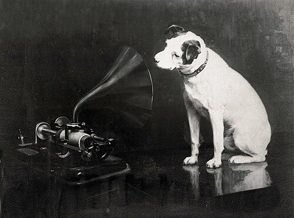

On the evening of 16 May 1888, at the Franklin Institute in Philadelphia, **[Emile Berliner](kloom:e/emile-berliner)** etched a voice into metal while his audience waited. He was a German immigrant from Hanover who had come to Washington in 1870 to clerk in a dry-goods store, and had made his name with a telephone transmitter. His patent of 8 November 1887 named a new machine, the gramophone, which played not a cylinder but a flat **[disc record](kloom:e/phonograph-record)**. "It may be termed, in short," he told the Institute, "the art of etching the human voice."

## Side to side

The **[phonograph](kloom:e/phonograph)** of **[Thomas Edison](kloom:e/thomas-edison)**, and the graphophone of Bell and Tainter, cut a cylinder of wax vertically: the louder the sound, the deeper the stylus dug, and the harder the wax resisted it. Berliner argued that this resistance bent the sound out of shape. "The louder it was necessary to speak when recording," he said, "the less distinct became the articulation." His answer was to trace the vibration "parallel to the record sheet," as the **[phonautograph](kloom:e/phonautograph)** of the 1850s had done in soot. In a gramophone groove the sound is a wiggle from side to side, cut to an even depth. The plate draws one wave cut both ways.

The even groove did a second job. A cylinder machine needed a feed screw to carry its stylus along; on a disc the spiral groove itself pulls the needle, arm and horn from the rim to the center. What came out was loud and scraping. Berliner admitted that hard metal records gave "the scraping sound, which is due to friction," under the voice, and hoped to press them into glass instead.

## Etched, plated, stamped

The disc's real advantage was copying. In the 1890s a cylinder could not be pressed: a singer stood before a few recording horns and sang the same song over and over, each take making a handful of cylinders, until mechanical dubbing and then, in 1902, Edison's Gold Moulded process changed that. Berliner's master was meant from the first to be "accurately multiplied in any number, by the electrotype process."

| Step  | What was done                                                          | Source              |
| ----- | ---------------------------------------------------------------------- | ------------------- |
| Coat  | A polished zinc disc flowed with beeswax dissolved in gasoline         | Berliner, 1888      |
| Trace | A stylus on a diaphragm clears a line through the wax as it turns      | Berliner, 1888      |
| Etch  | Chromic acid eats the line into a groove in 15 to 20 minutes           | Berliner, 1888      |
| Plate | The zinc is electroplated, giving a metal negative with raised ridges  | Library of Congress |
| Stamp | The negative presses copies: celluloid, then hard rubber, then shellac | Library of Congress |

Celluloid wore out under the steel needles. Hard rubber came next, and in 1895 the Duranoid Company, which molded electrical parts, sent back a pressing in a **[shellac](kloom:e/shellac)** compound that was better in every way. Shellac is a resin the female lac insect secretes on trees in India and Thailand, and it was in short supply: **[Leo Baekeland](kloom:e/leo-baekeland)** began his work on phenol and formaldehyde looking for a synthetic replacement for it, the work that led him to Bakelite. Records were pressed in shellac until vinyl took over in the decade after 1948.

Speed was settled late. Berliner's recorder of 1888 turned the disc about thirty times a minute, and his company's discs of 1894 were sold to play at "about 70." The Gramophone Company in London set 78 as its standard in 1912, and by 1925 most of the industry had followed.

## Victor, the dog and the tenor

A licensee sold Berliner's toy gramophones in Germany from about 1890. Berliner founded the United States Gramophone Company in 1894, and opened branches in London and, in 1898, in his home city, where **[Deutsche Grammophon](kloom:e/deutsche-grammophon)** began. In 1900 his American business was shut by an injunction won by his own former sales agent, Frank Seaman, who was selling a rival disc. Berliner passed his patents to **[Eldridge R. Johnson](kloom:e/eldridge-r-johnson)**, the Camden, New Jersey, machinist who built his spring motors, and in 1901 Johnson renamed his company the **[Victor Talking Machine Company](kloom:e/victor-talking-machine-company)**. Victor sold 256,908 records in 1901 and 7,686,709 in 1907.

In 1898 the painter **[Francis Barraud](kloom:e/francis-barraud)** painted his late brother's dog, Nipper, listening to an Edison-Bell cylinder phonograph. Edison-Bell's man in London declined it: "Dogs don't listen to phonographs." In 1899 the Gramophone Company in London bought it for £100, once he had painted a gramophone over the cylinder machine; Berliner registered the picture as an American trademark on 10 July 1900, and Victor put **[His Master's Voice](kloom:e/his-masters-voice)** on its records.

In 1888 Berliner had foreseen that "prominent singers" might "derive an income from royalties." **[Enrico Caruso](kloom:e/enrico-caruso)** made ten records for the Gramophone Company in Milan on 11 April 1902, for a fee of £100, and from 1904 recorded almost only for Victor. His first session in New York, on 1 February, included "**[Vesti la giubba](kloom:e/vesti-la-giubba)**" from _Pagliacci_, with piano: the clown Canio, betrayed, must still paint his face, because "the people pay, and want to laugh" (in our translation), and the aria climbs to "Ridi, Pagliaccio." The Library of Congress's transfer of that side runs about two and a half minutes, by our measure. Caruso recorded the aria in 1902, 1904 and 1907, and which of them first sold a million copies is told differently: Guinness names the 1902 Milan record, Wikipedia's article on the aria all three together, and neither quotes a sales ledger. His royalties from 1902 to 1921 are put at more than two million dollars.

## Discs beat cylinders

The disc needed no box, stood upright on a shelf, and carried its title on a label at the center. Columbia, the graphophone's company, began pressing discs in about 1902. Edison held on, with discs of his own from the 1910s and celluloid cylinders until October 1929, when he left the record business altogether. By then a new rival was in the parlor, and records were losing to it: music on the radio.
