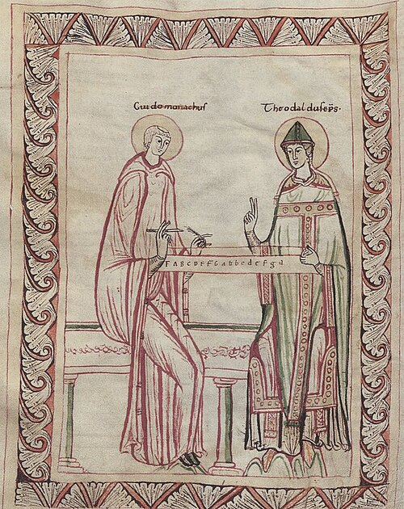
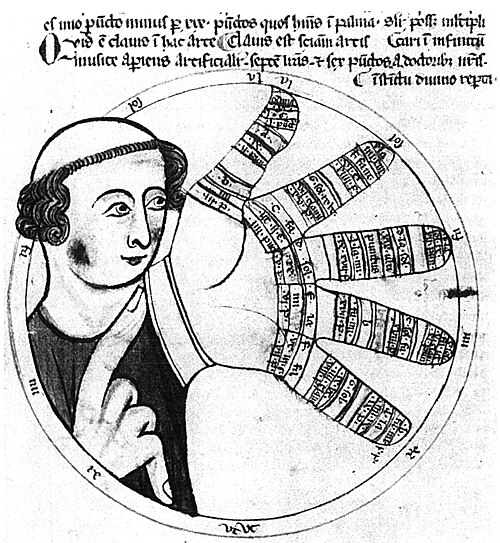

Some time in the late 1020s a monk from Arezzo was called to Rome. **[Pope John XIX](kloom:e/pope-john-xix)**, he wrote afterward to his friend Michael, had heard "how boys learned chants they had never heard" from the antiphoner his school had notated, and sent three messengers to fetch him. The pope turned the pages of that book "like some prodigy," and "did not stop, or rise from the seat where he sat, until he had learned a verse he had never heard" (in our translation, as are all of Guido's words here). The monk was **[Guido of Arezzo](kloom:e/guido-of-arezzo)**, and the book was written on lines.

## A singer's ten years

Guido had trained the singers at **[Pomposa Abbey](kloom:e/pomposa-abbey)**, on the Adriatic near Ferrara, and by his own account his brothers there resented his new method. In about 1025 he moved to Arezzo, where Bishop Tedald put him in charge of the cathedral's singers and asked him for a book. The **[_Micrologus_](kloom:e/micrologus)**, Guido's short treatise on music, is usually dated 1025–26, from a lost manuscript in which he gave his age as 34 under John XIX; Charles Atkinson and Jos Smits van Waesberghe put it a few years later.

The complaint came in the prologue to his antiphoner. "In our times, of all men, singers are the most foolish," it begins; a peasant who can prune one vine can prune them all, but singers, "even if they sing every day for a hundred years, will never sing by themselves, without a master, one antiphon, not even a small one." To Michael he put a number on it: under the old masters, pupils "could scarcely in ten years" gain "an imperfect knowledge of singing," where he made "a perfect singer in the space of a year, or at most two." The books were no better. There were now "as many antiphoners as there are masters," the prologue goes on, so that people spoke of an antiphoner "not of Gregory, but of Leo or Albert"; he blamed those who make the books, and warned that no one should neume an antiphoner who did not know the rules.

## Lines, letters and colors

The neumes showed a melody's shape and not its pitches. Guido kept the neumes and fixed their height. "Lines are drawn close together," the prologue explains, and "some rows of notes fall on the lines themselves, some between the lines, in the middle of the space." Every pitch, however often it returns, lies always in its own row. Two lines carry color: "wherever you see yellow, that is the third letter," C, and "wherever you see red, that is the sixth," F. Without letters or colors, he wrote, the placing of neumes, "however perfect, is quite blind, and worth nothing."

| On the page            | What it tells the singer                    |
| ---------------------- | ------------------------------------------- |
| A line, or a space     | one step of the scale, the same throughout  |
| Lines a third apart    | each step up is a line, then a space        |
| A letter before a line | which note that line is, from the monochord |
| A red line             | F, with its half step below it              |
| A yellow line          | C, with its half step below it              |

Guido did not invent the line itself. Scribes had drawn one or two lines to place their neumes before him, and Italian books of about 1000 set neumes at heights; what he joined was the **[staff](kloom:e/staff-music)**, lines and spaces a third apart, with the letters of the **[monochord](kloom:e/monochord)**, the measured string on which, in the _Micrologus_, every note is found.

## Ut, re, mi

To fix a note in the memory, Guido told Michael, find it "at the head of some well-known melody," and he gave the one "I use in teaching boys, first and last": the hymn **[_Ut queant laxis_](kloom:e/ut-queant-laxis)**, for Saint John the Baptist, its words attributed to **[Paul the Deacon](kloom:e/paul-the-deacon)**. Sung, it climbs a step at each half-line, and the plate draws the six openings: _Ut_ on C, _re_ on D, _mi_ on E, _fa_ on F, _sol_ on G and _la_ on a. Between _mi_ and _fa_ lies the only half step, so the six syllables, the **[hexachord](kloom:e/hexachord)**, carry the scale's one narrow step in their middle, and a singer who knows where _mi_–_fa_ falls can sing an unknown line. That naming of notes by syllables, **[solmization](kloom:e/solmization)**, is ours still, with _ut_ become _do_. Whether Guido wrote the tune or borrowed it is unknown: a variant sets an ode of Horace in an eleventh-century French manuscript. An old claim that the syllables came from Arabic letters has no documents behind it.

## The hand that came later

About 1105–10 the chronicler **[Sigebert of Gembloux](kloom:e/sigebert-of-gembloux)** wrote that by Guido's rule "boys and girls learn unknown chants more easily than by a master's voice," with the six syllables set on six notes, "marked off by the joints of the fingers of the left hand" (in our translation). That is the first tie between Guido and the **[Guidonian hand](kloom:e/guidonian-hand)**, some seventy years after his last letter. His own treatises do not draw it, and the hand appears in its full form only in the twelfth century; Wikipedia's article on Guido says he describes a rudimentary form, its article on the hand that the device only "may have been used" by him. The music historian John Hawkins was blunter in 1776: of the staff and of "the figure of a hand," Guido "does not appear to have made the least claim." Some 140 years after him, the songs of Hildegard of Bingen were written on such lines.
