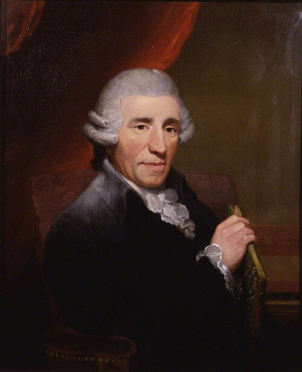

Toward evening one day in December 1790 there was a knock at **[Joseph Haydn](kloom:e/joseph-haydn)**'s door in Vienna. A stranger came in and said, as Haydn's biographer tells it, "Get ready to travel: in a fortnight we are going to [London](kloom:e/london) together." He was **[Johann Peter Salomon](kloom:e/johann-peter-salomon)**, a violinist from Bonn who had made his living in London for a decade by leading orchestras and promoting concerts. He had been in Cologne, on his way home from hiring musicians, when he heard that Haydn's employer, Prince Nikolaus of the **[Esterházy](kloom:e/esterhazy)** family, had died, and he came straight to Vienna. Haydn was fifty-eight, and had never seen the sea.

## Thirty years in livery

For nearly thirty years Haydn had been a servant of the Esterházy princes, the greatest landowners in Hungary: vice-Kapellmeister from 1761, Kapellmeister from 1766, in livery, with his own orchestra at their palaces of Eisenstadt and Eszterháza. He wrote for it what the prince wanted, baryton trios for the prince to play, operas for his theater, and symphonies by the dozen, more than ninety by 1790. "I was cut off from the world," he told his biographer **[Georg August Griesinger](kloom:e/georg-august-griesinger)**; "no one near me could make me doubt myself or torment me, and so I had to become original" (Griesinger's German, here and below, in our translation). From 1779 his contract let him sell his music, and printed copies made him famous where he had never been. When Nikolaus died on 28 September 1790, his heir dismissed most of the musicians and left Haydn a pension and a nominal post. He was free.

## Concerts for anyone with a ticket

Salomon offered what no prince did: an audience that paid at the door. London had sold music to the public for over a century, and Paris had followed:

| Year | Where                                      | What                                                             |
| ---- | ------------------------------------------ | ---------------------------------------------------------------- |
| 1672 | London, John Banister's house, Whitefriars | Concerts every afternoon, a shilling at the door                 |
| 1725 | Paris, the Tuileries                       | The Concert Spirituel, for the holy days when the opera was shut |
| 1775 | London, Hanover Square                     | Subscription concerts in a new hall built for them               |
| 1791 | London, Hanover Square                     | Salomon's series with Haydn                                      |

The violinist **[John Banister](kloom:e/john-banister-composer)** was the first. On 30 December 1672 the _London Gazette_ gave notice of "musick performed by excellent masters" at his house "this present Monday" and "every afternoon for the future." The lawyer and amateur musician Roger North described the room: a raised box for the musicians, "whose modesty required curtaines," seats and little tables round it "alehous fashion," and "one shilling was the price, and call for what you pleased." In Paris the **[Concert Spirituel](kloom:e/concert-spirituel)** began on 18 March 1725. By 1791 London's best room was the **[Hanover Square Rooms](kloom:e/hanover-square-rooms)**, built in 1774 for the subscription concerts of Johann Christian Bach and Carl Friedrich Abel. Its main hall is given as 79 feet by 32, though a diarist of 1776 put it at "115 feet long 40 broad," and it held about five hundred.

## The surprise

Salomon's first concert with Haydn was on 11 March 1791, with Haydn at the keyboard. The historian **[Charles Burney](kloom:e/charles-burney)** wrote that the sight of the composer "so electrified the audience" that all the slow movements were encored, "which never before happened, I believe, in any country." The twelve **[London symphonies](kloom:e/london-symphonies)**, Nos. 93 to 104, were written over two visits for this paying public.

On 23 March 1792 they heard the new **[Symphony No. 94](kloom:e/symphony-no-94-haydn)** in G. Its slow movement, an _andante_ in C major, begins with a tune any child could whistle, played by the strings in short, detached, soft notes: up the chord, C C E E G G E, then down, F F D D B B G. Eight bars, piano. Then the same eight bars again, softer still, the lower strings plucking, and on the second beat of the last bar the whole orchestra, with the kettledrums, strikes a single fortissimo chord. Then the tune goes on, quietly, as if nothing had happened. The plate draws the sixteen bars and their loudness.

Why? Griesinger asked Haydn, years later, whether he had written it "to wake the English who had fallen asleep at his concert." No, said Haydn: he wanted "to surprise the public with something new" and to make a brilliant debut, so as not to be outdone by his former pupil **[Ignaz Pleyel](kloom:e/ignaz-pleyel)**, whom the rival Professional Concert had engaged that season. His other biographer, Albert Christoph Dies, heard a different story: Haydn, offended that the audience slept, "vowed to avenge" his muse, and a young lady fainted during the _andante_. Both wrote from their visits to Haydn in his last years. The Germans still call it the symphony "with the kettledrum stroke."

## A guinea a lesson

London paid. Haydn's pupils paid a guinea a lesson, at which, he said, "I opened my eyes wide." In July 1791 the **[University of Oxford](kloom:e/university-of-oxford)** made him a Doctor of Music; Salomon whispered him his answers, and Griesinger noted that Handel, in thirty years in England, had never been given the honor. At his benefit concert in May 1795 he took 4,000 gulden in a night: "Such a thing is only possible in England." In 1790, Griesinger wrote, Haydn had had barely 2,000 gulden of capital; from England he brought back about 24,000, of which some 9,000 went on the journeys and his keep. On the road to London, at Bonn, the elector had shown Haydn his court musicians; in 1792 one of them, **[Ludwig van Beethoven](kloom:e/ludwig-van-beethoven)**, came to Vienna to study with him.
