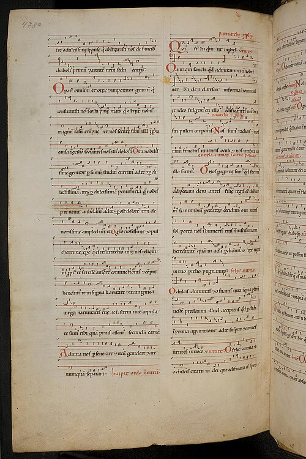

**[Hildegard of Bingen](kloom:e/hildegard-of-bingen)** was born about 1098 into a family of the lower nobility in the Rhineland and given as a child to the religious life. In 1112 she was enclosed with her teacher Jutta at the monastery of Disibodenberg; in 1136 the women there elected her their leader; in 1150 she moved about twenty of them to a new convent of her own at the Rupertsberg, across the Nahe from Bingen. From 1141 she wrote down the visions she had seen since childhood, in **[_Scivias_](kloom:e/scivias)** ("Know the ways"), and **[Pope Eugene III](kloom:e/pope-eugene-iii)** heard parts of it read at the Synod of Trier in 1147–48 and sent his blessing. She wrote on medicine and natural history (her _Physica_ notes that the hop's bitterness keeps drinks from spoiling), nearly four hundred letters and many sermons. When she asked **[Bernard of Clairvaux](kloom:e/bernard-of-clairvaux)** whether to speak of what she saw, the great abbot answered kindly and, in our translation of his words, "more briefly than I would wish". She also wrote songs, and nobody else wrote songs like them.

## A voice that climbs

Hildegard's music is one line, sung by her nuns without harmony; what sets it apart is how far and how long the line goes. Many songs are melismatic, a syllable stretched over a string of notes, and often start low or in the middle of the voice and rise as the words grow in importance. The **[Gregorian chant](kloom:e/gregorian-chant)** she sang every day in the Office usually kept within an octave, the span the theorists of her time gave a mode. Her chants, measured in the singer Karin Weston's table of 2022, average almost twelve steps, an octave and a half; several reach two octaves, _O tu illustrata_ an 18th and _O vos angeli_ a 19th. She was not alone: the monk **[Hermann of Reichenau](kloom:e/hermann-of-reichenau)**, a century earlier, wrote chants spanning a 13th. Few went as far as her widest: a manual for singers of about 1200 reports that some thought one wide chant "irregular because of its excessive ascent," and answers that the ascent is "delightful."

| Range in steps | 8   | 9   | 10  | 11  | 12  | 13  | 14  | 15  | 18  | 19  |
| -------------- | --- | --- | --- | --- | --- | --- | --- | --- | --- | --- |
| Chants         | 2   | 5   | 10  | 20  | 16  | 13  | 5   | 3   | 1   | 1   |

Her play, the **[_Ordo Virtutum_](kloom:e/ordo-virtutum)** (the Order of the Virtues), written about 1151, is a sung drama of 82 melodies in which a troop of Virtues fights the Devil for a human Soul. The Virtues and the Soul sing; the Devil, who cannot make divine harmony, only shouts. The last word, _porrigat_ ("may he stretch out" his hand to you), is drawn out over thirty-nine notes.

## Two books of songs

Counts differ, as editions group the pieces differently: Wikipedia counts 69 songs with music besides the play, the International Society of Hildegard von Bingen Studies 77. They survive in two manuscripts made in her lifetime or just after. The **[Dendermonde Codex](kloom:e/dendermonde-codex)**, of about 1174–75, went to the Cistercian abbey of Villers in Brabant and is now in Belgium. The **[Wiesbaden Codex](kloom:e/wiesbaden-codex)**, the _Riesencodex_ or "giant codex" of about 1180–85 (some date it nearer 1200), weighs 15 kilograms and gathers nearly all her works. Its songs are written in German **[neumes](kloom:e/neume)** on a staff of lines, with the F line drawn in red and the C line in a faint yellow ink.

## "Without being taught by anyone"

Her _Vita_, put together from her own words after her death, has her say, in our translation: "I also brought forth chant with melody in praise of God and the saints, without being taught by any person, and sang it, though I had never learned neumes or any chant at all." Scholars read the claim several ways. She had sung the Office since childhood, and her secretary Volmar may have taught her psalm notation; to call herself unlearned gave her songs the authority of revelation, in an age that gave a woman's voice little. Weston notes that she names neumes at all, which shows she knew what notation was. Whether the songs were sung as written is argued too. Vincent Corrigan, editing them, thought the angel songs' ranges impossible to perform and blamed the scribes; the German edition of Barth, Ritscher and Schmidt-Görg moved part of _O tu illustrata_ down an octave as "sometimes impossible to sing"; yet the ensemble Sequentia, among others, has recorded _O vos angeli_ over its full 19th.

In 1178 or so, the year before she died, the prelates of **[Mainz](kloom:e/mainz)** forbade her nuns to sing the Office, in a dispute over a man buried in their cemetery. She wrote to them, in words we translate, that "the body is the garment of the soul, which has a living voice," and that those who silence a church's songs "without the weight of certain reason" will go without the angels' praises in heaven.

Her songs became widely heard only in our own time. In September 1981 the ensemble **[Gothic Voices](kloom:e/gothic-voices)**, directed by the scholar Christopher Page, with the soprano **[Emma Kirkby](kloom:e/emma-kirkby)**, recorded eight of her sequences and hymns at St Jude-on-the-Hill in north London. Page described songs "conceived on a large—sometimes a massive—scale," ranging "from the most tranquil melody to an almost obsessive declamation at high pitch." Hyperion issued **[_A Feather on the Breath of God_](kloom:e/a-feather-on-the-breath-of-god)** on record in 1982 and on CD in 1985, and the Library of Congress later added it to the National Recording Registry. A generation after Hildegard, at the new cathedral in Paris, singers were laying a second voice, and then a third and fourth, over the chant.
