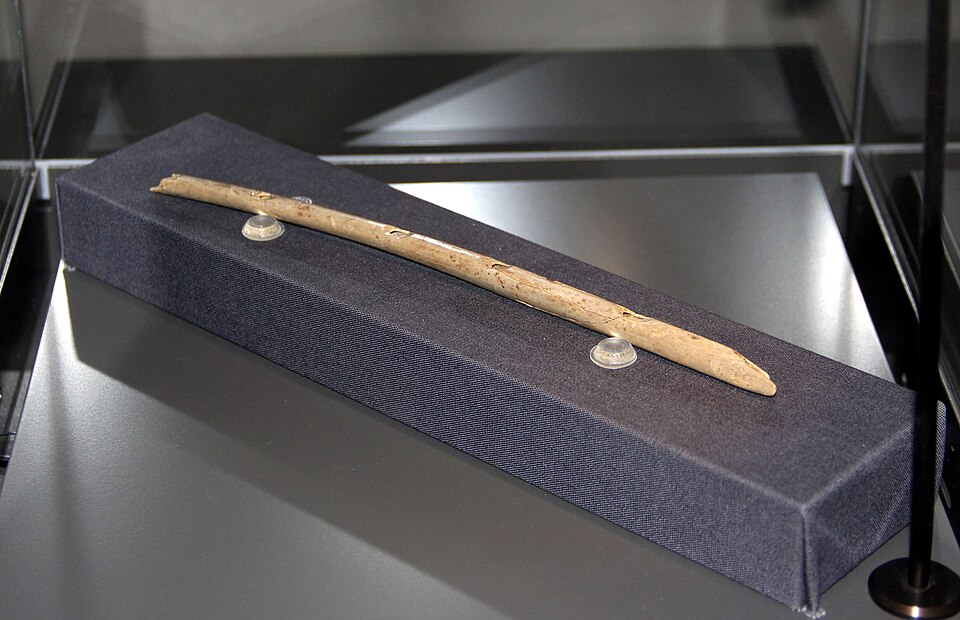

In the autumn of 2008 a team from the **[University of Tübingen](kloom:e/university-of-tubingen)**, led by the archaeologist **[Nicholas Conard](kloom:e/nicholas-conard)**, was digging the Ice Age layers of **[Hohle Fels](kloom:e/hohle-fels)**, a cave in the **[Swabian Jura](kloom:e/swabian-jura)** west of Ulm in southwestern Germany. They found twelve pieces of a thin, hollow bone. Fitted together, they made a tube 21.8 centimeters long and about 8 millimeters across, pierced with five finger holes. It was a flute, and a few feet away lay the carved ivory woman found the same season, the **[Venus of Hohle Fels](kloom:e/venus-of-hohle-fels)**. (Wikipedia's article on the flutes dates the flute's discovery to 2006; the reports of 2009 and the museum give 2008.) In June 2009 Conard, Maria Malina and Susanne Münzel announced both kinds of find in _Nature_: the flutes, they wrote, "demonstrate the presence of a well-established musical tradition at the time when modern humans colonized Europe, more than 35,000 calendar years ago."

## A vulture's wing, worked by hand

The bone is the radius, a long, light bone of the wing, of a **[griffon vulture](kloom:e/eurasian-griffon-vulture)**, a large bird whose skeletons are often found in these caves. Hollow and straight, it needed no boring. Its maker cut two deep, V-shaped notches into the end that was blown, and scratched fine lines around the finger holes: up to four at each. Conard read them as marks made to measure where each hole would go. The other end is broken off, and from the usual length of the bone two or three inches are missing (the reports of 2009 disagree on the rest too: NPR's called it "about a foot long").

The same layers held pieces of flutes made from **[woolly mammoth](kloom:e/woolly-mammoth)** ivory, which is far harder to make into a tube. A tusk had to be carved roughly to shape, split lengthwise, each half hollowed and smoothed, the finger holes cut, and the halves joined again with a seal tight enough to hold air. "Even if you can do all that," Conard told NPR, "then you've got the problem: how do you get the halves together?" An earlier ivory flute with three holes, from the nearby cave of **[Geissenklösterle](kloom:e/geissenklosterle)**, had shown the same work in 2004.

| Find                       | Cave             | Material               | Holes    |
| -------------------------- | ---------------- | ---------------------- | -------- |
| Flute 1 (found 2008)       | Hohle Fels       | Griffon vulture radius | 5        |
| Flutes 2 and 3 (fragments) | Hohle Fels       | Mammoth ivory          | broken   |
| Two bird-bone flutes       | Geissenklösterle | Mute swan wing bones   | 3 on one |
| Ivory flute (found 2004)   | Geissenklösterle | Mammoth ivory          | 3        |

## What did it sound like?

Nobody knows how it was played, which is the honest answer the Museum of Prehistory and Ice Age Art in Blaubeuren gives beside the flute today. The flutist Anne Friederike Potengowski plays a replica held at a slant, blowing across its edge, as a modern flute is played. The experimental archaeologist Jean-Loup Ringot argues that the long notch makes the bone hardly playable that way, and adds a mouthpiece of birch bark or a quill; with a reed it becomes something nearer a clarinet, with a piercing sound, and every one of the five holes speaks. A mouthpiece of bark would not survive forty thousand years, so the bone cannot settle it.

The first copy, made from a vulture bone by a colleague of Conard's, was more of a joke than a test. The first recording Conard heard was, he said, "an absolutely horrendous version of The Star-Spangled Banner." A swan-bone flute from Geissenklösterle, played without a mouthpiece, gives four basic notes and three overtones depending on how hard it is blown.

## The oldest instrument?

How old is it? Radiocarbon dates before about 30,000 years ago are hard to pin down, and samples from the Hohle Fels layer were run by two laboratories, in England and Germany, by different methods; both gave at least 35,000 years, and Conard thought the flutes "must be very close to 40,000 calendar years old." In 2012 Thomas Higham's laboratory at Oxford redated Geissenklösterle with a cleaner method and put its flutes at 42,000 to 43,000 years, which may make them older still. In 2017 the caves became a UNESCO World Heritage Site, **[Caves and Ice Age Art in the Swabian Jura](kloom:e/caves-and-ice-age-art-in-the-swabian-jura)**.

One rival is disputed. The **[Divje Babe flute](kloom:e/divje-babe-flute)**, a cave bear's thighbone with holes in it, found in Slovenia in 1995 and displayed in Ljubljana as a **[Neanderthal](kloom:e/neanderthal)** instrument, would be older still. Its critics argue that the holes were bitten: the paleontologist C. G. Diedrich showed the same round punctures in cub thighbones from a German den, made by hyenas' teeth. The flutes of the Swabian Jura are the oldest instruments no one doubts.

These **[Paleolithic flutes](kloom:e/paleolithic-flute)** tell us that the first people of our kind in Europe made instruments with care and played them in the same caves where they carved animals and people. What they played is lost. More than thirty thousand years later, in the royal tombs of Ur, the instruments themselves are grand enough to bury with a queen.
