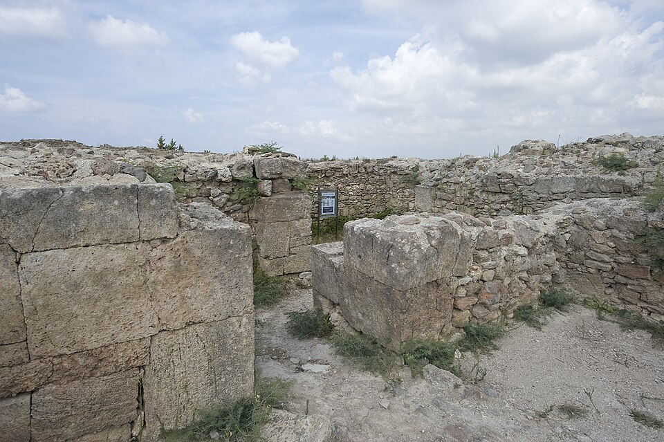

In the 1950s French archaeologists digging the Royal Palace of **[Ugarit](kloom:e/ugarit)**, a port city on the coast of northern Syria at the site called Ras Shamra, found fragments of clay tablets written in **[cuneiform](kloom:e/cuneiform)**. They lay in a layer of the fourteenth century BC, before the city was destroyed in about 1185 BC. The scholar **[Emmanuel Laroche](kloom:e/emmanuel-laroche)** saw that three of them, numbered by the diggers RS 15.30, 15.49 and 17.387, were pieces of one tablet, and that it and about thirty-five others held songs in **[Hurrian](kloom:e/hurrian-language)**, a language of northern Mesopotamia and Syria that is still only partly understood. Under the words of each song were lines of something else: Akkadian terms and numbers. The tablet Laroche numbered h.6, a hymn to the goddess **[Nikkal](kloom:e/nikkal)**, is nearly complete. It is the oldest written music that survives as a whole piece, from about 1400 BC.

## Words above, strings below

The **[Hurrian Hymn no. 6](kloom:e/hurrian-songs)** is laid out in two parts. At the top, above a double line, are the Hurrian words of the hymn, written in a spiral from one face of the tablet to the other, an arrangement unknown in Babylonian texts. Below the line come the musical instructions, interval names each followed by a number, and under a single line a colophon in Akkadian: "This [is] a song [in the] _nitkibli_, a _zaluzi_ … written down by Ammurabi." Five of the fragmentary songs name four composers, all with Hurrian names; this one names only its scribe.

The instructions make sense only because Babylonian tablets of about 1800 BC, centuries older, had already been read. They describe a stringed instrument, the _sammûm_, with nine strings, counted from one up to five and back down: "1st," "2nd," "3rd-thin," "God-Ea-made-it," "5th," then "4th-behind" and so on to "1st-behind." Fourteen pairs of strings within the first seven had names of their own, and several of them named a tuning as well. Here are five of the fourteen, in the regularized Old Babylonian forms and in the Hurrian scribe's spelling:

| Strings | Babylonian name | Meaning                 | On h.6    |
| ------- | --------------- | ----------------------- | --------- |
| 5–2     | _qablītum_      | middle                  | _qáblite_ |
| 2–7     | _rebûttum_      | fourth                  | _irbute_  |
| 7–5     | _šērum_         | tune, song              | _šaḫri_   |
| 2–6     | _išartum_       | straight, in good order | _išarte_  |
| 4–6     | _zerdum_        | loosening               | _zirte_   |

So the first line of the notation reads: _qáblite_ 3, _irbute_ 1, _qáblite_ 3, _šaḫri_ 1, _išarte_ 10, and then two words, _ušta mari_, which are neither interval nor number.

## Five songs from one tablet

The script is not in doubt; what it asks the player to do is. **[Anne Draffkorn Kilmer](kloom:e/anne-draffkorn-kilmer)**, an Assyriologist at the **[University of California, Berkeley](kloom:e/university-of-california-berkeley)**, worked with the musicologist Marcelle Duchesne-Guillemin through the early 1970s, and in 1974 the hymn had its first modern performance. On Kilmer's record _Sounds from Silence_ (1976) the musicologist Richard Crocker sings it to a lyre that Robert Brown built to ancient measurements. The first attempts, it was found later, had read the scale upside down.

Do the numbers count repetitions of an interval, or something else? Is each named pair two notes struck together, or the bounds of a run of notes? Does the music fit the words at all? Duchesne-Guillemin, Kilmer, David Wulstan, Raoul Vitale, Richard Dumbrill and the classicist **[Martin West](kloom:e/martin-litchfield-west)** each answered differently. West counted at least five "rival decipherments of the notation, each yielding entirely different results." In 2025 Dylan Gibson proposed writing the hymn as a tablature of string numbers, rather than in modern staff notation, so as to claim no more than the tablet says.

## Was it our scale?

Since Wulstan's study of 1968, Assyriologists have agreed that the tuning texts describe a diatonic scale, seven notes of the kind a piano's white keys play. Sam Mirelman warned in 2013 that the reading "seems uncomfortably familiar and Eurocentric," built from later Greek theory. In 2022 the music theorist Jay Rahn answered by starting only from what the Babylonian texts say, how the strings are ordered and which pairs were tightened or loosened in turn, and from how plucked pairs sound to any ear; he concluded that the tuning can be read as diatonic without borrowing Greek ideas of octaves and consonance at all.

The tablet is in the National Museum in Damascus. Its words can be read and its tuning roughly heard, but its tune is still argued over. The Greeks would soon try to explain why some intervals sound sweet at all, starting with the ratios credited to Pythagoras.
