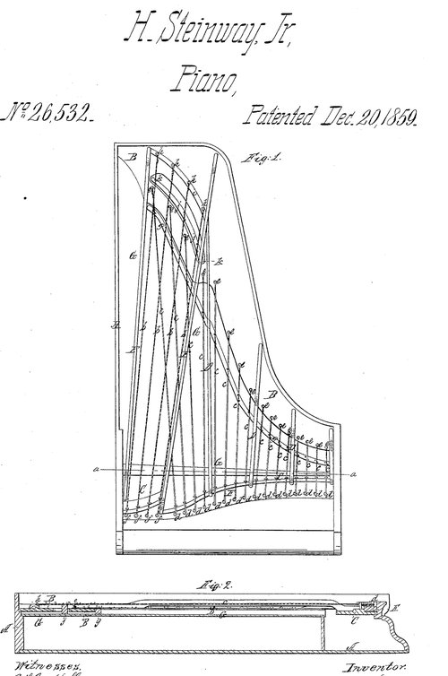

In 1808 the Vienna makers Wachtl & Bleyer reckoned that the strings of their grand pianos pulled on the case with a force of 9,000 pounds. The acoustician Harold Conklin put a modern concert grand's pull at about 210,000 newtons, some 47,000 pounds, or 21 tonnes. Between the two lies the nineteenth century's demand for a louder **[piano](kloom:e/piano)**: thicker strings, stretched harder, over a longer keyboard, for bigger halls. Wood alone could not hold the pull. The American commissioner Paran Stevens, reporting to Congress on the Paris exhibition of 1867, remembered the pianos imported from Europe early in the century arriving "like invalid immigrants to a hospital—bruised, disordered, and suffering," built for European weather and "not, even when put in order, sufficiently strong to long endure unimpaired the sudden and trying changes of our variable climate."

## One piece of iron

The answer was cast in Boston. On December 17, 1825, **[Alpheus Babcock](kloom:e/alpheus-babcock)** patented a cast-iron ring for a square piano, which in the words of a Steinway history of 1876 first joined "the iron hitch-pin plate, together with that portion which supported the wrest-plank in one piece": the end where the strings are hooked and the end where they are tuned were tied together in metal. (That history and the jury reporter of 1867 call Babcock a Philadelphia maker; he moved there only in 1830.) The first iron-framed pianos did not sound well. The Belgian critic **[François-Joseph Fétis](kloom:e/francois-joseph-fetis)** wrote that Babcock's were "strung with strings too thin and not in equilibrium with the metallic frame," so "their tone was thin and had a metallic sound." The iron paid only when the strings grew to match it.

Jonas Chickering of Boston, whose firm became **[Chickering & Sons](kloom:e/chickering-and-sons)**, hired Babcock in 1837, patented an iron frame for squares in 1840, and in 1843 a full iron frame for grands, cast in one piece (patent 3,238). Chickering used heavier strings on it, and, Fétis wrote, "the sonority of which was found to be better."

## The strings cross

**[Henry E. Steinway](kloom:e/henry-e-steinway)**, born Heinrich Engelhard Steinweg, reached **[New York City](kloom:e/new-york-city)** from Brunswick in 1850 with five of his sons, and in March 1853 they founded **[Steinway & Sons](kloom:e/steinway-and-sons)**. In 1855 the firm showed a square piano with a full iron frame and its bass strings crossing over the others, and won the gold medal at the American Institute's fair. On December 20, 1859, the founder's son Henry Steinway Jr. took out patent 26,532 for doing the same in a grand. "Though some attempts may have been made in that direction," he wrote, "I have after much research failed to find that an overstrung grand piano has, prior to the date of my present invention, ever been constructed."

The plate draws the idea. The treble strings run straight back from the keyboard. The middle strings fan out toward the long straight side, and the wound bass strings, raised in a second tier, cross over them toward a bridge near the middle of the soundboard, where the board is freest to move. The fan spreads the strings apart and lengthens them in the same case. Crossing strings was not new: Erard and Jean-Henri Pape had tried it in Paris and given it up.

## Two verdicts in Paris

At the **[Exposition Universelle](kloom:e/exposition-universelle-1867)** of 1867 the jury on musical instruments awarded four gold medals, and two went to Americans, Steinway and Chickering. Fétis heard the difference. Chickering's grands "strike with astonishment," but close by "the impression of the blow of the hammer ... produces a nervous sensation by its frequent repetition." Steinway's he called "brilliant in the treble, singing in the middle, and formidable in the bass," with "the blow of the hammer ... heard much less." Stevens, writing the American report, dissented: in every overstrung grand at the exhibition, "the crossing of the bass strings ... makes the bass too powerful and preponderant," and parallel strings, he wrote, were better wherever there was room. Pianists still argue it. The pianist Gwendolyn Mok hears a straight-strung piano keep bass, tenor and treble distinct, like the parts of a choir, where an overstrung one blends them.

| Source                | Piano                       | Total pull of the strings             |
| --------------------- | --------------------------- | ------------------------------------- |
| Wachtl & Bleyer, 1808 | their grand                 | 9,000 pounds                          |
| Stodart's grand, 1820 | Allen and Thom's bracing    | 13,000 pounds                         |
| Stevens, 1870         | "a first-class grand"       | more than 240,000 pounds              |
| Dolge, 1911           | modern grand; concert grand | 35,000–40,000; about 60,000 pounds    |
| Conklin, 1990         | modern concert grand        | about 210,000 newtons (47,000 pounds) |

Stevens's figure is about five times Conklin's, by our arithmetic, and no other source comes near it. The pull squeezes the plate end to end, and gray cast iron is at its strongest in compression.

## A factory and a parlor

By the 1860s Steinway filled a block on Park Avenue with 350 workers and made nearly 1,800 pianos a year. In the 1870s William Steinway moved the works to **[Astoria](kloom:e/astoria-queens)**, in Queens, and built a company village around a factory with its own foundry and sawmill, workers' houses, a library and a kindergarten. Steinway Hall on 14th Street, which cost $200,000, was entered through the showrooms. In 1872–73 the firm sent **[Anton Rubinstein](kloom:e/anton-rubinstein)** on an American tour of 215 concerts in 239 days on its pianos, the start of its roster of "Steinway Artists," some 2,000 by 2018, who must play Steinway wherever one is available. The musicologist Stuart de Ocampo warns that the firm "aggressively sought out and paid (in various forms)" for such endorsements.

The iron frame made the cheap piano possible too. Alfred Dolge counted 25,000 pianos made in the United States in 1869 and 350,000 in 1910. The census of 1909 counted 321,000 ordinary uprights made that year, the parlor's piano. Soon many of those uprights would play themselves: the player piano.
