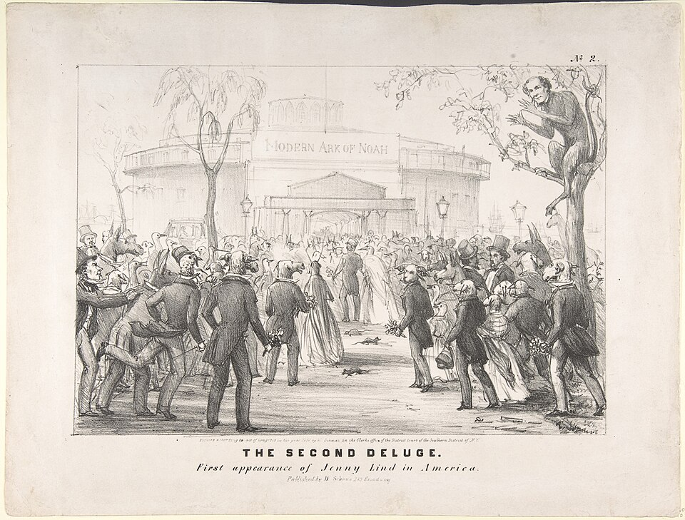

A little before noon on Sunday, 1 September 1850, the steamship _Atlantic_ came into New York harbor from Liverpool, and the showman **[P. T. Barnum](kloom:e/p-t-barnum)** climbed aboard from the health officer's boat to shake the hand of **[Jenny Lind](kloom:e/jenny-lind)**. She asked him when and where he had heard her sing. "I never had the pleasure of seeing you before in my life," he told her, in his own telling of 1869. He had risked $187,500 on her reputation. Thousands waited on the piers, under two arches Barnum did not quite admit to building, and by his count twenty thousand people stood outside her hotel on Broadway that evening.

## The Swedish Nightingale

Lind was born in Stockholm in 1820, trained at the theater school there from the age of nine, and became famous at the **[Royal Swedish Opera](kloom:e/royal-swedish-opera)** as Agathe in _Der Freischütz_ in 1838. Within three years she had sung her voice ragged. In Paris in 1841 she asked **[Manuel García](kloom:e/manuel-garcia-baritone)** to teach her; she broke down in the scene from _Lucia_ he asked for, and he told her, "_Vous n'avez plus de voix_": you have no voice left. He had her rest it, then rebuilt it. His biographer gives the lessons as ten months; Wikipedia, as 1841 to 1843. Her London debut, on 4 May 1847 at **[Her Majesty's Theatre](kloom:e/his-majestys-theatre-london)** with **[Queen Victoria](kloom:e/queen-victoria)** in the house, made her the most talked-about singer in Europe. In 1849, not yet thirty, she gave up opera for the concert hall.

## What Barnum bought

Barnum, who called himself unmusical, sent an agent to her with an offer, and on 9 January 1850 she signed: 150 concerts, "in no case to appear in operas," at $1,000 a night with all expenses, £5,000 (about $25,000) for her conductor **[Julius Benedict](kloom:e/julius-benedict)** and £2,500 for the baritone Giovanni Belletti, the whole sum secured in advance with her London bankers. Barnum mortgaged his property and borrowed the last $5,000 from a minister. The day the news broke, he wrote, a railroad conductor asked him, "Jenny Lind! Is she a dancer?"

So he spent six months selling her character before her voice: her charities, her piety, her modesty. He offered $200 for a "Greeting to America" for her to sing, and the poet Bayard Taylor won it. Tickets for the first concert were sold at auction, and the hatter John N. Genin paid $225 for the first. After she landed Barnum rewrote the contract: $1,000 a night and half of whatever each concert made above $5,500. In his account the change was his own generous idea; in others she asked for it once she saw what he stood to make.

## Castle Garden

The first concert was on 11 September at **[Castle Clinton](kloom:e/castle-clinton)**, then the concert hall called Castle Garden, an old round fort off the Battery in **[New York City](kloom:e/new-york-city)**. The **[New-York Tribune](kloom:e/new-york-tribune)** counted an audience of "near seven thousand," while two hundred boats of jeering boys circled the walls with drums and fifes. After an overture and an aria from Belletti, Lind came forward in white and sang "Casta diva" from _Norma_. "We never heard tones which in their sweetness went so far," the reviewer wrote; "they brought the most distant and ill-seated auditor close to her." She sang Meyerbeer's trio for voice and two flutes, written for her, a showpiece one report said "bordered on ventriloquism," a Swedish herdsman's song known as the Echo Song, and Taylor's ode. Then Barnum came out and announced that her share of the night, more than $10,000, would go to the charities of the city.

## Lind fever

New York had Jenny Lind gloves, bonnets, shawls, chairs, sofas and pianos. The company went on through the East and down the coast to Charleston and to **[Havana](kloom:e/havana)**, where the first audience hissed her entrance, two and a half thousand against a few hundred clapping, until she won it over. In **[New Orleans](kloom:e/new-orleans)** she gave twelve concerts. Abolitionists asked her to speak against slavery; she would not, and an English abolitionist who met her in 1851 thought her contemptuous of Black Americans, though in 1852 she gave Harriet Beecher Stowe $100 to buy an enslaved family's freedom. Tired of Barnum's selling, she used a clause in her contract and left him in Philadelphia on 9 June 1851, on good terms, after ninety-three concerts and two for charity.

The money depends on whose account is read. Barnum's statement of 1869 gives receipts of $712,161.34 from ninety-five concerts, $208,675.09 paid to Lind, and $176,675.09 to her after she paid him $32,000 for leaving early, against $535,486.25 kept by Barnum before his costs. Wikipedia gives her about $350,000 for ninety-three concerts. She gave most of hers to charity, chiefly free schools in Sweden. She toured on alone until May 1852, married her new accompanist, Otto Goldschmidt, in Boston that February, and never came back.

| City         | Concerts | Receipts    | Average a concert |
| ------------ | -------- | ----------- | ----------------- |
| New York     | 35       | $286,216.64 | $8,177.50         |
| New Orleans  | 12       | $87,646.12  | $7,303.84         |
| Boston       | 7        | $70,388.16  | $10,055.45        |
| Philadelphia | 8        | $48,884.41  | $6,110.55         |
| Cincinnati   | 5        | $44,242.13  | $8,848.43         |
| Baltimore    | 4        | $32,101.88  | $8,000.47         |
| St. Louis    | 5        | $30,613.67  | $6,122.73         |
| Havana       | 3        | $10,436.04  | $3,478.68         |

Barnum had made a singer famous to people who had never heard her, by newspaper, auction and merchandise, before she sang a note in America. The trail turns back to her teacher, and to what García saw when he looked down his own throat.
