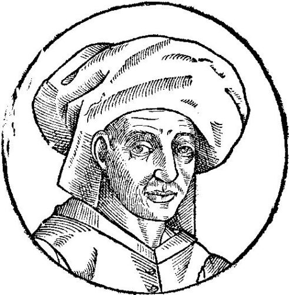

In 1502 **[Ottaviano Petrucci](kloom:e/ottaviano-petrucci)**, the Venetian printer of part-music, did something new: he gave a whole book of masses to a single composer and put his name in the title, _Misse Josquin_. The same year his first book of motets opened with the same man's **[_Ave Maria … virgo serena_](kloom:e/ave-maria-virgo-serena)**. **[Josquin des Prez](kloom:e/josquin-des-prez)** was then about fifty. Before 1502, by Marilee Mouser's count, only eight of his motets survive, in seven manuscripts. After it his music went wherever Petrucci's books were sold, and Josquin was the only composer whose masses Petrucci printed in a second and a third volume.

## A singer's career, rewritten

Josquin was born about 1450 in French-speaking Flanders. Documents of 1483 from Condé give his full name, Josquin Lebloitte dit des Prez. He was a singer for René of Anjou at Aix by 1477, and in **[Milan](kloom:e/milan)** by May 1484, where he entered the household of **[Ascanio Sforza](kloom:e/ascanio-sforza)**, a cardinal of the city's ruling family. From June 1489 to at least April 1494 he sang in the pope's choir in Rome; restorers cleaning the singers' gallery of the **[Sistine Chapel](kloom:e/sistine-chapel)** in 1997–98 found the name JOSQUINJ scratched into its wall, perhaps by him. He probably served King Louis XII of France, and in 1503 went to **[Ferrara](kloom:e/ferrara)**, where its duke, **[Ercole I d'Este](kloom:e/ercole-i-deste)**, had been told by one courtier that Josquin "composes better" than **[Heinrich Isaac](kloom:e/heinrich-isaac)**, "but he composes when he wants to and not when one wants him to, and he is asking 200 ducats in salary while Isaac will come for 120." Ercole paid the 200, the highest salary his chapel ever gave. Plague drove the court out within a year, and Josquin spent his last seventeen years as provost of the collegiate church at **[Condé-sur-l'Escaut](kloom:e/conde-sur-lescaut)**, where he died on 27 August 1521.

Much of that was learned late. Older books had him born about 1440 and in Milan years before he arrived, because they took another singer there, recorded as Judocus de Picardia, for him. Archival work of the 1990s, Lora Matthews and Paul Merkley's study of the singers' names in Milan among it, separated the two men, and with them the dates.

## Voices in turn

Josquin's music was admired for the way its voices took turns. In the _Ave Maria_, the soprano sings "Ave Maria" alone: a rising fourth from G to C, then up a step at a time to E and back to C. Two bars later the altos sing the same tune an octave lower, while the soprano goes on; then the tenors, at the altos' pitch; then the basses, an octave below them. Until the soprano returns with "gratia plena", only two voices ever sound at once, so each entry is heard plainly. This is **[imitation](kloom:e/imitation-music)**, and the next three lines of the hymn follow the same plan, near enough, each a chain of four entries.

| Voice   | Enters at bar | First note       | Then                            |
| ------- | ------------- | ---------------- | ------------------------------- |
| Soprano | 1             | G above middle C | C, C, D, E, C: "Ave Maria"      |
| Alto    | 3             | G below middle C | the same, an octave lower       |
| Tenor   | 5             | G below middle C | the same, at the alto's pitch   |
| Bass    | 7             | the G below that | the same, an octave lower again |

The bars are breves, as the New Josquin Edition bars them; the plate draws these four lines entering one after another. Then the texture changes, verse by verse. At "Ave cujus conceptio" the soprano and alto sing a duet, and four bars later the tenor and bass answer it. At "Solemni plena gaudio" all four move together in chords. At "Ave vera virginitas" the meter turns from two beats to three. The motet ends in plain chords, on a prayer in the singular: "O Mater Dei, memento mei. Amen" ("O Mother of God, remember me"). The notes on a 1965 record by the Primavera Singers call it "set in a bright C major." When it was written is disputed: Joshua Rifkin dates it to Josquin's Milan years, about 1485; it was once thought to be in a manuscript of about 1476.

## What his admirers said

**[Martin Luther](kloom:e/martin-luther)** sang at his own table, and **[Johannes Mathesius](kloom:e/johannes-mathesius)**, who ate and sang there in 1540 and wrote down his talk, recorded him saying between songs (in our translation): "Josquin is the master of the notes: they have had to do as he wanted; the other song-masters must do as the notes would have it." In 1547 the Swiss theorist **[Heinrich Glarean](kloom:e/heinrich-glarean)** printed Josquin's music among the 120 examples of his _Dodecachordon_, the book that named the Ionian mode, our major. The Florentine humanist Cosimo Bartoli called him Michelangelo's equal in music.

## More dead than alive

Fame had a price. Publishers, above all in Germany, put Josquin's name on music that sold better with it, and a remark went round that now that Josquin was dead he was producing more music than when he was alive. Who said it is itself uncertain: Willem Elders gives it to the music publisher Georg Forster in 1540, and _Grove_ to Luther. The cleanup has been drastic. _Grove_'s list of 2001 counts fewer than 200 works as his, down from more than 370, and the musicologist David Fallows notes that not all the false attributions were greed: there were other men named Josquin, pieces that quoted him, and pupils' exercises in his style.

Luther wanted more than a master's motets, though. He wanted a whole congregation singing, in German, which is where the chorale begins.
